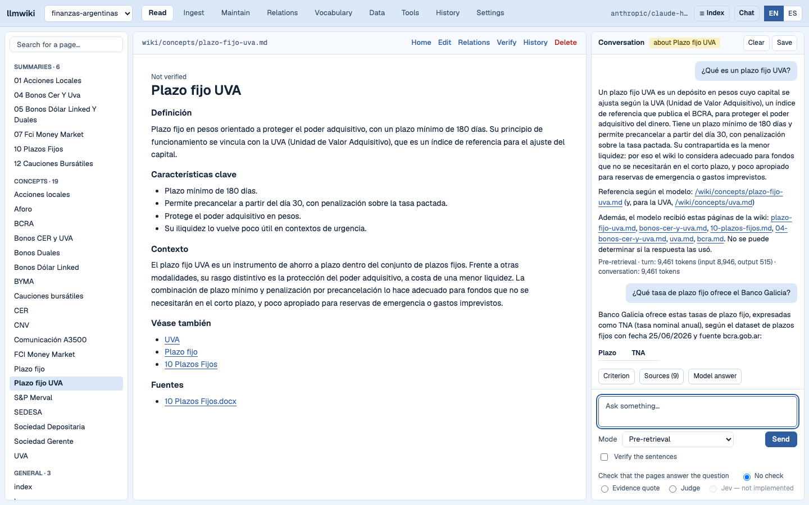
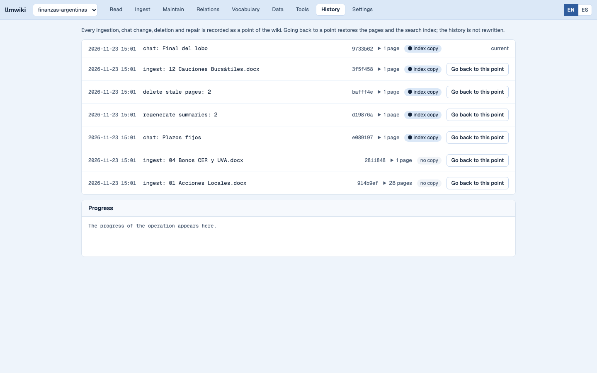
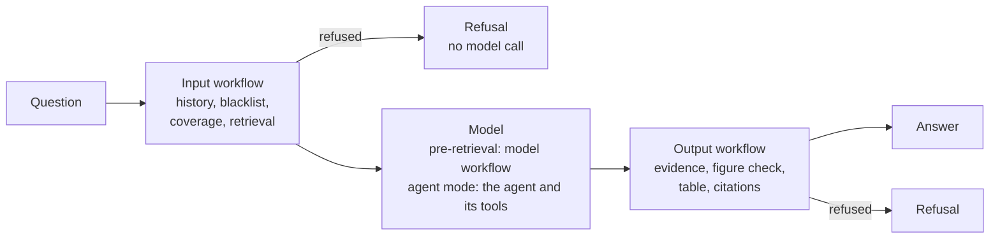

# LLM Wiki

[](https://github.com/Clod/harnessed-llmwiki/actions/workflows/test.yml)


[](https://github.com/astral-sh/ruff)
[](https://github.com/Clod/harnessed-llmwiki/releases)
[](CHANGELOG.md)

**English** · [Español](README_ES.md)

## What it is

A personal, local-first wiki that ingests your documents, builds a structured knowledge base, and lets you read and chat with it — all on your machine, no cloud required.

Inspired by [Karpathy's LLM Wiki idea](https://x.com/karpathy/status/2039805659525644595). The PDF-extraction and a few low-level ingestion pieces are adapted from [Lucas Astorian's open-source LLM Wiki](https://github.com/lucasastorian/llmwiki) (Apache-2.0); the rest is an independent local-first build on FastAPI, HTMX and SQLite. See [`NOTICE`](NOTICE).

[See it running](#see-it-running) · [Two ways to use it](#two-ways-to-use-it) · [Architecture](#architecture-the-guardrails-as-workflows) · [Quick start](#quick-start) · [Limitations](#limitations--non-goals) · [For developers](#for-developers)

---

## See it running



The **Read** tab on the finance example. The page index is on the left and the open page is in the middle. The conversation is on the right. Each answer ends with a reference line that names the pages it cites. Under the answer, one line names the answering mode and the tokens of the turn and of the conversation. The buttons **Criterion**, **Sources** and **Model answer** open the audit of the last answer.

Under the question field, the **Mode** selector has three values ([which to pick, and why](docs/manual/workflows/6.7-chat-rag.md)):

- **Pre-retrieval:** the code searches the wiki before calling the model and passes it the pages found. A question that names nothing the wiki covers is refused without calling the model.
- **Agent with evidence check:** the model searches the wiki with tools. If no tool returned evidence, the model is asked once more, and then the answer carries a warning.
- **No verification:** the answer appears as the model generates it, and the code does not check it.

The box **Verify the sentences** marks the sentences of the answer that no page supports. In the pre-retrieval mode, the buttons **Check that the pages answer the question** choose how the code checks the pages it found. The **Save** button turns the conversation into a wiki page only after you review the draft: the agent has no write tool.



The **History** tab. Every operation that changes the wiki is one point: an ingestion, a saved conversation, an edit, a deletion, a repair, a change of the settings or of the vocabulary. A point marked "index copy" has a copy of the search index, so returning to it is immediate; for the others the index is rebuilt without calling the model. This capture was taken on the finance example with seven points added by the capture script.

▶ **[Watch the 1-minute demo](https://youtu.be/g1Qg3ZJzuek)**: a generated page, then an answer that compares two tales and cites a page for every claim (4 s), then a question the wiki does not cover, refused **in 0.1 s because the model was never called**.

▶ **[Watch the full tour](https://youtu.be/uBj1jrn3MgU)** (Spanish interface, 4:15): the ingestion of a document, the reading screen, the relations, the vocabulary, a data file with its tool, the three chat modes, a refusal and its audit, the save of a conversation, lint and repair, and the history. The spans that wait for the model are sped up, and a badge on screen gives the factor.

---

## Two ways to use it

This project serves two purposes, and each purpose has its own reader.

### 1. An implementation of Karpathy's LLM Wiki

You give the application your documents. A large language model (LLM) reads each document and writes a wiki: a set of interlinked Markdown pages that summarise the documents and record their concepts, cross-references and contradictions. The LLM keeps the wiki up to date as you add documents. You read the wiki and ask questions about it in a chat. Compared with [Karpathy's original idea](https://x.com/karpathy/status/2039805659525644595), this implementation adds:

| Addition | What it gives you |
| --- | --- |
| **A fully local option** | The application, the documents and the wiki stay on your machine preserving confidentiality if required. With a local model server (Ollama or LM Studio), the model calls stay there too. |
| **An embedded agent** | Ingestion, retrieval, maintenance and the web interface are one application. There is no external agent (Claude Desktop, Cursor, an MCP client) to connect. |
| **Figures as well as prose** | A wiki can hold dated datasets (rates, prices, statistics). The chat agent queries them with tools, and Python code, not the LLM, computes over the figures. |
| **An automatic history, with the index** | Karpathy's idea already keeps the wiki in git. Here every operation that changes the wiki is a commit, and the History tab returns the pages and the search index together to an earlier point, without calling the LLM. |
| **A graph of the wiki** | The Relations tab draws the pages and the sources with the links and citations between them. A search field finds a page, and the local graph of a page shows its neighbours. |
| **Self-maintenance** | Sixteen lint checks find contradictions, stale pages, orphan pages and sentences that no source supports. The repair step fixes the safe ones automatically. |

The main limitations: ingestion runs in one pass, so the LLM does not discuss a source with you before it writes the pages, as in Karpathy's ingest flow (the conversation comes afterwards: you chat about the wiki and save the conversation as a page, which you review and edit before it is written); the wiki is Markdown pages only; and deleting a source does not remove its text from pages that also cite other sources. The chat agent does not search the web, by design: a web page is untrusted text, and the wiki takes in only the documents you choose to ingest. The full list is in **Limitations & non-goals**, below.

### 2. A test bench for RAG systems

**Prototype before you build.** Before starting the development of a RAG system, ingest a sample of your own documents, choose a model and ask the questions your users would ask. In hours, not weeks, you see which model is good enough, which questions the guardrails refuse, where the answers lose their citations and what a conversation costs in tokens. Those findings carry over to the system you build, except the ones about search quality, because this project searches by keywords, not by embeddings (see **How it differs from classic RAG**, below). The guardrails are declared as workflows: each check of the prototype is a named function you can carry into the final product, and the generated diagrams document the flow you are porting. More about the workflows in **Architecture: the guardrails as workflows**, below.

Retrieval-augmented generation (RAG) is the pattern in which a system retrieves passages from a knowledge base and passes them to an LLM, and the LLM answers from those passages. The retrieval and answering side of this project follows the RAG pattern (see **How it differs from classic RAG**, below). The project therefore lets you try out and observe the parts that surround a RAG system:

| Part | What you can try or observe |
| --- | --- |
| **Input guardrail** | A guardrail is a check, written in code, that runs before or after the LLM. In Pre-retrieval mode, the code refuses a question that names nothing the wiki covers, before the LLM is called. |
| **Output guardrails** | The figure check marks in red each figure of the answer that no passage, table or question supports. The Verify the sentences box marks each sentence that no page supports. |
| **Calculation tools** | The LLM does not do arithmetic: it calls tools whose calculation functions are Python code. The Tools tab lists each tool and the source code of its functions. |
| **An audit of every answer** | The **audit page**, one button away from each answer, shows the path of the question on the flow diagram of the system, the passages the wiki gave the LLM, and the text of the LLM before the code replaced it. For developers, `WIKI_TRACE=1` writes an OpenTelemetry span for each step to `spans.jsonl`. |
| **Token accounting** | Under each answer, one line gives the tokens of the turn and of the whole conversation. The application does not convert tokens into money: multiply the counts by your provider's prices to estimate the cost. |
| **Model evaluation** | **Switching models is a setting, not a code change**: the Settings tab sets the chat, ingestion and vision models separately, any OpenAI-compatible endpoint, local or hosted, and the next question uses the new model without a restart. Ask the same questions with two models and compare the answers, their audit and their tokens. The Test buttons of the Settings tab, or one command, check whether a model can answer from a page and cite it, decline a question the page does not answer, search with the tools, and ingest a text. |
| **LLM-as-judge evaluation** | One command generates an eval packet: the questions, the answers, the cited pages and a fixed 1–5 rubric. You paste it into the judge models you choose, and they score the answers. |
| **A test knowledge base in one step** | Ingestion turns a folder of documents into a knowledge base, without manual chunking or tagging. The `examples/` folder ships ready-made wikis. |

---

## Architecture: the guardrails as workflows

Every chat turn runs as declared workflows, not as code buried around the model call. The checks of the question, the call to the model and the checks of the answer are separate graphs ([pydantic-graph](https://ai.pydantic.dev/graph/)), and the model runs between the two checks, never around them.



| Workflow | What it holds |
| --- | --- |
| **Input** (both modes) | The input guardrails: the history of the turn, the blacklist and, in pre-retrieval mode, the coverage of the question and the retrieval of the text the prompt injects. A question refused here never reaches the model. |
| **Model** (pre-retrieval mode) | The calls to the model: the answer from the wiki pages, an optional check that the pages answer the question, and a second call with the source fragments when the model found nothing in the pages. In agent mode, the agent runs here with its tools. |
| **Output** (both modes) | The output guardrails: the evidence check, the figure check, the advisory table, the citations and the refusal. |

Why it matters:

- **Each guardrail is a node with a name.** Adding, removing or moving a check is one node and one edge in a graph; the model call does not change.
- **The model cannot skip a check.** The guardrails run in code before and after the model, whatever the model writes.
- **The diagram is the code.** The audit page draws each turn's path on the flowchart generated from the same graphs, and [`docs/workflow_diagrams.md`](docs/workflow_diagrams.md) is generated from them too: a test fails when the document and the graphs differ.
- **One function per check.** A check that two modes use is the same function in both workflows.
- **Each node is an OpenTelemetry span.** With `WIKI_TRACE=1`, every node writes a span named by its identifier, so a trace is the path of the turn through the workflows. The model calls are child spans of the node that ran them, written by the instrumentation of Pydantic AI. Spans go to `.llmwiki/traces/spans.jsonl`, prompts and responses to separate payload files, and `scripts/render_trace.py` renders a trace. The graphs add no spans of their own: the trace has the same nodes as the diagram.

The streaming mode (No verification) runs no workflow: it shows the answer as the model writes it.

---

## How it differs from classic RAG

The difference is in how the knowledge base is built and maintained. Retrieval is close to classic RAG, and that closeness is what makes the project usable as a test bench.

**Building the knowledge base.** A classic RAG system splits each document into chunks and indexes the chunks as they are: the chunks never change after ingestion. This project has the LLM read each document and integrate it into a persistent set of interlinked Markdown pages: summary pages, concept pages, a catalogue, an overview and a timeline. Cross-references and contradictions are written down at ingestion, before anyone asks a question. Each new document updates the existing pages, and the lint checks keep the pages consistent with one another. The raw chunks are kept as well, in a SQLite full-text index.

**Retrieval.** Retrieval works as in a RAG system: the system searches the knowledge base, passes the results to the LLM, and the LLM answers citing the pages it used. Two things differ. First, the search reads the wiki pages first and falls back to the raw chunks only when the pages are not enough. Second, the search can be run by the code or by the LLM: in Pre-retrieval mode the code runs the search before calling the LLM; in Agent with evidence check mode the LLM runs the search with tools.

**Exception: lexical search only.** The search is full-text (SQLite FTS5), not vector similarity over embeddings. Results that this test bench gives about guardrails, traces, tools and model evaluation apply to a vector-based RAG system. Results about search quality do not apply.

---

## Highlights

> **Why not point Claude Code at a folder of notes?** That question has a long answer: [From Idea to Product](docs/from_idea_to_product.md) — seventeen ways the LLM-wiki idea leaks when a generic agent is pointed at it, each with a real example and what this project does about it, including the three where the answer is a deliberate trade rather than a fix.

**AI / LLM engineering**

| Feature | How it works |
| --- | --- |
| **Deterministic, grounded advisory** | The example `finance_argentina` overlay computes "what would I earn" over the datasets in pure Python (effective-rate math, eligibility), lists every option ranked and cited, and refuses to estimate equities, inflation or FX rather than invent a number. |
| **Wiki-first RAG** | The agent reads the curated pages first (`index.md` → wiki FTS5 → raw source chunks as a fallback), so knowledge is compiled once and compounds instead of being re-retrieved per query. |
| **Per-wiki language (en/es, extensible)** | Chosen when the wiki is created (`[wiki] language` in `wiki_config.toml`). Pages, headers and chat answers are written in that language, **regardless of the source documents' language**. Every prompt is a file per language in `prompts/`; a third language is one `Locale` entry and one translated file per prompt. |
| **Evidence-based prompting** | The default system prompt (`prompts/system_prompt.<lang>.md`) embeds a worked, fully cited comparison. A comparison that left points uncited cited every point once the example was added ([CHANGELOG](CHANGELOG.md), 0.2.x). |

**Engineering quality**

| Practice | How it shows |
| --- | --- |
| **Tests across three layers, ≈1:1 test-to-code** | Deterministic fake-LLM unit tests (no keys, no network); a frozen golden-corpus *characterization* regression that re-checks the real-ingest backbone without re-calling the model; and Playwright tests of the web interface, run in CI. |
| **Framework-agnostic core** | The logic lives in `base/domain/` (ingestion, chat, datasets, extensions, lint, repair, verify, rollback, eval and others). The web interface (`web/`) is only the UI at the edges and calls `base/services/`, so unit tests exercise the engine without a browser. |
| **Server-rendered web interface** | FastAPI and Jinja2 render the HTML, HTMX updates the page, and Server-Sent Events stream chat answers and the progress of long operations. No JavaScript build step: the few scripts and stylesheets are plain files in `web/static/`. |
| **Security-conscious** | A path-traversal guard on the LLM-callable page reader, an explicit prompt-injection threat model, and a documented [`SECURITY.md`](SECURITY.md). |
| **Scale-aware** | Re-ingest skips unchanged files by content hash, lint compares only page pairs that share a source (not N²), and the overview synthesis is incremental. |
| **Reproducible & clean** | Pinned `uv.lock` for deterministic installs, zero `ruff` warnings, and no `TODO`/`FIXME` debt in the codebase. |

**Transparency & docs**

| Practice | How it shows |
| --- | --- |
| **Citation graph in SQLite** | Every page→source and page→page edge is recorded and rebuilt deterministically, so provenance is queryable. |
| **Documented end to end** | A programmer manual with its apps / workflows / internals reference, a SQLite data dictionary, and a Karpathy-alignment matrix grading what is done, partial, and deferred. |

---

## What it does

Each wiki has nine tabs:

| Tab | What you do there |
| --- | --- |
| **Read** | Browse the generated pages through the page index, read a page, verify each of its sentences against its sources, edit it in a Markdown editor with a live preview, or delete it. In the same tab, **chat** about your documents: the agent reads the curated pages first, queries the datasets for figures and falls back to the source fragments, citing every fact. Under each answer, a line gives its mode and its tokens, and **Criterion**, **Sources** and **Model answer** open the audit page. **Save** turns the conversation into a wiki page after you review the draft. The conversation survives navigation, the editor and a reload. |
| **Ingest** | Add PDF, office (`.docx`, `.doc`, `.odt`, `.rtf`), Markdown, text or, when the wiki does not ignore images, image files, or copy them to `sources/` and click **Scan sources/ for changes**. The pipeline extracts the text, writes or updates the summary and concept pages, the catalogue, the overview and the timeline, and commits the result to the wiki's git repo. The tab also lists and deletes sources. [Adding documents](docs/adding_documents.md) explains what the scan changes. |
| **Maintain** | Regenerate the summary pages, verify every page against its sources, run lint and repair, delete stale pages, describe the images with a vision model, install the local sentence verifier, and rebuild the search index without calling the model. |
| **Relations** | The graph of pages and sources, with a page search, zoom buttons and the graph of one page and its neighbours. |
| **Vocabulary** | The names the wiki covers (read only, with a search field), their aliases, the rejected aliases and the blacklist of terms the chat must refuse. Every change is a point of the history. |
| **Data** | The data files of the wiki: their metadata and their tables. |
| **Tools** | The tools the chat can use, with their trace node, arguments and role, whether each is active in this wiki and why, and the source of their calculation functions. Read only. |
| **History** | Return the whole wiki to an earlier point, and read or compare earlier versions of one page. A return is a new point: the history is not rewritten. |
| **Settings** | Choose and test the models (saved in `.env`, shared by every wiki), and edit the system prompt, the pre-retrieval, the verification and the images of this wiki; the next question uses them without a restart. The wiki language is shown read only. |

The interface is in English and in Spanish: the **EN | ES** switch at the right of the header chooses the language (a cookie; without it, the browser's language; without that, English). This is the language of the labels and messages only. The language of the wiki content is set per wiki and is a different setting (see [Wiki content language](#wiki-content-language)): a Spanish wiki can be read with the English interface, and the reverse.

> **From marimo to a web interface.** Up to [v0.4.0](https://github.com/Clod/harnessed-llmwiki/releases/tag/v0.4.0) the interface of this project was a set of [marimo](https://marimo.io) notebooks; that release is the one to install for them. marimo re-runs a whole cell whenever one of its widgets changes, which suits a notebook. The application came to need a conversation that survives moving between pages, progress streamed while an ingestion runs, and an address for every page and screen, so it moved to a server-rendered web interface (FastAPI and HTMX). The marimo apps were removed from the repository on 2026-11-15; this documentation describes the web interface only.

---

## Prerequisites

| Requirement | Needed for | How to install |
| --- | --- | --- |
| **Python 3.12+** and **[uv](https://docs.astral.sh/uv/)** | Everything | The installer installs both. By hand: see the uv page |
| An **OpenAI-compatible LLM API** | Chat and ingestion | OpenRouter, Ollama, LM Studio, etc. |
| **A Java runtime** | Ingesting **PDF and office files**: the text extractor (`opendataloader-pdf`) runs a bundled `.jar`, and an office file is converted to PDF first. Not needed for `.md`, `.txt` or image files, nor to read and chat with a wiki already built (so the demos open without it) | macOS: `brew install --cask temurin` · Debian/Ubuntu: `sudo apt install default-jre` (Fedora: `sudo dnf install java-21-openjdk`) · Windows: `winget install EclipseAdoptium.Temurin.21.JRE` |
| **LibreOffice** | Office files only (`.docx`, `.doc`, `.odt`, `.rtf`) | macOS: `brew install --cask libreoffice` · Debian/Ubuntu: `sudo apt install libreoffice` (Fedora: `sudo dnf install libreoffice`) · Windows: `winget install TheDocumentFoundation.LibreOffice` |
| **git** | Cloning the repo (the installer's zip needs no git). Also the wiki's version history, which is optional: without git the commits are skipped with a warning, or set `WIKI_AUTOCOMMIT=0` | Most systems already have it |

---

## Quick start

All you need is an internet connection: the installer brings `uv` and Python 3.12, with no administrator rights. The example wikis ship pre-ingested, so no Java runtime is needed to read them.

| Step | Windows | macOS and Linux |
| --- | --- | --- |
| 1. Download | On GitHub, **Code → Download ZIP**, and extract it | The same, or `git clone` |
| 2. Install | Double-click `install.cmd` | `bash install.sh` in that folder |
| 3. Choose the wikis folder | Enter accepts `Documents\LLM Wiki` | Enter accepts `~/Documents/LLM Wiki` |
| 4. Start | Double-click `open_web.cmd` | `bash open_web.sh` |
| 5. Configure the model | Open a wiki, then the **Settings** tab: set the chat model and press **Test** | The same |

The installer copies the three example wikis to the folder you chose, writes a short log (`install.log`), checks the installation without calling any model, and creates the `open_web` shortcut, which opens <http://localhost:8765>. Running it again is safe: it keeps your wikis and `.env`. [`INSTALLER.md`](INSTALLER.md) explains every step, the Windows SmartScreen warning, what to do when a step fails, and how to uninstall.

The wikis can be read without a model; the chat needs one. The **Settings** tab saves the models in `.env`, shared by every wiki, and tests each one. The wiki picker also lists the **example wikis**: **Open a copy** puts a fresh copy beside your wikis.

> **Scripted installs.** `quickstart.py` (Python 3.12+ and a git clone) asks for the provider in the console and writes the whole `.env`; its flags make it scriptable: `python3 quickstart.py --demo fairy-tales --provider ollama --yes --no-launch`. Run `python3 quickstart.py --help` for the options.

Prefer to wire it up yourself? The manual `uv` setup is below.

### Manual setup (uv)

#### 1. Clone and install

```bash
git clone https://github.com/Clod/harnessed-llmwiki.git
cd harnessed-llmwiki
uv sync --group web
```

#### 2. Configure

Copy `.env.example` to `.env` and fill in:

```env
WIKI_PATH=/path/to/your/wiki          # the wiki opened on launch (the default)

# Any OpenAI-compatible endpoint works. Example: Ollama (local, free).
LLM_BASE_URL=http://localhost:11434/v1
LLM_API_KEY=ollama                    # any non-empty string for Ollama
LLM_MODEL=llama3.2
```

`WIKI_PATH` is just the **default** — the web interface starts on a wiki picker, and the wiki selector in the header switches between wikis at runtime without editing `.env`. The picker lists
the wikis discovered next to `WIKI_PATH` and the recent ones, and opens any
other folder by its path. Set `WIKI_HOME=/path/to/wikis` to point discovery at a
specific folder instead of the parent of `WIKI_PATH`.

See [LLM providers](#llm-providers) for Ollama and LM Studio config.

#### 3. Launch the web interface

```bash
uv run --group web uvicorn web.app:app --port 8765
```

Open <http://localhost:8765>. The page lists the wikis; open one. The server listens on `localhost` and has no authentication: it is for one user on one machine. Without `uv`, use the `python -m uvicorn web.app:app --port 8765` of an environment that has the `web` group installed.

Add documents in **Ingest** first: a wiki with no sources has nothing to read. The sample wikis in `examples/` are already ingested.

The environment variables are listed in [`web/README.md`](web/README.md).

---

## LLM providers

The stack uses the OpenAI-compatible API everywhere. Switch providers in the block "Models" of the **Settings** screen, or in `.env`: both write the same keys, and no code changes are needed.

| Provider | `LLM_BASE_URL` | `LLM_API_KEY` | `LLM_MODEL` |
| --- | --- | --- | --- |
| **Ollama** (local, free) | `http://localhost:11434/v1` | `ollama` | `llama3.2` |
| **LM Studio** (local, free) | `http://localhost:1234/v1` | `lm-studio` | `local-model-name` |
| **OpenRouter** (cloud, hosted models) | `https://openrouter.ai/api/v1` | `sk-or-...` | `anthropic/claude-haiku-5.5` |

**Split config** — use a cheap/local model for chat but a stronger model for wiki generation:

```env
LLM_BASE_URL=http://localhost:11434/v1   # chat uses this
LLM_API_KEY=ollama
LLM_MODEL=llama3.2

WIKI_LLM_BASE_URL=https://openrouter.ai/api/v1   # ingest uses this
WIKI_LLM_API_KEY=sk-or-...
WIKI_LLM_MODEL=anthropic/claude-haiku-5.5
```

If `WIKI_LLM_*` are blank, ingestion falls back to `LLM_*`. The vision model (`VISION_*`, see [Document formats](#document-formats)) falls back to `WIKI_LLM_*` and then to `LLM_*`.

> **Don't use too small a model for ingestion.** Summarisation, concept extraction, and contradiction-checking all lean on the model's reasoning, so a model that's underpowered for *your* documents yields thin summaries, weak citations, or hallucinated pages. What counts as "too small" depends on your corpus and your standards — judge it on the pages it actually produces. If wiki quality disappoints, raise the `WIKI_LLM_*` (ingest) model before blaming the pipeline; the split config above lets you do that while keeping chat on a smaller local model.

> **Chat grounding & citations scale with the chat model, too.** The chat agent's default prompt is strict — *answer only from your wiki, and cite every fact* — but a prompt is only a request; the model has to be capable of honouring it. A concrete example from testing on OpenRouter, same provider, same wiki, with the strict default prompt:
>
> | Question | `openai/gpt-4o-mini` | `openai/gpt-4o` |
> | --- | --- | --- |
> | "What's the capital of France?" (off-corpus) | sometimes answers "Paris" | declines — outside the wiki |
> | "Who is Cinderella?" (single fact) | answers, but cites the raw PDF or nothing | cites the curated wiki page |
> | "What do Cinderella and Snow White have in common?" (synthesis) | drops citations | cites every point to its source pages |
>
> Cross-document **synthesis** is the most demanding case — a weaker model gives up citations there first. Getting it cited reliably took *both* a capable model and a worked example of a fully-cited comparison, which is why that example is now baked into the default prompt. If chat answers arrive uncited or stray outside your documents, raise the chat model (`LLM_MODEL`) before assuming the agent is broken. You can keep a cheap model for ingestion and a stronger one for chat (or vice versa) via the split config above.
>
> **Not sure if a model clears the bar?** Press **Test** next to the model in the block "Models" of the **Settings** screen, or run `uv run python scripts/eval_chat_model.py`. Both run the same tests, on material that ships with the product, in a temporary wiki that is deleted at the end:
>
> - **Reading model** — three questions to a wiki of two pages. The model answers with the datum of the page and cites the page, declines a question the page does not answer, and, in the mode with tools, searches the wiki before it answers.
> - **Ingestion model** — the ingestion of a text of one paragraph. The model writes the summary page and a concept page that names the source, and the lint finds no error.
> - **Vision model** — a scanned page with an invented text and table. The fourteen data of the page are in what the model reads, and the description of the page has the format the product asks for.
>
> Each check prints ✓, ✗, or ? when the service gave no answer. The test does not write `.env`. The **Save** button next to it writes that model, and asks for a confirmation when the values were not tested or failed their last test. Passing is necessary, not sufficient: the tests find a model that cannot do the work, and they do not compare two models that can.
>
> **A data point from local testing** (LM Studio on an M2 Pro, Q4\_K\_M quants, chat agent pinned at `temperature=0`), measured with an earlier version of `eval_chat_model.py` that asked three questions to a sample wiki of fairy tales. The strict retrieve-then-cite protocol is demanding, and local models under \~12B each broke it in a different way:
>
> | Model (local) | `eval_chat_model.py` | How it failed |
> | --- | --- | --- |
> | `Qwen2.5-7B-Instruct` | 2/3 | skipped retrieval when it "knew" the answer; retrieved but then didn't cite |
> | `Meta-Llama-3.1-8B-Instruct` | 2/3 | followed the protocol, but *gave up* on the synthesis question — wrongly claimed the content wasn't in the wiki when it was |
> | `gemma-4-12b-it-qat` (QAT) | ✗ inconsistent | fabricated citations with **zero tool calls**; leaked a reasoning channel into the answer |
> | `gemma-4-12b` (non-QAT) | **3/3** | — |
>
> Takeaway: **choose a model that passes every check**, and for local models expect that to mean roughly **12B or larger**. Smaller models each break the grounding contract in their own way — the eval is how you catch it *before* you trust the wiki's answers. The chat agent pins the temperature to 0 (greedy decoding).

---

## Customising the chat assistant

The **Settings** tab edits the system prompt, the pre-retrieval and the verification of a wiki, and the next question uses them without a restart. The same keys live in the file `wiki_config.toml` of the wiki, which you can also edit by hand:

```toml
[assistant]
system_prompt = """
You are a personal investment wiki assistant.
Answer from the curated wiki first: read wiki/index.md, then search_wiki_fts;
only fall back to search_source_chunks when the wiki pages lack the detail.
Cite document name and page for specific facts.
"""

suggested_prompts = [
    "Summarize my investment portfolio",
    "What are the main risks?",
    "Which instruments offer the highest returns?",
]
```

Copy `wiki_config.example.toml` from the project root as a starting point (or `wiki_config_es.example.toml` for a Spanish wiki — same structure with `language = "es"` and Spanish prompts). Without a `system_prompt`, the wiki uses the default prompt of its language, the file `prompts/system_prompt.<lang>.md`; if the file `wiki_config.toml` is absent, every setting takes its default.

### Who goes looking: the Mode selector

The **Mode** selector under the question of the chat picks, for each question, who goes looking. In **Agent with evidence check** the model holds the search tools and decides what to call. In **Pre-retrieval**, the mode the chat opens with, code retrieves *before* the model is consulted and decides, in Python, whether this wiki covers the question at all — refusing without spending a token when it does not.

It is a trade, not an upgrade. You gain a guarantee that retrieval happened and a refusal you can predict; you lose reach, because coverage is derived from the names the wiki covers — the concept-page titles, the topics of the pages, the aliases, and the categories and keys of the datasets, listed in the **Vocabulary** tab — so a question naming none of them is turned away even when a search would have found something. The agent mode suits a wiki of prose; Pre-retrieval suits a wiki where a wrong answer costs money, a dose or a legal date. The template documents the `[pre_retrieval]` section and the three scope lists that go with it.

`[pre_retrieval] min_coverage` (default `0.2`) is a starting value, not a measured one. When Pre-retrieval answers from the original documents, the code counts the fraction of the content words of the answer that the document fragments contain. An answer below the threshold is replaced by a refusal. The sentence verifier, when installed and enabled, replaces this check. The right value depends on the documents and on the questions of each wiki: measure it on yours. A higher value refuses more answers; a lower one lets through more answers the fragments do not support.

### Wiki content language

The language of a wiki is chosen when the wiki is created: the folder browser of the picker asks it (English or Español), and the wiki stores it in the `[wiki]` section of `wiki_config.toml`. The whole wiki — pages, structural headers and labels, and chat answers — is generated in that language, **regardless of the source documents' language**, and the model receives its instructions in that language (the files `prompts/<name>.<lang>.md`):

```toml
[wiki]
language = "es"   # "en" (default) | "es"; extensible — add a Locale in base/domain/i18n.py
```

Language is a *per-wiki* property, so you can keep an English wiki and a Spanish wiki side by side. A wiki created outside the picker sets it by hand **before the first ingest**; an absent or unknown value falls back to English. The Settings tab shows it read only, because the search index keeps the word stems of that language. See [`docs/manual/apps.md`](docs/manual/apps.md) §8.

---

## Document formats

| Format | Parser | Needs |
| --- | --- | --- |
| PDF | opendataloader-pdf | A Java runtime. Text-heavy PDFs work well; a scanned PDF needs an OCR engine (below) |
| DOCX | LibreOffice → PDF → opendataloader-pdf | LibreOffice **and** a Java runtime |
| DOC | LibreOffice → PDF → opendataloader-pdf | LibreOffice **and** a Java runtime |
| ODT | LibreOffice → PDF → opendataloader-pdf | LibreOffice **and** a Java runtime |
| RTF | LibreOffice → PDF → opendataloader-pdf | LibreOffice **and** a Java runtime |
| MD | read directly | Nothing. Encoding UTF-8, UTF-8 with BOM or cp1252. Pages split at level-1/2 headings (about 4,000 characters per page, no paragraph cut); the front-matter block is not stored |
| TXT | read directly | Nothing. Same encodings; pages split at blank-line paragraph boundaries (about 4,000 characters per page) |
| PNG, JPG, JPEG, WEBP, GIF | kept as an image; its text is the description of a vision model | `ignore = false` in `[images]` (below) and a vision model |

The list of formats is one place in the code, `base/domain/ingestion/formats.py`. LibreOffice needs its word processor component (Writer) to convert; the **Maintain** tab shows whether the installed LibreOffice converts a document.

**Images are ignored by default.** With `ignore = true` in the `[images]` section of `wiki_config.toml`, the default, ingestion keeps no image of the sources: it copies, links and describes none, the summary page has no "Figures" section, and an image file is not accepted as a source. The Settings screen edits the key (checkbox "Ignore the images"), and the key applies to the sources ingested afterwards. With `ignore = false`, the two paragraphs below apply.

**Images of a PDF.** opendataloader-pdf extracts the images of a PDF while it converts it. Ingestion keeps them in the document's ingestion folder, `.llmwiki/cache/local/<document id>/images/`, beside `converted.pdf`. The folder is derived from the source, so it stays out of `wiki/` and out of git. The stored text links to each kept image with a path relative to the workspace root, ``, and the summary page of a source with images gets a "Figures" section, written by the code, with one thumbnail per image, its page number and its caption. The web application serves the images at `/w/{wiki_id}/images/{document_id}/{file}`. The model receives the link only; it does not see the image. A DOCX goes through the same path, as a PDF. Ingesting a changed source replaces its images, and deleting a source deletes them. Two lint checks look after the images: `missing_image` (a stored link whose file does not exist) and `orphan_image` (a kept file that no link uses). Their repairs call no model: the first extracts the images again when the source is still in `sources/`, or replaces the link with "\[Imagen no disponible, página N\]" when it is gone; the second deletes the file. A rebuild of the index must extract the images again.

**Describing the images (opt-in).** With `describe = true` in the `[images]` section of `wiki_config.toml`, a vision model (`VISION_BASE_URL`, `VISION_API_KEY`, `VISION_MODEL`, set in the Settings screen or in `.env`, falling back to the ingestion and then the chat model) describes each kept image. The key `describe` acts only with `ignore = false`. The description is a file beside the image (`<image>.desc.json`, outside git), enters the stored text of the source as a block delimited by `<!-- image-description: … -->` so the search, the ingestion model and the verification see it, and appears in the Figures section of the summary page in a folded block labelled "Generated description". The verification marks a sentence supported only by a description with its own state (a dotted underline). Images of a Markdown source (local raster files inside `sources/`) are kept and described the same way, and an image file (`.png`, `.jpg`, `.jpeg`, `.webp`, `.gif`) is a source whose text is its description. The text inside an image is untrusted input: see [`SECURITY.md`](SECURITY.md). Details: [`docs/design_image_handling.md`](docs/design_image_handling.md).

**Scanned PDFs (OCR).** A PDF whose pages carry almost no text (fewer than 20 characters on at least a quarter of its pages) is read with the OCR engine `OCR_ENGINE`, set in the Settings screen (block "Models", group "Vision model") or in `.env`:

| `OCR_ENGINE` | What it does |
| --- | --- |
| `none` (default) | The ingestion fails with a message that names the setting and the two engines. |
| `tesseract` | Local: `ocrmypdf` with Tesseract, run as external programs. Install them with `brew install ocrmypdf tesseract tesseract-lang` (macOS) or `sudo apt-get install ocrmypdf tesseract-ocr tesseract-ocr-spa` (Debian, Ubuntu); on Windows follow the [ocrmypdf instructions](https://ocrmypdf.readthedocs.io/en/latest/installation.html#windows). The language follows the wiki language (`spa` for `es`, `eng` for `en`). The copy with a text layer is kept as `ocr.pdf` in the document's cache directory, and the source viewer shows it. |
| `vision` | A model with vision reads each page through an OpenAI-compatible API: one model call per page, and the text may vary between runs. Each of `OCR_BASE_URL`, `OCR_API_KEY` and `OCR_MODEL` is the first value that is not blank among `OCR_*`, `VISION_*`, `WIKI_LLM_*` and `LLM_*`, so the vision model of the Settings screen reads the pages unless `OCR_*` is set in `.env`. |

`quickstart.py` asks which engine to use and writes the setting. In a mixed PDF (some pages with text, some scanned) both engines read only the scanned pages. The images of a scanned page are kept as on any other page: the extraction keeps them first, OCR then replaces the text of the page, and the page keeps the links to its kept images, so the image handling (the Figures section, the lint checks, the optional description) applies to them.

---

## Limitations & non-goals

This is a working proof of concept of the LLM-Wiki pattern, not a finished
product. The core loop — ingest → build/maintain wiki → read → chat with
citations → lint → repair — is fully implemented. Some ideas from the original
concept are **deliberately deferred** for the PoC:

- **No web search.** The chat agent answers only from *your* curated local
corpus — it never reaches out to the web, and there is no automatic web→wiki
loop. To bring in an outside source, fetch it yourself (e.g. save the article
as a PDF) and then **ingest it manually** — dropping a file into `sources/`
does nothing on its own. Open the **Ingest** tab and either (a) choose the file in
the upload form and click **Ingest**, or (b) put it in
`WIKI_PATH/sources/` and click **Scan sources/ for changes**, which detects
and ingests anything new or modified. Treat a document from an untrusted origin
the way you would treat untrusted code: at ingestion its text is turned into wiki
pages automatically — see [`SECURITY.md`](SECURITY.md).
- **Images are ignored by default.** With `[images] ignore = true`, the default,
the images embedded in a document are skipped: not kept, not described. See
[Document formats](#document-formats).
- **OCR is off by default.** A scanned / image-only PDF fails with a message until
you set `OCR_ENGINE` (see [Document formats](#document-formats)). The `vision`
engine costs one model call per page and its text may vary between runs.
- **Output is markdown only — no alternate formats.** The wiki
records a full citation/link graph in the database (`document_references`:
which page cites which source, which pages link to which), and the
**Relations** tab draws it. There are no generators for slide
decks (**Marp**) or spatial **canvas** layouts. You read the wiki as linked
markdown pages.
- **Ingestion is automated, not a guided conversation.** Karpathy's flow has the
LLM discuss a source with you and write pages under your direction; here you
drop a file and the pipeline extracts → summarises → files it in one shot, with
no mid-ingest review. You steer the wiki *afterwards*: open the resulting page
in the **Read** tab, chat about the document, then save the conversation
as a wiki page with **Save**. The agent only drafts and proposes — you review
the draft in a dialog and the save is your explicit
click — so the human-in-the-loop step is post-hoc rather than during ingestion.

* **Deleting a source leaves its contribution in the pages it shares.** A page
that cites only the deleted source is deleted, and no link to it is left. A page
that also cites another source is kept, marked stale, and stops citing the deleted
file — but its text and its generated aliases may still hold what that file
contributed, because a page does not record which sentence came from which
source. This applies equally to a deletion from the **Ingest** tab and to a file
removed from `sources/` by hand, which the wiki deletes when you open it. The only
way to remove that text is to rebuild the whole wiki from the remaining sources:
  1. In the wiki list, create a new wiki in an empty folder.
  2. In its **Ingest** tab, upload the remaining source documents.
  3. Copy `wiki_config.toml` from the old wiki: it holds the blacklist and the hand-written aliases.

  Changes made by hand in the old wiki (edited pages, removed topics) are not carried over. **Rebuild the index** in the **Maintain** tab does not do this: it rebuilds the search database from the pages as they are.

Those are the deliberate omissions. The rationale for each cut, what is planned next, and the things that are built but known to be imperfect — measured rather than suspected — are in [`ROADMAP.md`](ROADMAP.md).

---

## For developers

The sections below are for people who change the code, run the tests or look after a wiki's files.

> **For developers:** the canonical reference is [`docs/manual/programmer_manual.md`](docs/manual/programmer_manual.md) — workflows, prompts, entry points, gaps, and the pending-work roadmap. Earlier design notes are in [`docs/archive/`](docs/archive/).
>
> **Want the big picture first?** The [Ingestion Walkthrough](docs/ingestion_walkthrough.md) follows one small corpus through its whole lifecycle — first document, second document, a no-op re-ingest, an edited source, a deletion — showing exactly which wiki pages, DB rows, citation edges and vocabulary entries each step produces. Its numbers are not hand-written: they come from a real run, and `scripts/capture_ingestion_walkthrough.py` regenerates them on demand.

### What ends up on disk

```
YOUR_WIKI_PATH/
├── sources/                 # Uploaded files (created by the Ingest tab)
│   ├── paper.pdf
│   └── report.docx
├── wiki/                    # Generated by the LLM — you read it, the wiki writes it
│   ├── index.md             # Catalogue of every page
│   ├── overview.md          # Narrative synthesis (rewritten on each ingest)
│   ├── log.md               # Append-only timeline
│   ├── summaries/           # One per source document
│   │   ├── paper.md
│   │   └── report.md
│   └── concepts/            # Topic-centric, multi-source
│       └── interest-rates.md
├── datasets/                # Optional: dated data files (Markdown tables), edited by you
├── wiki_config.toml         # The wiki's language and optional settings of the chat assistant
└── .llmwiki/
    ├── index.db             # SQLite: documents, chunks, FTS5 index, citation graph, verifications
    ├── aliases.generated.toml  # Aliases of the vocabulary, generated at ingestion
    ├── snapshots/           # Copies of the index for the latest history points (default 5)
    └── cache/               # Extraction cache (rebuildable)
```

Source files are never modified. **Rebuild the index** in the Maintain tab rebuilds `index.db` from `sources/` and `wiki/` without calling the model; re-ingesting the sources also rebuilds it, but rewrites the pages.

Your **`WIKI_PATH` workspace is its own git repo** (a separate repo from this project's). Every operation that changes the wiki commits it with a label (`ingest: paper.pdf`), so the knowledge base has a version history. It only ever stages `wiki/`, the `.gitignore` it creates, `wiki_config.toml`, `datasets/` and the generated aliases — never your `sources/` or the database — and uses a local `LLM Wiki <llmwiki@local>` identity, so your global git config is untouched. Set `WIKI_AUTOCOMMIT=0` in `.env` to turn this off and manage the wiki's git yourself (then LLM Wiki runs no `git init` and no commits).

**The wiki repo is local-only — nothing is pushed anywhere.** It has no remote and stays entirely on your machine; LLM Wiki only ever commits locally, it never pushes. That is deliberate: your sources and the knowledge derived from them are private by default. If you *want* to back the wiki up or sync it across machines, add your own remote — and use a **private** repo, since it holds your personal knowledge:

```bash
cd "$WIKI_PATH"                                       # your wiki folder
git remote add origin git@github.com:you/my-wiki.git # a PRIVATE repo you own
git push -u origin HEAD
```

From then on, pushing is on you (`git push` whenever you like, or wire up your own automation) — the app's job ends at the local commit.

> Each wiki is a **separate** repo from this project and from your other wikis. So a wiki you back up to GitHub is its own private repo — not a folder inside `harnessed-llmwiki`, and nothing about your documents ever lands in the public project repo.

### Project structure

```
base/                   # Ingestion pipeline + chat agent (self-contained Python)
├── config.py              # pydantic-settings — reads .env
└── domain/
    ├── ingestion/         # PDF/office/md/txt/image → text → chunks → summary + concept pages
    ├── datasets/          # Generic engine for dated, structured data (rates/prices/stats)
    ├── extensions/        # Domain tools, one subpackage per domain: finance_argentina/ (deterministic, cited investment advisory)
    ├── chat/              # PydanticAI agent + wiki/source/save/dataset tools + grounding guardrail
    ├── eval/              # Half-automated UAT: build a judge-ready eval packet
    ├── lint/              # Wiki health checks
    ├── repair/            # Auto-fixes for safe lint issues
    ├── verify/            # Sentence-level verification of pages and answers against their sources
    ├── rollback/          # Return of a wiki to an earlier point: pages and index together
    ├── text/              # Snowball stemming per wiki language
    ├── tools/             # Native CRUD: wiki_fs, search, references, deletion, reindex, git_ops, db
    ├── modeltest/         # The model tests of the Settings screen (reading, ingestion, vision)
    ├── prompts.py         # load_prompt(): reads the files of prompts/
    └── wiki_registry.py   # Multi-wiki picker: discovery + recent list + path hygiene

prompts/                # Every prompt the model receives, one file per name and language (<name>.<lang>.md)

web/                    # The web interface: FastAPI + Jinja2 + HTMX (see web/README.md)
├── app.py                 # Application factory; `web.app:app` is what uvicorn loads
├── routes/                # picker, pages, chat, audit, ingest, history, relations, vocabulary, datasets, tools, settings, lang
├── templates/             # Jinja2 templates (English message ids; the Spanish catalog is in locale/)
├── i18n.py                # Interface language: catalogs, choice of language, _() and ngettext()
├── locale/                # gettext catalogs, one per language but English
└── static/                # CSS, JavaScript, htmx, force-graph, mermaid

base/services/          # The calls the web routes make: wiki, chat, ingest, verification, vocabulary, settings, model_test


database/
└── sqlite_schema.sql      # Canonical DB schema

docs/
├── manual/                # Canonical developer reference, one shared §-numbering
│   ├── programmer_manual.md          # §1 §2 §3 §10 §11 §13 — orientation, layers, glossary
│   ├── workflows.md                  # §6 — index: status table + write matrix
│   ├── workflows/                    # §6.1–§6.10, one file per workflow
│   ├── internals.md                  # §4 §5 §14 — schema, tool layer, tracing
│   └── apps.md                       # §7 §8 §9 §15 — apps, config, testing, datasets
├── from_idea_to_product.md           # Seventeen ways the LLM-wiki idea leaks, and what this project does
├── sqlite_data_dictionary.md         # Every table and column of index.db
├── adding_documents.md               # The upload and the scan of sources/, for users
├── ingestion_walkthrough.md          # One corpus, end to end — the narrative view
├── ingestion_walkthrough_appendix.md # Its artifact inventory (generated, regenerable)
├── query_walkthrough.md              # Questions to the example wikis, in the three chat modes
├── query_walkthrough_appendix.md     # Its captured run (generated, regenerable)
├── uat_test_plan.md                  # The acceptance plan: automated, manual and model checks
└── archive/               # Superseded design docs (historical)

examples/               # Pre-ingested demo wikis (copied by the installer; the picker opens a copy)
├── fairy-tales/           # Browsable with no LLM; chat needs a model
├── cuentos-de-hadas/      # The same demo as a Spanish wiki
└── finanzas-argentinas/   # Spanish finance wiki with datasets; the screenshots above use it

tests/
├── unit/                  # Deterministic unit tests (FakeLLM, no network)
├── regression/            # Frozen golden-corpus tests (real ingest, no live model)
├── web/                   # Web interface: routes, rendering, design, Playwright flows (in CI)
│   └── e2e/               # Playwright flows over a copy of the finance example
└── fixtures/              # Test PDFs + wiki config + golden corpus

install.cmd, install.ps1, install.sh  # The installer (see Quick start and INSTALLER.md)
scripts/install_steps.py  # The installer's steps that need Python
quickstart.py           # Console installer for scripted installs (Python 3.12+ and a git clone)
requirements.txt        # Hash-pinned deps exported from uv.lock (for the installer's pip path)
```

### Testing

Two automated suites, fastest first, and one manual check. CI runs the two suites.

**1. Fast regression gate** — deterministic, no LLM keys, no running server, finishes in about three minutes (measured on 2026-11-23). Run it after any change:

```bash
uv run pytest tests/unit tests/regression -q
```

It asserts the structural invariants (DB integrity, FTS alignment, deletion cascade, save mechanics, lint logic, git commits) over fake-LLM unit tests plus a **frozen real-ingest "golden corpus"** — so the backbone is checked against a real ingest without re-calling the model.

**2. Web interface** — routes, rendering, the design checks (contrast, tokens) and Playwright flows over a copy of `examples/finanzas-argentinas`. The agents are simulated: no test calls a model, and none needs Java or LibreOffice.

```bash
uv run playwright install chromium                    # once
uv run --group web pytest -q tests/web                # everything, with the browser flows
uv run --group web pytest -q tests/web --ignore=tests/web/e2e   # without a browser
```

**What CI runs.** `.github/workflows/test.yml` has two jobs on every push and pull request to `master`: `unit` runs suite 1 and `ruff check .`; `web` installs the `web` and `dev` groups and Chromium and runs suite 2. CI has no LibreOffice, so the tests that convert an office document skip there (`tests/unit/test_office_conversion.py`).

**3. Model check (manual)** — *is the model you picked good enough?* A one-command check of the models of `.env` (no documents needed — the tests bring their own material). The **Test** buttons of the Settings screen run the same tests:

```bash
uv run python scripts/eval_chat_model.py    # PASS/FAIL for the reading, ingestion and vision models
```

The acceptance plan, [`docs/uat_test_plan.md`](docs/uat_test_plan.md), lists the two automated suites, the manual checks of the web interface and the model check. Test PDFs live in `tests/fixtures/pdfs/`.

#### Automating the un-testable: the eval packet

Some behaviour cannot be regression-tested — there is no deterministic "right answer" for *is this chat reply well-grounded?* or *is this generated page faithful to its source?* The output varies with the model and even run to run. The workaround is to **move the judgement to an LLM, but keep it cheap and bias-resistant**: generate a single self-contained markdown **eval packet** and paste it into one — or several — capable chat models (a free Gemini / ChatGPT / Claude tab) to score against a fixed 1–5 rubric.

```bash
uv run python scripts/build_eval_packet.py                 # the golden corpus
uv run python scripts/build_eval_packet.py --wiki PATH      # an existing wiki
uv run python scripts/build_eval_packet.py --skip-ingestion # chat only (cheap)
```

The packet bundles everything a judge needs — the questions, the model's own answers, the cited pages, and (per source) the original text next to the pages the engine generated — plus the rubric and a blank scorecard. It covers **chat quality** and **ingestion quality**, records the two models it measured and a corpus hash so packets are comparable, and is written to a gitignored `eval_reports/`. Generation is automated; judging stays human-in-the-loop (paste to as many judges as you like and average), so it doubles as a way to compare the models your wiki engine uses. Details in [`docs/manual/apps.md`](docs/manual/apps.md) §9.

### Performance at scale

For a personal-sized wiki (tens to low-hundreds of documents) the pipeline stays comfortable — nothing here grows quadratically with the document count:

- **Ingestion is incremental.** Unchanged files are skipped by content hash, so re-scanning a large `sources/` folder only re-processes what actually changed.
- **Lint doesn't compare every page against every other.** The cross-reference and contradiction checks only look at concept-page *pairs that cite a common source*, so their cost scales with how topically interconnected your wiki is — not with the raw document count. Unrelated pages are never compared.
- **The overview synthesis is incremental.** Each ingest folds the new document into the existing overview instead of re-reading the whole corpus.

The one cost that *can* grow is the **contradiction** lint check: it makes one LLM call per shared-source page pair, so a single source cited by many concept pages can make that check slow. It runs only when you start lint and repair in the **Maintain** tab. It reports progress and never blocks ingestion — everything else stays roughly linear.

---

## Contributing & security

- Contribution setup, test workflow, and conventions: [`CONTRIBUTING.md`](CONTRIBUTING.md)
- Security model and how to report issues: [`SECURITY.md`](SECURITY.md)

---

## License

Apache 2.0
