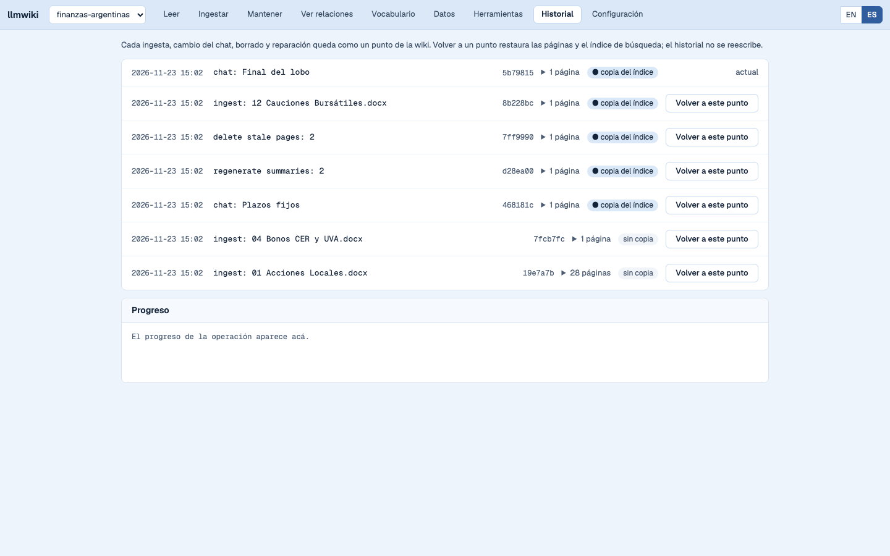
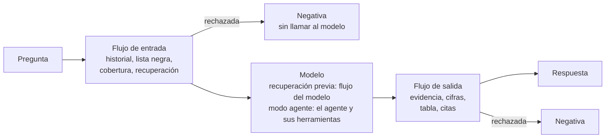

# LLM Wiki

[](https://github.com/Clod/harnessed-llmwiki/actions/workflows/test.yml)


[](https://github.com/astral-sh/ruff)
[](https://github.com/Clod/harnessed-llmwiki/releases)
[](CHANGELOG.md)

[English](README.md) · **Español**

> Traducción de [`README.md`](README.md), que es la versión canónica. Ante cualquier discrepancia, prevalece el inglés.

## Qué es

Una wiki personal y *local-first* que ingiere tus documentos, construye una base de conocimiento estructurada y te permite leerla y conversar con ella — todo en tu máquina, sin necesidad de la nube.

Inspirada en [la idea de la «LLM Wiki» de Karpathy](https://x.com/karpathy/status/2039805659525644595). La extracción de PDF y algunas piezas de bajo nivel de la ingesta están adaptadas de [la LLM Wiki de código abierto de Lucas Astorian](https://github.com/lucasastorian/llmwiki) (Apache-2.0); el resto es una construcción *local-first* independiente sobre FastAPI, HTMX y SQLite. Ver [`NOTICE`](NOTICE).

[Verla funcionando](#verla-funcionando) · [Dos maneras de usarla](#dos-maneras-de-usarla) · [Arquitectura](#arquitectura-las-salvaguardas-como-flujos-de-trabajo) · [Inicio rápido](#inicio-rápido) · [Limitaciones](#limitaciones-y-objetivos-excluidos) · [Para desarrolladores](#para-desarrolladores)

---

## Verla funcionando


La pestaña **Leer** sobre el ejemplo de finanzas. El índice de páginas está a la izquierda y la página abierta en el centro. La conversación está a la derecha. Cada respuesta termina con una línea de referencia que nombra las páginas que cita. Bajo la respuesta, una línea nombra el modo de respuesta y los tokens del turno y de la conversación. Los botones **Criterio**, **Fuentes** y **Respuesta** abren la auditoría de la última respuesta.

Bajo el campo de la pregunta, el selector **Modo** tiene tres valores ([cuál elegir, y por qué](docs/manual/workflows/6.7-chat-rag.md)):

- **Recuperación previa:** el código busca en la wiki antes de llamar al modelo y le pasa las páginas encontradas. Una pregunta que no nombra nada de lo que la wiki cubre se rechaza sin llamar al modelo.
- **Agente con comprobación de evidencia:** el modelo busca en la wiki con herramientas. Si ninguna herramienta devolvió evidencia, se le pregunta una vez más al modelo, y después la respuesta lleva un aviso.
- **Sin verificación:** la respuesta aparece a medida que el modelo la genera, y el código no la comprueba.

La casilla **Verificar las oraciones** marca las oraciones de la respuesta que ninguna página respalda. En el modo de recuperación previa, los botones **Comprobar que las páginas responden la pregunta** eligen cómo comprueba el código las páginas que encontró. El botón **Guardar** convierte la conversación en una página de la wiki solo después de que revisás el borrador: el agente no tiene herramienta de escritura.



La pestaña **Historial**. Cada operación que cambia la wiki es un punto: una ingesta, una conversación guardada, una edición, un borrado, una reparación, un cambio de la configuración o del vocabulario. Un punto marcado "copia del índice" tiene una copia del índice de búsqueda, así que volver a él es inmediato; en los demás, el índice se reconstruye sin llamar al modelo. Esta captura se tomó sobre el ejemplo de finanzas, con siete puntos agregados por el script de captura.

▶ **[Mirá la demo de 1 minuto](https://youtu.be/g1Qg3ZJzuek)**: una página generada, después una respuesta que compara dos cuentos y cita una página por cada afirmación (4 s), y después una pregunta que la wiki no cubre, rechazada **en 0,1 s porque nunca se llamó al modelo**.

▶ **[Mirá el recorrido completo](https://youtu.be/uBj1jrn3MgU)** (interfaz en castellano, 4:15): la ingesta de un documento, la pantalla de lectura, las relaciones, el vocabulario, un archivo de datos con su herramienta, los tres modos del chat, una negativa y su auditoría, el guardado de una conversación, el lint y la reparación, y el historial. Los tramos que esperan al modelo van acelerados, y un rótulo en pantalla da el factor.

---

## Dos maneras de usarla

Este proyecto tiene dos propósitos, y cada propósito tiene su propio lector.

### 1. Una implementación de la LLM Wiki de Karpathy

Le das tus documentos a la aplicación. Un modelo de lenguaje grande (LLM) lee cada documento y escribe una wiki: un conjunto de páginas Markdown enlazadas entre sí que resumen los documentos y registran sus conceptos, sus referencias cruzadas y sus contradicciones. El LLM mantiene la wiki al día a medida que agregás documentos. Vos leés la wiki y le hacés preguntas en un chat. Frente a [la idea original de Karpathy](https://x.com/karpathy/status/2039805659525644595), esta implementación agrega:

| Agregado | Qué te da |
| --- | --- |
| **Una opción completamente local** | La aplicación, los documentos y la wiki quedan en tu máquina, lo que preserva la confidencialidad si hace falta. Con un servidor de modelos local (Ollama o LM Studio), las llamadas al modelo también quedan ahí. |
| **Un agente integrado** | La ingesta, la recuperación, el mantenimiento y la interfaz web son una sola aplicación. No hay que conectar un agente externo (Claude Desktop, Cursor, un cliente MCP). |
| **Cifras además de prosa** | Una wiki puede tener conjuntos de datos fechados (tasas, precios, estadísticas). El agente del chat los consulta con herramientas, y el que calcula sobre las cifras es código Python, no el LLM. |
| **Un historial automático, con el índice** | La idea de Karpathy ya guarda la wiki en git. Acá cada operación que cambia la wiki es un commit, y la pestaña Historial devuelve las páginas y el índice de búsqueda juntos a un punto anterior, sin llamar al LLM. |
| **Un grafo de la wiki** | La pestaña Ver relaciones dibuja las páginas y las fuentes con los enlaces y las citas entre ellas. Un campo de búsqueda encuentra una página, y el grafo local de una página muestra sus vecinas. |
| **Automantenimiento** | Dieciséis comprobaciones de lint encuentran contradicciones, páginas desactualizadas, páginas huérfanas y oraciones que ninguna fuente respalda. El paso de reparación arregla automáticamente las seguras. |

Las principales limitaciones: la ingesta se hace en una pasada, así que el LLM no discute una fuente con vos antes de escribir las páginas, como en el flujo de ingesta de Karpathy (la conversación viene después: conversás sobre la wiki y guardás la conversación como página, que revisás y editás antes de que se escriba); la wiki es solo de páginas Markdown; y borrar una fuente no quita su texto de las páginas que también citan otras fuentes. El agente del chat no busca en la web, a propósito: una página web es texto no confiable, y la wiki solo incorpora los documentos que elegís ingerir. La lista completa está en **Limitaciones y objetivos excluidos**, más abajo.

### 2. Un banco de pruebas para sistemas RAG

**Prototipá antes de construir.** Antes de empezar el desarrollo de un sistema RAG, ingerí una muestra de tus propios documentos, elegí un modelo y hacé las preguntas que harían tus usuarios. En horas, no en semanas, ves qué modelo alcanza, qué preguntas rechazan las salvaguardas, dónde las respuestas pierden sus citas y cuánto cuesta una conversación en tokens. Esos hallazgos se trasladan al sistema que construyas, salvo los de la calidad de la búsqueda, porque este proyecto busca por palabras clave, no por embeddings (ver **En qué se diferencia del RAG clásico**, más abajo). Las salvaguardas están declaradas como flujos de trabajo: cada comprobación del prototipo es una función con nombre que podés llevar al producto final, y los diagramas generados documentan el flujo que estás portando. Más sobre los flujos en **Arquitectura: las salvaguardas como flujos de trabajo**, más abajo.

La generación aumentada por recuperación (RAG) es el patrón en que un sistema recupera pasajes de una base de conocimiento y se los pasa a un LLM, y el LLM responde a partir de esos pasajes. El lado de recuperación y respuesta de este proyecto sigue el patrón RAG (ver **En qué se diferencia del RAG clásico**, más abajo). El proyecto permite, por lo tanto, probar y observar las partes que rodean a un sistema RAG:

| Parte | Qué podés probar u observar |
| --- | --- |
| **Salvaguarda de entrada** | Una salvaguarda (*guardrail*) es una comprobación, escrita en código, que corre antes o después del LLM. En el modo Recuperación previa, el código rechaza una pregunta que no nombra nada de lo que la wiki cubre, antes de llamar al LLM. |
| **Salvaguardas de salida** | La comprobación de cifras marca en rojo cada cifra de la respuesta que ningún pasaje, tabla o pregunta respalda. La casilla Verificar las oraciones marca cada oración que ninguna página respalda. |
| **Herramientas de cálculo** | El LLM no hace cuentas: llama a herramientas cuyas funciones de cálculo son código Python. La pestaña Herramientas lista cada herramienta y el código fuente de sus funciones. |
| **Una auditoría de cada respuesta** | La **página de auditoría**, a un botón de cada respuesta, muestra el camino de la pregunta sobre el diagrama de flujo del sistema, los pasajes que la wiki le dio al LLM y el texto del LLM antes de que el código lo reemplazara. Para desarrolladores, `WIKI_TRACE=1` escribe un span de OpenTelemetry por cada paso en `spans.jsonl`. |
| **Cuenta de tokens** | Bajo cada respuesta, una línea da los tokens del turno y de toda la conversación. La aplicación no convierte tokens en dinero: multiplicá las cuentas por los precios de tu proveedor para estimar el costo. |
| **Evaluación de modelos** | **Cambiar de modelo es una configuración, no un cambio de código**: la pestaña Configuración fija por separado los modelos del chat, de la ingesta y de visión, cualquier endpoint compatible con OpenAI, local o alojado, y la siguiente pregunta usa el modelo nuevo sin reiniciar. Hacé las mismas preguntas con dos modelos y compará las respuestas, su auditoría y sus tokens. Los botones Probar de la pestaña Configuración, o un comando, comprueban si un modelo puede responder a partir de una página y citarla, declinar una pregunta que la página no responde, buscar con las herramientas e ingerir un texto. |
| **Evaluación con un LLM como juez** | Un comando genera un paquete de evaluación: las preguntas, las respuestas, las páginas citadas y una rúbrica fija de 1 a 5. Lo pegás en los modelos jueces que elijas, y ellos puntúan las respuestas. |
| **Una base de conocimiento de prueba en un paso** | La ingesta convierte una carpeta de documentos en una base de conocimiento, sin trocear ni etiquetar a mano. La carpeta `examples/` trae wikis listas. |

---

## Arquitectura: las salvaguardas como flujos de trabajo

Cada turno del chat corre como flujos de trabajo declarados, no como código enterrado alrededor de la llamada al modelo. Las comprobaciones de la pregunta, la llamada al modelo y las comprobaciones de la respuesta son grafos separados ([pydantic-graph](https://ai.pydantic.dev/graph/)), y el modelo corre entre las dos comprobaciones, nunca alrededor de ellas.



| Flujo | Qué contiene |
| --- | --- |
| **Entrada** (ambos modos) | Las salvaguardas de entrada: el historial del turno, la lista negra y, en el modo de recuperación previa, la cobertura de la pregunta y la recuperación del texto que el prompt inyecta. Una pregunta rechazada acá nunca llega al modelo. |
| **Modelo** (modo de recuperación previa) | Las llamadas al modelo: la respuesta a partir de las páginas de la wiki, una comprobación opcional de que las páginas responden la pregunta, y una segunda llamada con los fragmentos de las fuentes cuando el modelo no encontró nada en las páginas. En el modo agente, acá corre el agente con sus herramientas. |
| **Salida** (ambos modos) | Las salvaguardas de salida: la comprobación de evidencia, la comprobación de cifras, la tabla de asesoramiento, las citas y la negativa. |

Por qué importa:

- **Cada salvaguarda es un nodo con nombre.** Agregar, quitar o mover una comprobación es un nodo y una arista en un grafo; la llamada al modelo no cambia.
- **El modelo no puede saltear una comprobación.** Las salvaguardas corren en código antes y después del modelo, escriba lo que escriba el modelo.
- **El diagrama es el código.** La página de auditoría dibuja el camino de cada turno sobre el diagrama de flujo generado a partir de los mismos grafos, y [`docs/workflow_diagrams.md`](docs/workflow_diagrams.md) también se genera a partir de ellos: un test falla cuando el documento y los grafos difieren.
- **Una función por comprobación.** Una comprobación que usan dos modos es la misma función en los dos flujos.
- **Cada nodo es un span de OpenTelemetry.** Con `WIKI_TRACE=1`, cada nodo escribe un span con su identificador como nombre, así que una traza es el camino del turno por los flujos. Las llamadas al modelo son spans hijos del nodo que las hizo, escritos por la instrumentación de Pydantic AI. Los spans van a `.llmwiki/traces/spans.jsonl`, los prompts y las respuestas a archivos de contenido aparte, y `scripts/render_trace.py` muestra una traza. Los grafos no agregan spans propios: la traza tiene los mismos nodos que el diagrama.

El modo con streaming (Sin verificación) no corre ningún flujo: muestra la respuesta a medida que el modelo la escribe.

---

## En qué se diferencia del RAG clásico

La diferencia está en cómo se construye y se mantiene la base de conocimiento. La recuperación se parece a la del RAG clásico, y ese parecido es lo que hace que el proyecto sirva como banco de pruebas.

**La construcción de la base de conocimiento.** Un sistema RAG clásico divide cada documento en fragmentos e indexa los fragmentos tal como son: los fragmentos no cambian después de la ingesta. Este proyecto hace que el LLM lea cada documento y lo integre en un conjunto persistente de páginas Markdown enlazadas: páginas de resumen, páginas de conceptos, un catálogo, un panorama general y una cronología. Las referencias cruzadas y las contradicciones se escriben en la ingesta, antes de que nadie haga una pregunta. Cada documento nuevo actualiza las páginas existentes, y las comprobaciones de lint mantienen las páginas coherentes entre sí. Los fragmentos crudos también se guardan, en un índice de texto completo de SQLite.

**La recuperación.** La recuperación funciona como en un sistema RAG: el sistema busca en la base de conocimiento, le pasa los resultados al LLM, y el LLM responde citando las páginas que usó. Hay dos diferencias. Primero, la búsqueda lee primero las páginas de la wiki y recurre a los fragmentos crudos solo cuando las páginas no alcanzan. Segundo, la búsqueda la puede hacer el código o el LLM: en el modo Recuperación previa el código busca antes de llamar al LLM; en el modo Agente con comprobación de evidencia el LLM busca con herramientas.

**Excepción: solo búsqueda léxica.** La búsqueda es de texto completo (SQLite FTS5), no por similitud vectorial sobre embeddings. Los resultados que este banco de pruebas da sobre salvaguardas, trazas, herramientas y evaluación de modelos valen para un sistema RAG vectorial. Los resultados sobre la calidad de la búsqueda no valen.

---

## Aspectos destacados

> **¿Por qué no apuntar Claude Code a una carpeta de notas?** Esa pregunta tiene una respuesta larga: [From Idea to Product](docs/from_idea_to_product.md) — diecisiete maneras en que la idea de la LLM Wiki hace agua cuando se le apunta un agente genérico, cada una con un ejemplo real y lo que este proyecto hace al respecto, incluidas las tres en que la respuesta es una concesión deliberada y no un arreglo.

**Ingeniería de IA / LLM**

| Característica | Cómo funciona |
| --- | --- |
| **Asesoramiento determinista y fundamentado** | La extensión de ejemplo `finance_argentina` calcula «cuánto ganaría» sobre los conjuntos de datos en Python puro (cálculo de tasas efectivas, elegibilidad), lista cada opción ordenada y citada, y se niega a estimar acciones, inflación o tipo de cambio antes que inventar un número. |
| **RAG con la wiki primero** | El agente lee primero las páginas curadas (`index.md` → FTS5 de la wiki → fragmentos crudos de las fuentes como respaldo), así que el conocimiento se compila una vez y se acumula, en lugar de recuperarse de nuevo en cada consulta. |
| **Idioma por wiki (en/es, extensible)** | Se elige al crear la wiki (`[wiki] language` en `wiki_config.toml`). Las páginas, los encabezados y las respuestas del chat se escriben en ese idioma, **sea cual sea el idioma de los documentos fuente**. Cada prompt es un archivo por idioma en `prompts/`; un tercer idioma es una entrada `Locale` y un archivo traducido por prompt. |
| **Prompting basado en evidencia** | El prompt de sistema por defecto (`prompts/system_prompt.<lang>.md`) incluye una comparación resuelta y completamente citada. Una comparación que dejaba puntos sin citar pasó a citar cada punto una vez agregado el ejemplo ([CHANGELOG](CHANGELOG.md), 0.2.x). |

**Calidad de ingeniería**

| Práctica | Cómo se ve |
| --- | --- |
| **Tests en tres capas, ≈1:1 entre test y código** | Tests unitarios deterministas con un LLM simulado (sin claves, sin red); una regresión de *caracterización* sobre un corpus dorado congelado que vuelve a comprobar el esqueleto de una ingesta real sin volver a llamar al modelo; y tests de Playwright de la interfaz web, que corren en la CI. |
| **Núcleo independiente del framework** | La lógica vive en `base/domain/` (ingesta, chat, conjuntos de datos, extensiones, lint, reparación, verificación, vuelta atrás, evaluación y otros). La interfaz web (`web/`) es solo la capa de UI en los bordes y llama a `base/services/`, así que los tests unitarios ejercitan el motor sin navegador. |
| **Interfaz web renderizada en el servidor** | FastAPI y Jinja2 generan el HTML, HTMX actualiza la página, y Server-Sent Events transmiten las respuestas del chat y el progreso de las operaciones largas. Sin paso de build de JavaScript: los pocos scripts y hojas de estilo son archivos planos en `web/static/`. |
| **Atenta a la seguridad** | Una protección contra *path traversal* en el lector de páginas que el LLM puede llamar, un modelo de amenazas explícito para la inyección de prompts y un [`SECURITY.md`](SECURITY.md) documentado. |
| **Pensada para escalar** | La reingesta saltea los archivos sin cambios por hash de contenido, el lint compara solo los pares de páginas que comparten una fuente (no N²), y la síntesis del panorama general es incremental. |
| **Reproducible y limpia** | `uv.lock` fijado para instalaciones deterministas, cero advertencias de `ruff` y ninguna deuda de `TODO`/`FIXME` en el código. |

**Transparencia y documentación**

| Práctica | Cómo se ve |
| --- | --- |
| **Grafo de citas en SQLite** | Cada arista página→fuente y página→página se registra y se reconstruye de forma determinista, así que la procedencia se puede consultar. |
| **Documentada de punta a punta** | Un manual del programador con su referencia de apps / flujos / internos, un diccionario de datos de SQLite y una matriz de alineación con Karpathy que califica lo hecho, lo parcial y lo postergado. |

---

## Qué hace

Cada wiki tiene nueve pestañas:

| Pestaña | Qué hacés ahí |
| --- | --- |
| **Leer** | Recorrés las páginas generadas con el índice de páginas, leés una página, verificás cada una de sus oraciones contra sus fuentes, la editás en un editor Markdown con vista previa en vivo, o la borrás. En la misma pestaña, **conversás** sobre tus documentos: el agente lee primero las páginas curadas, consulta los conjuntos de datos para las cifras y recurre a los fragmentos de las fuentes, citando cada dato. Bajo cada respuesta, una línea da su modo y sus tokens, y **Criterio**, **Fuentes** y **Respuesta** abren la página de auditoría. **Guardar** convierte la conversación en una página de la wiki después de que revisás el borrador. La conversación sobrevive a la navegación, al editor y a una recarga. |
| **Ingestar** | Agregás archivos PDF, de oficina (`.docx`, `.doc`, `.odt`, `.rtf`), Markdown, de texto o, cuando la wiki no ignora las imágenes, de imagen, o los copiás a `sources/` y hacés clic en **Escanear sources/**. El proceso extrae el texto, escribe o actualiza las páginas de resumen y de conceptos, el catálogo, el panorama general y la cronología, y hace commit del resultado en el repo git de la wiki. La pestaña también lista y borra fuentes. [Agregar documentos](docs/adding_documents.md) explica qué cambia el escaneo. |
| **Mantener** | Regenerás las páginas de resumen, verificás cada página contra sus fuentes, corrés el lint y la reparación, borrás páginas desactualizadas, describís las imágenes con un modelo de visión, instalás el verificador local de oraciones y reconstruís el índice de búsqueda sin llamar al modelo. |
| **Ver relaciones** | El grafo de páginas y fuentes, con búsqueda de páginas, botones de zoom y el grafo de una página y sus vecinas. |
| **Vocabulario** | Los nombres que la wiki cubre (solo lectura, con campo de búsqueda), sus alias, los alias rechazados y la lista negra de términos que el chat debe rechazar. Cada cambio es un punto del historial. |
| **Datos** | Los archivos de datos de la wiki: sus metadatos y sus tablas. |
| **Herramientas** | Las herramientas que el chat puede usar, con su nodo de traza, sus argumentos y su rol, si cada una está activa en esta wiki y por qué, y el código de sus funciones de cálculo. Solo lectura. |
| **Historial** | Devolvés la wiki entera a un punto anterior, y leés o comparás versiones anteriores de una página. Una vuelta atrás es un punto nuevo: el historial no se reescribe. |
| **Configuración** | Elegís y probás los modelos (guardados en `.env`, compartidos por todas las wikis), y editás el prompt de sistema, la recuperación previa, la verificación y las imágenes de esta wiki; la siguiente pregunta los usa sin reiniciar. El idioma de la wiki se muestra en solo lectura. |

La interfaz está en inglés y en castellano: el selector **EN | ES** a la derecha del encabezado elige el idioma (una cookie; sin ella, el idioma del navegador; sin ese, inglés). Es el idioma de las etiquetas y los mensajes solamente. El idioma del contenido de la wiki se fija por wiki y es otra configuración (ver [Idioma de contenido de la wiki](#idioma-de-contenido-de-la-wiki)): una wiki en castellano se puede leer con la interfaz en inglés, y al revés.

> **De marimo a una interfaz web.** Hasta [v0.4.0](https://github.com/Clod/harnessed-llmwiki/releases/tag/v0.4.0) la interfaz de este proyecto fue un conjunto de notebooks de [marimo](https://marimo.io); esa versión es la que hay que instalar para usarlos. marimo vuelve a ejecutar una celda entera cada vez que cambia uno de sus widgets, lo que le sienta bien a un notebook. La aplicación pasó a necesitar una conversación que sobreviva al pasar de una página a otra, el progreso transmitido mientras corre una ingesta y una dirección para cada página y cada pantalla, así que se mudó a una interfaz web renderizada en el servidor (FastAPI y HTMX). Las apps de marimo se quitaron del repositorio el 2026-11-15; esta documentación describe solo la interfaz web.

---

## Requisitos previos

| Requisito | Para qué | Cómo instalarlo |
| --- | --- | --- |
| **Python 3.12+** y **[uv](https://docs.astral.sh/uv/)** | Todo | El instalador instala los dos. A mano: ver la página de uv |
| Una **API de LLM compatible con OpenAI** | Chat e ingesta | OpenRouter, Ollama, LM Studio, etc. |
| **Un entorno de ejecución de Java** | Ingerir **PDF y archivos de oficina**: el extractor de texto (`opendataloader-pdf`) ejecuta un `.jar` incluido, y un archivo de oficina se convierte antes a PDF. No hace falta para archivos `.md`, `.txt` o de imagen, ni para leer y conversar con una wiki ya construida (por eso las demos abren sin él) | macOS: `brew install --cask temurin` · Debian/Ubuntu: `sudo apt install default-jre` (Fedora: `sudo dnf install java-21-openjdk`) · Windows: `winget install EclipseAdoptium.Temurin.21.JRE` |
| **LibreOffice** | Solo archivos de oficina (`.docx`, `.doc`, `.odt`, `.rtf`) | macOS: `brew install --cask libreoffice` · Debian/Ubuntu: `sudo apt install libreoffice` (Fedora: `sudo dnf install libreoffice`) · Windows: `winget install TheDocumentFoundation.LibreOffice` |
| **git** | Clonar el repo (el zip del instalador no necesita git). También el historial de versiones de la wiki, que es opcional: sin git los commits se saltean con un aviso, o poné `WIKI_AUTOCOMMIT=0` | La mayoría de los sistemas ya lo tienen |

---

## Inicio rápido

Solo necesitás conexión a internet: el instalador trae `uv` y Python 3.12, sin permisos de administrador. Las wikis de ejemplo vienen ya ingeridas, así que para leerlas no hace falta Java.

| Paso | Windows | macOS y Linux |
| --- | --- | --- |
| 1. Descargar | En GitHub, **Code → Download ZIP**, y descomprimilo | Lo mismo, o `git clone` |
| 2. Instalar | Doble clic en `install.cmd` | `bash install.sh` en esa carpeta |
| 3. Elegir la carpeta de las wikis | Enter acepta `Documents\LLM Wiki` | Enter acepta `~/Documents/LLM Wiki` |
| 4. Iniciar | Doble clic en `open_web.cmd` | `bash open_web.sh` |
| 5. Configurar el modelo | Abrí una wiki y después la pestaña **Configuración**: fijá el modelo del chat y apretá **Probar** | Lo mismo |

El instalador copia las tres wikis de ejemplo a la carpeta que elegiste, escribe un registro breve (`install.log`), comprueba la instalación sin llamar a ningún modelo y crea el acceso directo `open_web`, que abre <http://localhost:8765>. Volver a ejecutarlo es seguro: conserva tus wikis y el `.env`. Los mensajes del instalador están en inglés. [`INSTALLER.md`](INSTALLER.md) explica cada paso, el aviso SmartScreen de Windows, qué hacer cuando falla un paso y cómo desinstalar.

Las wikis se pueden leer sin modelo; el chat necesita uno. La pestaña **Configuración** guarda los modelos en `.env`, compartidos por todas las wikis, y prueba cada uno. El selector de wikis también lista las **Wikis de ejemplo**: **Abrir una copia** pone una copia nueva junto a tus wikis.

> **Instalaciones automatizadas.** `quickstart.py` (Python 3.12+ y un clon con git) pregunta el proveedor en la consola y escribe el `.env` completo; sus opciones permiten automatizarlo: `python3 quickstart.py --demo fairy-tales --provider ollama --yes --no-launch`. `python3 quickstart.py --help` lista las opciones.

¿Preferís armarlo vos? La instalación manual con `uv` está más abajo.

### Instalación manual (uv)

#### 1. Clonar e instalar

```bash
git clone https://github.com/Clod/harnessed-llmwiki.git
cd harnessed-llmwiki
uv sync --group web
```

#### 2. Configurar

Copiá `.env.example` a `.env` y completá:

```env
WIKI_PATH=/ruta/a/tu/wiki             # la wiki que se abre al iniciar (la predeterminada)

# Sirve cualquier endpoint compatible con OpenAI. Ejemplo: Ollama (local, gratis).
LLM_BASE_URL=http://localhost:11434/v1
LLM_API_KEY=ollama                    # cualquier texto no vacío para Ollama
LLM_MODEL=llama3.2
```

`WIKI_PATH` es solo la wiki **predeterminada** — la interfaz web arranca en un selector de wikis, y el selector de wiki del encabezado cambia de wiki en tiempo de ejecución sin editar `.env`. El selector lista las wikis descubiertas junto a `WIKI_PATH` y las recientes, y abre cualquier otra carpeta por su ruta. Poné `WIKI_HOME=/ruta/a/las/wikis` para que el descubrimiento mire una carpeta concreta en lugar de la carpeta madre de `WIKI_PATH`.

Ver [Proveedores de LLM](#proveedores-de-llm) para la configuración de Ollama y LM Studio.

#### 3. Iniciar la interfaz web

```bash
uv run --group web uvicorn web.app:app --port 8765
```

Abrí <http://localhost:8765>. La página lista las wikis; abrí una. El servidor escucha en `localhost` y no tiene autenticación: es para un usuario en una máquina. Sin `uv`, usá el `python -m uvicorn web.app:app --port 8765` de un entorno que tenga instalado el grupo `web`.

Primero agregá documentos en **Ingestar**: una wiki sin fuentes no tiene nada para leer. Las wikis de ejemplo de `examples/` ya están ingeridas.

Las variables de entorno están listadas en [`web/README.md`](web/README.md).

---

## Proveedores de LLM

Todo el sistema usa la API compatible con OpenAI. Cambiá de proveedor en el bloque «Modelos» de la pantalla **Configuración**, o en `.env`: los dos escriben las mismas claves, y no hace falta cambiar código.

| Proveedor | `LLM_BASE_URL` | `LLM_API_KEY` | `LLM_MODEL` |
| --- | --- | --- | --- |
| **Ollama** (local, gratis) | `http://localhost:11434/v1` | `ollama` | `llama3.2` |
| **LM Studio** (local, gratis) | `http://localhost:1234/v1` | `lm-studio` | `local-model-name` |
| **OpenRouter** (nube, modelos alojados) | `https://openrouter.ai/api/v1` | `sk-or-...` | `anthropic/claude-haiku-5.5` |

**Configuración dividida** — un modelo barato o local para el chat y uno más fuerte para generar la wiki:

```env
LLM_BASE_URL=http://localhost:11434/v1   # lo usa el chat
LLM_API_KEY=ollama
LLM_MODEL=llama3.2

WIKI_LLM_BASE_URL=https://openrouter.ai/api/v1   # lo usa la ingesta
WIKI_LLM_API_KEY=sk-or-...
WIKI_LLM_MODEL=anthropic/claude-haiku-5.5
```

Si `WIKI_LLM_*` están vacías, la ingesta usa `LLM_*`. El modelo de visión (`VISION_*`, ver [Formatos de documento](#formatos-de-documento)) usa `WIKI_LLM_*` y después `LLM_*`.

> **No uses un modelo demasiado chico para la ingesta.** Resumir, extraer conceptos y comprobar contradicciones dependen del razonamiento del modelo, así que un modelo que se queda corto para *tus* documentos da resúmenes pobres, citas débiles o páginas alucinadas. Qué es «demasiado chico» depende de tu corpus y de tu nivel de exigencia — juzgalo por las páginas que realmente produce. Si la calidad de la wiki decepciona, subí el modelo de `WIKI_LLM_*` (ingesta) antes de culpar al proceso; la configuración dividida de arriba te deja hacerlo manteniendo el chat en un modelo local más chico.

> **El fundamento y las citas del chat también dependen del modelo del chat.** El prompt por defecto del agente del chat es estricto — *respondé solo a partir de tu wiki y citá cada dato* — pero un prompt es solo un pedido; el modelo tiene que ser capaz de cumplirlo. Un ejemplo concreto de pruebas en OpenRouter, mismo proveedor, misma wiki, con el prompt estricto por defecto:
>
> | Pregunta | `openai/gpt-4o-mini` | `openai/gpt-4o` |
> | --- | --- | --- |
> | «¿Cuál es la capital de Francia?» (fuera del corpus) | a veces responde «París» | declina — fuera de la wiki |
> | «¿Quién es Cenicienta?» (un dato) | responde, pero cita el PDF crudo o nada | cita la página curada de la wiki |
> | «¿Qué tienen en común Cenicienta y Blancanieves?» (síntesis) | pierde las citas | cita cada punto con sus páginas fuente |
>
> La **síntesis** entre documentos es el caso más exigente — ahí es donde un modelo más débil abandona primero las citas. Lograr que citara de manera confiable requirió *tanto* un modelo capaz como un ejemplo resuelto de una comparación completamente citada, y por eso ese ejemplo ahora está incluido en el prompt por defecto. Si las respuestas del chat llegan sin citas o se salen de tus documentos, subí el modelo del chat (`LLM_MODEL`) antes de suponer que el agente está roto. Podés dejar un modelo barato para la ingesta y uno más fuerte para el chat (o al revés) con la configuración dividida de arriba.
>
> **¿No sabés si un modelo da la talla?** Apretá **Probar** junto al modelo en el bloque «Modelos» de la pantalla **Configuración**, o ejecutá `uv run python scripts/eval_chat_model.py`. Los dos corren las mismas pruebas, sobre material que viene con el producto, en una wiki temporal que se borra al final:
>
> - **Modelo de lectura** — tres preguntas a una wiki de dos páginas. El modelo responde con el dato de la página y cita la página, declina una pregunta que la página no responde y, en el modo con herramientas, busca en la wiki antes de responder.
> - **Modelo de ingesta** — la ingesta de un texto de un párrafo. El modelo escribe la página de resumen y una página de concepto que nombra la fuente, y el lint no encuentra errores.
> - **Modelo de visión** — una página escaneada con un texto y una tabla inventados. Los catorce datos de la página están en lo que el modelo lee, y la descripción de la página tiene el formato que pide el producto.
>
> Cada comprobación imprime ✓, ✗, o ? cuando el servicio no respondió. La prueba no escribe `.env`. El botón **Guardar** de al lado escribe ese modelo, y pide una confirmación cuando los valores no se probaron o fallaron su última prueba. Pasar es necesario, no suficiente: las pruebas encuentran un modelo que no puede hacer el trabajo, y no comparan dos modelos que sí pueden.
>
> **Un dato de pruebas locales** (LM Studio en un M2 Pro, cuantizaciones Q4\_K\_M, el agente del chat fijado en `temperature=0`), medido con una versión anterior de `eval_chat_model.py` que hacía tres preguntas a una wiki de ejemplo de cuentos de hadas. El protocolo estricto de recuperar y después citar es exigente, y los modelos locales de menos de \~12B lo rompieron cada uno a su manera:
>
> | Modelo (local) | `eval_chat_model.py` | Cómo falló |
> | --- | --- | --- |
> | `Qwen2.5-7B-Instruct` | 2/3 | se salteó la recuperación cuando «sabía» la respuesta; recuperó pero después no citó |
> | `Meta-Llama-3.1-8B-Instruct` | 2/3 | siguió el protocolo, pero *se rindió* con la pregunta de síntesis — afirmó, mal, que el contenido no estaba en la wiki cuando sí estaba |
> | `gemma-4-12b-it-qat` (QAT) | ✗ inconsistente | inventó citas con **cero llamadas a herramientas**; filtró un canal de razonamiento en la respuesta |
> | `gemma-4-12b` (no QAT) | **3/3** | — |
>
> Conclusión: **elegí un modelo que pase todas las comprobaciones**, y en modelos locales esperá que eso signifique más o menos **12B o más**. Los modelos más chicos rompen el contrato de fundamentación cada uno a su manera — la evaluación es cómo lo detectás *antes* de confiar en las respuestas de la wiki. El agente del chat fija la temperatura en 0 (decodificación codiciosa).

---

## Personalizar el asistente de chat

La pestaña **Configuración** edita el prompt de sistema, la recuperación previa y la verificación de una wiki, y la siguiente pregunta los usa sin reiniciar. Las mismas claves viven en el archivo `wiki_config.toml` de la wiki, que también podés editar a mano:

```toml
[assistant]
system_prompt = """
Sos un asistente de una wiki personal de inversiones.
Respondé primero a partir de la wiki curada: leé wiki/index.md y después search_wiki_fts;
recurrí a search_source_chunks solo cuando a las páginas de la wiki les falte el detalle.
Citá el nombre del documento y la página para los datos específicos.
"""

suggested_prompts = [
    "Resumí mi cartera de inversiones",
    "¿Cuáles son los principales riesgos?",
    "¿Qué instrumentos ofrecen los mayores rendimientos?",
]
```

Copiá `wiki_config.example.toml` de la raíz del proyecto como punto de partida (o `wiki_config_es.example.toml` para una wiki en castellano — la misma estructura con `language = "es"` y prompts en castellano). Sin un `system_prompt`, la wiki usa el prompt por defecto de su idioma, el archivo `prompts/system_prompt.<lang>.md`; si el archivo `wiki_config.toml` no existe, cada configuración toma su valor por defecto.

### Quién va a buscar: el selector «Modo»

El selector **Modo** bajo la pregunta del chat elige, para cada pregunta, quién va a buscar. En **Agente con comprobación de evidencia** el modelo tiene las herramientas de búsqueda y decide qué llamar. En **Recuperación previa**, el modo con que abre el chat, el código recupera *antes* de consultar al modelo y decide, en Python, si esta wiki cubre la pregunta — y la rechaza sin gastar un token cuando no la cubre.

Es una concesión, no una mejora. Ganás la garantía de que hubo recuperación y una negativa predecible; perdés alcance, porque la cobertura se deriva de los nombres que la wiki cubre — los títulos de las páginas de conceptos, los temas de las páginas, los alias, y las categorías y claves de los conjuntos de datos, listados en la pestaña **Vocabulario** — así que una pregunta que no nombra ninguno se rechaza aunque una búsqueda hubiera encontrado algo. El modo agente le sienta a una wiki de prosa; Recuperación previa le sienta a una wiki donde una respuesta equivocada cuesta plata, una dosis o una fecha legal. La plantilla documenta la sección `[pre_retrieval]` y las tres listas de alcance que la acompañan.

`[pre_retrieval] min_coverage` (por defecto `0.2`) es un valor de partida, no uno medido. Cuando Recuperación previa responde a partir de los documentos originales, el código cuenta la fracción de las palabras de contenido de la respuesta que contienen los fragmentos de los documentos. Una respuesta por debajo del umbral se reemplaza por una negativa. El verificador de oraciones, cuando está instalado y activado, reemplaza esta comprobación. El valor correcto depende de los documentos y de las preguntas de cada wiki: medilo en las tuyas. Un valor más alto rechaza más respuestas; uno más bajo deja pasar más respuestas que los fragmentos no respaldan.

### Idioma de contenido de la wiki

El idioma de una wiki se elige al crearla: el explorador de carpetas del selector lo pregunta (English o Español), y la wiki lo guarda en la sección `[wiki]` de `wiki_config.toml`. Toda la wiki — páginas, encabezados y etiquetas estructurales, y respuestas del chat — se genera en ese idioma, **sea cual sea el idioma de los documentos fuente**, y el modelo recibe sus instrucciones en ese idioma (los archivos `prompts/<nombre>.<lang>.md`):

```toml
[wiki]
language = "es"   # "en" (por defecto) | "es"; extensible — agregá un Locale en base/domain/i18n.py
```

El idioma es una propiedad *de cada wiki*, así que podés tener una wiki en inglés y una en castellano lado a lado. Una wiki creada fuera del selector lo fija a mano **antes de la primera ingesta**; un valor ausente o desconocido vuelve al inglés. La pestaña Configuración lo muestra en solo lectura, porque el índice de búsqueda guarda las raíces de las palabras de ese idioma. Ver [`docs/manual/apps.md`](docs/manual/apps.md) §8.

---

## Formatos de documento

| Formato | Lector | Necesita |
| --- | --- | --- |
| PDF | opendataloader-pdf | Un entorno de Java. Los PDF con mucho texto funcionan bien; un PDF escaneado necesita un motor de OCR (abajo) |
| DOCX | LibreOffice → PDF → opendataloader-pdf | LibreOffice **y** un entorno de Java |
| DOC | LibreOffice → PDF → opendataloader-pdf | LibreOffice **y** un entorno de Java |
| ODT | LibreOffice → PDF → opendataloader-pdf | LibreOffice **y** un entorno de Java |
| RTF | LibreOffice → PDF → opendataloader-pdf | LibreOffice **y** un entorno de Java |
| MD | lectura directa | Nada. Codificación UTF-8, UTF-8 con BOM o cp1252. Las páginas se dividen en los encabezados de nivel 1/2 (unos 4.000 caracteres por página, sin cortar párrafos); el bloque de front-matter no se guarda |
| TXT | lectura directa | Nada. Las mismas codificaciones; las páginas se dividen en los límites de párrafo con línea en blanco (unos 4.000 caracteres por página) |
| PNG, JPG, JPEG, WEBP, GIF | se guarda como imagen; su texto es la descripción de un modelo de visión | `ignore = false` en `[images]` (abajo) y un modelo de visión |

La lista de formatos está en un solo lugar del código, `base/domain/ingestion/formats.py`. LibreOffice necesita su procesador de textos (Writer) para convertir; la pestaña **Mantener** muestra si el LibreOffice instalado convierte un documento.

**Las imágenes se ignoran por defecto.** Con `ignore = true` en la sección `[images]` de `wiki_config.toml`, el valor por defecto, la ingesta no guarda ninguna imagen de las fuentes: no copia, no enlaza ni describe ninguna, la página de resumen no tiene sección «Figuras», y un archivo de imagen no se acepta como fuente. La pantalla Configuración edita la clave (casilla «Ignorar las imágenes»), y la clave vale para las fuentes que se ingieran después. Con `ignore = false`, valen los dos párrafos de abajo.

**Imágenes de un PDF.** opendataloader-pdf extrae las imágenes de un PDF mientras lo convierte. La ingesta las guarda en la carpeta de ingesta del documento, `.llmwiki/cache/local/<id del documento>/images/`, junto a `converted.pdf`. La carpeta se deriva de la fuente, así que queda fuera de `wiki/` y fuera de git. El texto guardado enlaza cada imagen guardada con una ruta relativa a la raíz del espacio de trabajo, ``, y la página de resumen de una fuente con imágenes recibe una sección «Figuras», escrita por el código, con una miniatura por imagen, su número de página y su pie. La aplicación web sirve las imágenes en `/w/{wiki_id}/images/{document_id}/{file}`. El modelo recibe solo el enlace; no ve la imagen. Un DOCX sigue el mismo camino, como PDF. Ingerir una fuente cambiada reemplaza sus imágenes, y borrar una fuente las borra. Dos comprobaciones de lint cuidan las imágenes: `missing_image` (un enlace guardado cuyo archivo no existe) y `orphan_image` (un archivo guardado que ningún enlace usa). Sus reparaciones no llaman a ningún modelo: la primera vuelve a extraer las imágenes cuando la fuente sigue en `sources/`, o reemplaza el enlace por «\[Imagen no disponible, página N\]» cuando ya no está; la segunda borra el archivo. Una reconstrucción del índice tiene que volver a extraer las imágenes.

**Describir las imágenes (opcional).** Con `describe = true` en la sección `[images]` de `wiki_config.toml`, un modelo de visión (`VISION_BASE_URL`, `VISION_API_KEY`, `VISION_MODEL`, fijados en la pantalla Configuración o en `.env`, con el modelo de ingesta y después el del chat como respaldo) describe cada imagen guardada. La clave `describe` actúa solo con `ignore = false`. La descripción es un archivo junto a la imagen (`<imagen>.desc.json`, fuera de git), entra en el texto guardado de la fuente como un bloque delimitado por `<!-- image-description: … -->` para que la búsqueda, el modelo de ingesta y la verificación la vean, y aparece en la sección Figuras de la página de resumen en un bloque plegado con el rótulo «Descripción generada». La verificación marca una oración respaldada solo por una descripción con un estado propio (un subrayado de puntos). Las imágenes de una fuente Markdown (archivos raster locales dentro de `sources/`) se guardan y se describen igual, y un archivo de imagen (`.png`, `.jpg`, `.jpeg`, `.webp`, `.gif`) es una fuente cuyo texto es su descripción. El texto dentro de una imagen es entrada no confiable: ver [`SECURITY.md`](SECURITY.md). Detalles: [`docs/design_image_handling.md`](docs/design_image_handling.md).

**PDF escaneados (OCR).** Un PDF cuyas páginas casi no tienen texto (menos de 20 caracteres en al menos un cuarto de sus páginas) se lee con el motor de OCR `OCR_ENGINE`, fijado en la pantalla Configuración (bloque «Modelos», grupo «Modelo de visión») o en `.env`:

| `OCR_ENGINE` | Qué hace |
| --- | --- |
| `none` (por defecto) | La ingesta falla con un mensaje que nombra la configuración y los dos motores. |
| `tesseract` | Local: `ocrmypdf` con Tesseract, ejecutados como programas externos. Instalalos con `brew install ocrmypdf tesseract tesseract-lang` (macOS) o `sudo apt-get install ocrmypdf tesseract-ocr tesseract-ocr-spa` (Debian, Ubuntu); en Windows seguí las [instrucciones de ocrmypdf](https://ocrmypdf.readthedocs.io/en/latest/installation.html#windows). El idioma sigue al idioma de la wiki (`spa` para `es`, `eng` para `en`). La copia con capa de texto se guarda como `ocr.pdf` en la carpeta de caché del documento, y el visor de fuentes la muestra. |
| `vision` | Un modelo con visión lee cada página a través de una API compatible con OpenAI: una llamada al modelo por página, y el texto puede variar entre ejecuciones. Cada uno de `OCR_BASE_URL`, `OCR_API_KEY` y `OCR_MODEL` es el primer valor no vacío entre `OCR_*`, `VISION_*`, `WIKI_LLM_*` y `LLM_*`, así que el modelo de visión de la pantalla Configuración lee las páginas salvo que `OCR_*` esté fijado en `.env`. |

`quickstart.py` pregunta qué motor usar y escribe la configuración. En un PDF mixto (algunas páginas con texto, algunas escaneadas) los dos motores leen solo las páginas escaneadas. Las imágenes de una página escaneada se guardan como en cualquier otra página: la extracción las guarda primero, el OCR reemplaza después el texto de la página, y la página conserva los enlaces a sus imágenes guardadas, así que el manejo de imágenes (la sección Figuras, las comprobaciones de lint, la descripción opcional) se aplica a ellas.

---

## Limitaciones y objetivos excluidos

Esta es una prueba de concepto funcional del patrón LLM-Wiki, no un producto terminado. El ciclo central — ingerir → construir/mantener la wiki → leer → conversar con citas → lint → reparar — está implementado por completo. Algunas ideas del concepto original están **postergadas a propósito** en la prueba de concepto:

- **Sin búsqueda web.** El agente del chat responde solo a partir de *tu* corpus local curado — nunca sale a la web, y no hay un circuito automático web→wiki. Para incorporar una fuente externa, conseguila vos (por ejemplo, guardá el artículo como PDF) y después **ingerila a mano** — dejar un archivo en `sources/` no hace nada por sí solo. Abrí la pestaña **Ingestar** y (a) elegí el archivo en el formulario de carga y hacé clic en **Ingestar**, o (b) ponelo en `WIKI_PATH/sources/` y hacé clic en **Escanear sources/**, que detecta e ingiere lo nuevo o modificado. Tratá un documento de origen no confiable como tratarías código no confiable: en la ingesta su texto se convierte automáticamente en páginas de la wiki — ver [`SECURITY.md`](SECURITY.md).
- **Las imágenes se ignoran por defecto.** Con `[images] ignore = true`, el valor por defecto, las imágenes incrustadas en un documento se saltean: no se guardan ni se describen. Ver [Formatos de documento](#formatos-de-documento).
- **El OCR está apagado por defecto.** Un PDF escaneado o de solo imágenes falla con un mensaje hasta que fijes `OCR_ENGINE` (ver [Formatos de documento](#formatos-de-documento)). El motor `vision` cuesta una llamada al modelo por página y su texto puede variar entre ejecuciones.
- **La salida es solo Markdown — sin formatos alternativos.** La wiki registra un grafo completo de citas y enlaces en la base de datos (`document_references`: qué página cita qué fuente, qué páginas enlazan a cuáles), y la pestaña **Ver relaciones** lo dibuja. No hay generadores de presentaciones (**Marp**) ni de lienzos espaciales (**canvas**). La wiki se lee como páginas Markdown enlazadas.
- **La ingesta es automática, no una conversación guiada.** En el flujo de Karpathy el LLM discute una fuente con vos y escribe páginas bajo tu dirección; acá dejás un archivo y el proceso extrae → resume → archiva de una vez, sin revisión a mitad de la ingesta. La wiki se conduce *después*: abrí la página resultante en la pestaña **Leer**, conversá sobre el documento y guardá la conversación como página de la wiki con **Guardar**. El agente solo redacta y propone — revisás el borrador en un diálogo y el guardado es tu clic explícito — así que el paso con una persona en el circuito viene después y no durante la ingesta.
- **Borrar una fuente deja su aporte en las páginas que comparte.** Una página que cita solo la fuente borrada se borra, y no queda ningún enlace a ella. Una página que también cita otra fuente se conserva, se marca desactualizada y deja de citar el archivo borrado — pero su texto y sus alias generados pueden seguir teniendo lo que ese archivo aportó, porque una página no registra qué oración vino de qué fuente. Esto vale igual para un borrado desde la pestaña **Ingestar** que para un archivo quitado a mano de `sources/`, que la wiki borra cuando la abrís. La única manera de quitar ese texto es reconstruir la wiki entera a partir de las fuentes que quedan:
  1. En la lista de wikis, creá una wiki nueva en una carpeta vacía.
  2. En su pestaña **Ingestar**, subí los documentos fuente que quedan.
  3. Copiá `wiki_config.toml` de la wiki vieja: tiene la lista negra y los alias escritos a mano.

  Los cambios hechos a mano en la wiki vieja (páginas editadas, temas quitados) no se trasladan. **Reconstruir el índice** en la pestaña **Mantener** no hace esto: reconstruye la base de búsqueda a partir de las páginas tal como están.

Esas son las omisiones deliberadas. El porqué de cada recorte, lo que viene después, y lo que está construido pero se sabe imperfecto — medido, no sospechado — están en [`ROADMAP.md`](ROADMAP.md).

---

## Para desarrolladores

Las secciones que siguen son para quienes cambian el código, corren los tests o cuidan los archivos de una wiki.

> **Para desarrolladores:** la referencia canónica es [`docs/manual/programmer_manual.md`](docs/manual/programmer_manual.md) — flujos de trabajo, prompts, puntos de entrada, huecos y la hoja de ruta del trabajo pendiente. Las notas de diseño anteriores están en [`docs/archive/`](docs/archive/).
>
> **¿Querés primero el panorama?** El [Ingestion Walkthrough](docs/ingestion_walkthrough.md) sigue un corpus chico por todo su ciclo de vida — primer documento, segundo documento, una reingesta sin cambios, una fuente editada, un borrado — y muestra exactamente qué páginas de la wiki, filas de la base, aristas de citas y entradas del vocabulario produce cada paso. Sus números no están escritos a mano: salen de una ejecución real, y `scripts/capture_ingestion_walkthrough.py` los regenera cuando haga falta.

### Qué queda en disco

```
TU_WIKI_PATH/
├── sources/                 # Archivos subidos (los crea la pestaña Ingestar)
│   ├── paper.pdf
│   └── report.docx
├── wiki/                    # Generada por el LLM — vos la leés, la wiki la escribe
│   ├── index.md             # Catálogo de todas las páginas
│   ├── overview.md          # Síntesis narrativa (se reescribe en cada ingesta)
│   ├── log.md               # Cronología de solo agregado
│   ├── summaries/           # Una por documento fuente
│   │   ├── paper.md
│   │   └── report.md
│   └── concepts/            # Por tema, con varias fuentes
│       └── interest-rates.md
├── datasets/                # Opcional: archivos de datos fechados (tablas Markdown), editados por vos
├── wiki_config.toml         # El idioma de la wiki y la configuración opcional del asistente del chat
└── .llmwiki/
    ├── index.db             # SQLite: documentos, fragmentos, índice FTS5, grafo de citas, verificaciones
    ├── aliases.generated.toml  # Alias del vocabulario, generados en la ingesta
    ├── snapshots/           # Copias del índice de los últimos puntos del historial (5 por defecto)
    └── cache/               # Caché de extracción (reconstruible)
```

Los archivos fuente nunca se modifican. **Reconstruir el índice** en la pestaña Mantener reconstruye `index.db` a partir de `sources/` y `wiki/` sin llamar al modelo; reingerir las fuentes también lo reconstruye, pero reescribe las páginas.

Tu **espacio de trabajo `WIKI_PATH` es su propio repo git** (un repo distinto del de este proyecto). Cada operación que cambia la wiki hace un commit con una etiqueta (`ingest: paper.pdf`), así que la base de conocimiento tiene historial de versiones. Solo agrega al stage `wiki/`, el `.gitignore` que crea, `wiki_config.toml`, `datasets/` y los alias generados — nunca tus `sources/` ni la base de datos — y usa una identidad local `LLM Wiki <llmwiki@local>`, así que tu configuración global de git no se toca. Poné `WIKI_AUTOCOMMIT=0` en `.env` para apagarlo y manejar vos el git de la wiki (entonces LLM Wiki no ejecuta `git init` ni hace commits).

**El repo de la wiki es solo local — no se sube nada a ningún lado.** No tiene remoto y queda entero en tu máquina; LLM Wiki solo hace commits locales, nunca hace push. Es a propósito: tus fuentes y el conocimiento derivado de ellas son privados por defecto. Si *querés* respaldar la wiki o sincronizarla entre máquinas, agregá tu propio remoto — y usá un repo **privado**, porque tiene tu conocimiento personal:

```bash
cd "$WIKI_PATH"                                       # tu carpeta de la wiki
git remote add origin git@github.com:vos/mi-wiki.git # un repo PRIVADO tuyo
git push -u origin HEAD
```

De ahí en más, el push corre por tu cuenta (`git push` cuando quieras, o tu propia automatización) — el trabajo de la aplicación termina en el commit local.

> Cada wiki es un repo **separado** de este proyecto y de tus otras wikis. Así que una wiki que respaldás en GitHub es su propio repo privado — no una carpeta dentro de `harnessed-llmwiki`, y nada de tus documentos llega nunca al repo público del proyecto.

### Estructura del proyecto

```
base/                   # Proceso de ingesta + agente del chat (Python autocontenido)
├── config.py              # pydantic-settings — lee .env
└── domain/
    ├── ingestion/         # PDF/oficina/md/txt/imagen → texto → fragmentos → páginas de resumen + conceptos
    ├── datasets/          # Motor genérico de datos fechados y estructurados (tasas/precios/estadísticas)
    ├── extensions/        # Herramientas de dominio, un subpaquete por dominio: finance_argentina/ (asesoramiento de inversión determinista y citado)
    ├── chat/              # Agente PydanticAI + herramientas de wiki/fuentes/guardado/datos + salvaguarda de fundamentación
    ├── eval/              # Aceptación semiautomática: arma un paquete de evaluación listo para jueces
    ├── lint/              # Comprobaciones de salud de la wiki
    ├── repair/            # Arreglos automáticos de los problemas de lint seguros
    ├── verify/            # Verificación por oración de páginas y respuestas contra sus fuentes
    ├── rollback/          # Vuelta de una wiki a un punto anterior: páginas e índice juntos
    ├── text/              # Stemming Snowball por idioma de la wiki
    ├── tools/             # CRUD nativo: wiki_fs, search, references, deletion, reindex, git_ops, db
    ├── modeltest/         # Las pruebas de modelos de la pantalla Configuración (lectura, ingesta, visión)
    ├── prompts.py         # load_prompt(): lee los archivos de prompts/
    └── wiki_registry.py   # Selector de wikis: descubrimiento + lista de recientes + higiene de rutas

prompts/                # Cada prompt que recibe el modelo, un archivo por nombre e idioma (<nombre>.<lang>.md)

web/                    # La interfaz web: FastAPI + Jinja2 + HTMX (ver web/README.md)
├── app.py                 # Fábrica de la aplicación; `web.app:app` es lo que carga uvicorn
├── routes/                # picker, pages, chat, audit, ingest, history, relations, vocabulary, datasets, tools, settings, lang
├── templates/             # Plantillas Jinja2 (ids de mensaje en inglés; el catálogo en castellano está en locale/)
├── i18n.py                # Idioma de la interfaz: catálogos, elección del idioma, _() y ngettext()
├── locale/                # Catálogos gettext, uno por idioma salvo el inglés
└── static/                # CSS, JavaScript, htmx, force-graph, mermaid

base/services/          # Las llamadas que hacen las rutas web: wiki, chat, ingest, verification, vocabulary, settings, model_test


database/
└── sqlite_schema.sql      # Esquema canónico de la base

docs/
├── manual/                # Referencia canónica para desarrolladores, con una numeración § compartida
│   ├── programmer_manual.md          # §1 §2 §3 §10 §11 §13 — orientación, capas, glosario
│   ├── workflows.md                  # §6 — índice: tabla de estado + matriz de escritura
│   ├── workflows/                    # §6.1–§6.10, un archivo por flujo
│   ├── internals.md                  # §4 §5 §14 — esquema, capa de herramientas, trazas
│   └── apps.md                       # §7 §8 §9 §15 — apps, configuración, tests, conjuntos de datos
├── from_idea_to_product.md           # Diecisiete maneras en que la idea de la LLM Wiki hace agua, y qué hace este proyecto
├── sqlite_data_dictionary.md         # Cada tabla y columna de index.db
├── adding_documents.md               # La carga y el escaneo de sources/, para usuarios
├── ingestion_walkthrough.md          # Un corpus, de punta a punta — la vista narrativa
├── ingestion_walkthrough_appendix.md # Su inventario de artefactos (generado, regenerable)
├── query_walkthrough.md              # Preguntas a las wikis de ejemplo, en los tres modos del chat
├── query_walkthrough_appendix.md     # Su ejecución capturada (generada, regenerable)
├── uat_test_plan.md                  # El plan de aceptación: comprobaciones automáticas, manuales y de modelos
└── archive/               # Documentos de diseño reemplazados (históricos)

examples/               # Wikis de demostración ya ingeridas (las copia el instalador; el selector abre una copia)
├── fairy-tales/           # Se recorre sin LLM; el chat necesita un modelo
├── cuentos-de-hadas/      # La misma demo como wiki en castellano
└── finanzas-argentinas/   # Wiki de finanzas en castellano con conjuntos de datos; las capturas de arriba la usan

tests/
├── unit/                  # Tests unitarios deterministas (FakeLLM, sin red)
├── regression/            # Tests sobre un corpus dorado congelado (ingesta real, sin modelo en vivo)
├── web/                   # Interfaz web: rutas, renderizado, diseño, flujos de Playwright (en la CI)
│   └── e2e/               # Flujos de Playwright sobre una copia del ejemplo de finanzas
└── fixtures/              # PDF de prueba + configuración de wiki + corpus dorado

install.cmd, install.ps1, install.sh  # El instalador (ver Inicio rápido e INSTALLER.md)
scripts/install_steps.py  # Los pasos del instalador que necesitan Python
quickstart.py           # Instalador de consola para instalaciones automatizadas (Python 3.12+ y un clon con git)
requirements.txt        # Dependencias con hash exportadas de uv.lock (para el camino con pip del instalador)
```

### Tests

Dos suites automáticas, la más rápida primero, y una comprobación manual. La CI corre las dos suites.

**1. Barrera rápida de regresión** — determinista, sin claves de LLM, sin servidor corriendo, termina en unos tres minutos (medido el 2026-11-23). Corrélo después de cualquier cambio:

```bash
uv run pytest tests/unit tests/regression -q
```

Afirma las invariantes estructurales (integridad de la base, alineación del FTS, borrado en cascada, mecánica del guardado, lógica del lint, commits de git) con tests unitarios de LLM simulado más un **«corpus dorado» congelado de una ingesta real** — así el esqueleto se comprueba contra una ingesta real sin volver a llamar al modelo.

**2. Interfaz web** — rutas, renderizado, las comprobaciones de diseño (contraste, tokens) y flujos de Playwright sobre una copia de `examples/finanzas-argentinas`. Los agentes están simulados: ningún test llama a un modelo, y ninguno necesita Java ni LibreOffice.

```bash
uv run playwright install chromium                    # una vez
uv run --group web pytest -q tests/web                # todo, con los flujos del navegador
uv run --group web pytest -q tests/web --ignore=tests/web/e2e   # sin navegador
```

**Qué corre la CI.** `.github/workflows/test.yml` tiene dos trabajos en cada push y pull request a `master`: `unit` corre la suite 1 y `ruff check .`; `web` instala los grupos `web` y `dev` y Chromium y corre la suite 2. La CI no tiene LibreOffice, así que los tests que convierten un documento de oficina se saltean ahí (`tests/unit/test_office_conversion.py`).

**3. Comprobación de modelos (manual)** — *¿alcanza el modelo que elegiste?* Una comprobación de un comando de los modelos de `.env` (no hacen falta documentos — las pruebas traen su propio material). Los botones **Probar** de la pantalla Configuración corren las mismas pruebas:

```bash
uv run python scripts/eval_chat_model.py    # PASS/FAIL para los modelos de lectura, ingesta y visión
```

El plan de aceptación, [`docs/uat_test_plan.md`](docs/uat_test_plan.md), lista las dos suites automáticas, las comprobaciones manuales de la interfaz web y la comprobación de modelos. Los PDF de prueba están en `tests/fixtures/pdfs/`.

#### Automatizar lo que no se puede testear: el paquete de evaluación

Hay comportamiento que no se puede testear por regresión — no hay una «respuesta correcta» determinista para *¿esta respuesta del chat está bien fundamentada?* o *¿esta página generada es fiel a su fuente?* La salida varía con el modelo e incluso de una ejecución a otra. La solución es **pasarle el juicio a un LLM, pero de manera barata y resistente al sesgo**: generar un único **paquete de evaluación** en Markdown, autocontenido, y pegarlo en uno — o varios — modelos de chat capaces (una pestaña gratuita de Gemini / ChatGPT / Claude) para puntuar con una rúbrica fija de 1 a 5.

```bash
uv run python scripts/build_eval_packet.py                 # el corpus dorado
uv run python scripts/build_eval_packet.py --wiki RUTA      # una wiki existente
uv run python scripts/build_eval_packet.py --skip-ingestion # solo el chat (barato)
```

El paquete reúne todo lo que necesita un juez — las preguntas, las respuestas del propio modelo, las páginas citadas y (por fuente) el texto original junto a las páginas que generó el motor — más la rúbrica y una planilla de puntajes en blanco. Cubre la **calidad del chat** y la **calidad de la ingesta**, registra los dos modelos que midió y un hash del corpus para que los paquetes sean comparables, y se escribe en `eval_reports/`, ignorado por git. La generación es automática; el juicio sigue con una persona en el circuito (pegalo en todos los jueces que quieras y promediá), así que también sirve para comparar los modelos que usa tu motor de wiki. Detalles en [`docs/manual/apps.md`](docs/manual/apps.md) §9.

### Rendimiento a escala

Para una wiki de tamaño personal (de decenas a unos pocos cientos de documentos) el proceso anda cómodo — nada acá crece de forma cuadrática con la cantidad de documentos:

- **La ingesta es incremental.** Los archivos sin cambios se saltean por hash de contenido, así que volver a escanear una carpeta `sources/` grande solo reprocesa lo que de verdad cambió.
- **El lint no compara cada página con todas las demás.** Las comprobaciones de referencias cruzadas y de contradicciones miran solo los *pares* de páginas de conceptos *que citan una fuente en común*, así que su costo escala con cuán interconectada está tu wiki por tema — no con la cantidad cruda de documentos. Las páginas no relacionadas nunca se comparan.
- **La síntesis del panorama general es incremental.** Cada ingesta incorpora el documento nuevo al panorama existente en lugar de releer todo el corpus.

El único costo que *sí* puede crecer es la comprobación de lint de **contradicciones**: hace una llamada al LLM por cada par de páginas que comparten una fuente, así que una sola fuente citada por muchas páginas de conceptos puede hacer lenta esa comprobación. Corre solo cuando iniciás el lint y la reparación en la pestaña **Mantener**. Informa su progreso y nunca bloquea la ingesta — todo lo demás se mantiene más o menos lineal.

---

## Contribuir y seguridad

- Preparación del entorno, flujo de tests y convenciones para contribuir: [`CONTRIBUTING.md`](CONTRIBUTING.md)
- Modelo de seguridad y cómo reportar problemas: [`SECURITY.md`](SECURITY.md)

---

## Licencia

Apache 2.0
