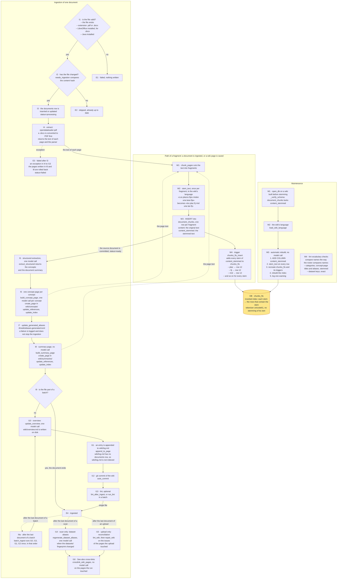

# Ingestion nodes

This document is the writing diagram of the wiki: the steps that turn a source
document into wiki pages, and the steps that put each fragment of text into the
index. Its sibling, [`query_nodes.md`](query_nodes.md), is the reading diagram:
the steps that answer a question.

Each step is a node with an identifier, for example `I4`. The identifier of a
node appears in three places:

1. In this document, in the diagram and in the node table.
2. In the code, as the first argument of the tracing call that marks the node:
   `tracing.node("I4", W)` or `tracing.mark("I1", W, ...)`
   (`base/domain/tracing.py`).
3. In the trace of a run, as the name of the record that the tracing call writes.
   The trace is written only when the environment variable `WIKI_TRACE` is set to
   `1`; the records go to `<workspace>/.llmwiki/traces/spans.jsonl`.

The test `tests/unit/test_flow_nodes.py` compares the node table of this document
with the tracing calls of the code. A node added, renamed or removed in the code
and not in this document, or in this document and not in the code, fails the
test.

## 1. The diagram

The ingestion of one document runs `ingest_file`
(`base/domain/ingestion/pipeline.py`). The ingestion of a batch runs
`ingest_file` once per document, and then runs the closing steps once
(`batch_ingest`, `base/domain/ingestion/batch.py`). Every wiki page that the
ingestion writes goes through the same fragment path as the source document. The
example values of W2 and W4 were computed with the Spanish Snowball stemmer, the
stemmer of a wiki whose language is Spanish.

The node identifiers follow five groups:

- I1 to I13: the ingestion of one document.
- I14 to I16: the passes that run after the documents of a scan or of an upload.
- E1 to E4: the end state of one document.
- W1 to W4: the path of one fragment, from the text to the index.
- M1 to M4: maintenance of a wiki built before stemming existed.

DB is the index, `chunks_fts`. The index is the point where the writing diagram
ends and the reading diagram begins: the reading diagram searches the index at
nodes Q6 and Q8 of [`query_nodes.md`](query_nodes.md).

## 2. The node table

The columns of the node table:

- **ID**: the identifier of the node. The identifier is the same string as the
  first argument of the tracing call that marks the node.
- **What it does**.
- **Code**: the file and the symbol that run the node. A symbol is a function, a
  class or a constant defined in that file. The table never cites a line
  number, because a line number changes when the code above the line changes.
- **Trace**: the attributes of the record that the node writes in the trace,
  without the prefix `llmwiki.`. A node that writes no record says
  `none: <reason>`. A node whose record has no attribute says `no attributes`.
- **Status**: `code` for a node that the code runs; `design` for a node that
  exists only in a design.

| ID | What it does | Code | Trace | Status |
|---|---|---|---|---|
| I1 | Checks that the file exists, that the extension of the file is supported, and that LibreOffice (for a `.docx`) and Java are installed; a failure returns before any write | `base/domain/ingestion/pipeline.py`, `_ingest_file` | `answer`, `error` | code |
| I2 | Compares the content hash of the file with the stored content hash; an unchanged file is skipped | `base/domain/ingestion/detector.py`, `needs_ingestion`; `base/domain/ingestion/pipeline.py`, `_ingest_file` | `answer`, `content_hash` | code |
| I3 | Inserts or updates the row of the document in `documents`, with `status='processing'` | `base/domain/ingestion/pipeline.py`, `_ingest_file` | `document_id`, `relative_path` | code |
| I4 | Extracts the text of each page of the document with opendataloader-pdf; a `.docx` is converted to PDF first | `base/domain/ingestion/extractor.py`, `extract`; `base/domain/ingestion/pipeline.py`, `_ingest_file` | `page_count`, `parser` | code |
| I5 | One model call returns the concepts of the document and the summary of the document | `base/domain/ingestion/wiki_generator.py`, `extract_structured`; `base/domain/ingestion/pipeline.py`, `_ingest_file` | `concepts` | code |
| I6 | For each concept, one model call writes the concept page; `create_page` stores the concept page, and the text of the concept page goes to W1; the references and `wiki/index.md` are updated | `base/domain/ingestion/wiki_generator.py`, `build_concept_page`; `base/domain/ingestion/pipeline.py`, `_ingest_file` | `concept_count`, `pages` | code |
| I7 | Adds the names and the aliases of the concepts to `.llmwiki/aliases.generated.toml`; a failure is logged and does not stop the ingestion | `base/domain/ingestion/alias_generation.py`, `update_generated_aliases`; `base/domain/ingestion/pipeline.py`, `_ingest_file` | `collisions`, or `error` | code |
| I8 | Builds the summary page without a model call; `create_page` stores the summary page, and the text of the summary page goes to W1 | `base/domain/ingestion/wiki_generator.py`, `build_summary_page`; `base/domain/ingestion/pipeline.py`, `_ingest_file` | `page` | code |
| I9 | Chooses between the single-file path and the batch path | `base/domain/ingestion/pipeline.py`, `_ingest_file` | `answer` | code |
| I9a | In a batch, each document ends at E4 right after I9; after the last document, `batch_ingest` runs I10, I13, I11 and I12 once, in that order | `base/domain/ingestion/batch.py`, `batch_ingest` | `ingested` | code |
| I10 | One model call rewrites `wiki/overview.md` | `base/domain/ingestion/wiki_generator.py`, `update_overview`; `base/domain/ingestion/pipeline.py`, `_ingest_file`; `base/domain/ingestion/batch.py`, `batch_ingest` | no attributes | code |
| I11 | Appends the entry of the ingestion to `wiki/log.md`; `wiki/log.md` has no row in `documents`, so `wiki/log.md` is not indexed | `base/domain/tools/wiki_fs.py`, `append_to_page`; `base/domain/ingestion/pipeline.py`, `_ingest_file`; `base/domain/ingestion/batch.py`, `batch_ingest` | no attributes | code |
| I12 | Commits the wiki to the git repository of the wiki | `base/domain/tools/git_ops.py`, `auto_commit`; `base/domain/ingestion/pipeline.py`, `_ingest_file`; `base/domain/ingestion/batch.py`, `batch_ingest` | no attributes | code |
| I13 | Runs the lint checks and appends the result of the lint checks to `wiki/log.md`, when the caller requests the lint checks | `base/domain/lint/runner.py`, `lint_wiki`; `base/domain/ingestion/pipeline.py`, `_ingest_file`; `base/domain/ingestion/batch.py`, `batch_ingest` | `issues` | code |
| I14 | After the documents of a scan: regenerates the aliases of the dataset terms with one model call, only when the fingerprint of `datasets/` changed | `base/domain/ingestion/alias_generation.py`, `regenerate_dataset_aliases`; `base/domain/ingestion/pipeline.py`, `scan_and_ingest` | `regenerated`, or `error` | code |
| I15 | After the documents of an upload: runs the lint checks, and repairs the issues of the pages the upload touched | `base/domain/lint/runner.py`, `lint_wiki`; `base/domain/repair/runner.py`, `repair_wiki`; `base/services/ingest.py`, `ingest_uploads` | `mode`, `pages`, `issues`, `fixable` | code |
| I16 | After a scan or an upload: adds "See also" cross-links to the pages the run touched, with no model call | `base/domain/ingestion/pipeline.py`, `crosslink_wiki_pages`, `scan_and_ingest`; `base/services/ingest.py`, `ingest_uploads` | `touched`, `linked` | code |
| E1 | Failed validation: the result is `failed`, and nothing was written | `base/domain/ingestion/pipeline.py`, `ingest_file` | `message` | code |
| E2 | Unchanged file: the result is `skipped` | `base/domain/ingestion/pipeline.py`, `ingest_file` | no attributes | code |
| E3 | An exception in I4 to I13: the pages written in I6 and I8 are rolled back, and the row of the document in `documents` gets `status='failed'` | `base/domain/ingestion/pipeline.py`, `_ingest_file`, `_rollback_wiki_pages` | `error`, `rolled_back` | code |
| E4 | The result is `ingested` | `base/domain/ingestion/pipeline.py`, `ingest_file` | no attributes | code |
| W1 | Cuts the extracted text of a document, or the text of a wiki page, into fragments | `base/domain/ingestion/chunker.py`, `chunk_pages`; `base/domain/ingestion/pipeline.py`, `_ingest_file`; `base/domain/tools/wiki_fs.py`, `_insert_chunks` | `document_id`, `fragments` | code |
| W2 | Stems each fragment with the Snowball stemmer of the wiki's language | `base/domain/text/stemming.py`, `stem_text`; `base/domain/ingestion/pipeline.py`, `_ingest_file`; `base/domain/tools/wiki_fs.py`, `_insert_chunks` | `document_id`, `fragments`, `language` | code |
| W3 | Inserts one row per fragment into `document_chunks`, with the original text in `content` and the stemmed text in `content_stemmed` | `base/domain/ingestion/pipeline.py`, `_ingest_file`; `base/domain/tools/wiki_fs.py`, `_insert_chunks` | `document_id`, `fragments` | code |
| W4 | The insert trigger adds every stem of `content_stemmed` to `chunks_fts`, tagged with the `rowid` of the row | `database/sqlite_schema.sql`, `chunks_fts_insert` | none: an SQL trigger, which runs inside SQLite | code |
| DB | The inverted index: from each stem to the rows that contain the stem. Tokenizer `unicode61`, with no stemming of its own | `database/sqlite_schema.sql`, `chunks_fts` | none: a table | code |
| M1 | On opening a wiki built before stemming existed, the schema guard finds that `document_chunks` lacks `content_stemmed` | `base/domain/tools/db.py`, `open_db`, `_verify_schema` | none: runs when a database is opened, outside any traced run | code |
| M2 | Finds the wiki's language from the path of the database | `base/domain/wiki_settings.py`, `load_wiki_language` | none: runs when a database is opened, outside any traced run | code |
| M3 | Rebuilds the index with no model call, and logs one warning | `base/domain/tools/db.py`, `_rebuild_stemmed_index` | none: runs when a database is opened, outside any traced run | code |
| M4 | The lint vocabulary checks compare names the way the coverage roster compares names | `base/domain/lint/checks.py`, `vocabulary_check` | none: one lint check among many; the result of `vocabulary_check` is part of the `issues` of I13 and I15 | code |

## 3. A wiki page saved from the chat

A wiki page saved from the chat, or rewritten by a repair, goes through
`_insert_chunks` (`base/domain/tools/wiki_fs.py`). `_insert_chunks` runs W1, W2
and W3 for the text of the wiki page, and records W1, W2 and W3 in the trace.
