# Ingestion nodes

This document is the writing diagram of the wiki: the steps that turn a source
document into wiki pages, and the steps that put each fragment of text into the
index. Its sibling, [`query_nodes.md`](query_nodes.md), is the reading diagram:
the steps that answer a question.

Each step is a node with an identifier, for example `I_EXTRACT`. The identifier of a
node appears in three places:

1. In this document, in the diagram and in the node table.
2. In the code, as the first argument of the tracing call that marks the node:
   `tracing.node("I_EXTRACT", W)` or `tracing.mark("I_VALIDATE", W, ...)`
   (`base/domain/tracing.py`).
3. In the trace of a run, as the name of the record that the tracing call writes.
   The trace is written only when the environment variable `WIKI_TRACE` is set to
   `1`; the records go to `<workspace>/.llmwiki/traces/spans.jsonl`.

The test `tests/unit/test_flow_nodes.py` compares the node table of this document
with the tracing calls of the code. A node added, renamed or removed in the code
and not in this document, or in this document and not in the code, fails the
test.

## 1. The diagram

The ingestion of one document runs `ingest_file`
(`base/domain/ingestion/pipeline.py`). The ingestion of a batch runs
`ingest_file` once per document, and then runs the closing steps once
(`batch_ingest`, `base/domain/ingestion/batch.py`). Every wiki page that the
ingestion writes goes through the same fragment path as the source document. The
example values of W_STEM and W_FTS_TRIGGER were computed with the Spanish Snowball stemmer, the
stemmer of a wiki whose language is Spanish.

The identifier of a node is the letter of its group and a name of what the
node does. A decision node is named by its question: `I_IS_CHANGED` asks
whether the file changed. The node identifiers follow five groups:

- **I**: the ingestion of one document (`I_VALIDATE` to `I_LINT`), the images
  of one document (`I_IMAGES_KEPT`, `I_IMAGE_DESCRIBED`, `I_IMAGE_SKIPPED`,
  inside `I_EXTRACT`), and the passes that run after the documents of a scan
  or of an upload (`I_DATASET_ALIASES`, `I_UPLOAD_REPAIR`, `I_CROSSLINKS`).
- **E**: the end state of one document (`E_INVALID`, `E_UNCHANGED`,
  `E_ROLLED_BACK`, `E_INGESTED`).
- **W**: the path of one fragment, from the text to the index (`W_CHUNK`,
  `W_STEM`, `W_INSERT_CHUNKS`, `W_FTS_TRIGGER`).
- **M**: maintenance of a wiki built before stemming existed (`M_LACKS_STEMS`,
  `M_LANGUAGE`, `M_REBUILD_INDEX`, `M_LINT_NAMES`).

DB is the index, `chunks_fts`. The index is the point where the writing diagram
ends and the reading diagram begins: the reading diagram searches the index at
nodes Q_SEARCH_WIKI and Q_SEARCH_SOURCES of [`query_nodes.md`](query_nodes.md).

```mermaid
flowchart TD
    subgraph I["Ingestion of one document"]
        I_VALIDATE{"I_VALIDATE · is the file valid?<br/>– the file exists<br/>– extension .pdf or .docx<br/>– LibreOffice installed, for .docx<br/>– Java installed"}
        I_IS_CHANGED{"I_IS_CHANGED · has the file changed?<br/>needs_ingestion compares the content hash"}
        I_DOCUMENT_ROW["I_DOCUMENT_ROW · the documents row is inserted or updated<br/>status=processing"]
        I_EXTRACT["I_EXTRACT · extract: opendataloader-pdf<br/>a .docx is converted to PDF first<br/>returns the text of each page and the parser"]
        I_CONCEPTS["I_CONCEPTS · structured extraction, one model call<br/>extract_structured returns the concepts<br/>and the document summary"]
        I_CONCEPT_PAGES["I_CONCEPT_PAGES · one concept page per concept<br/>build_concept_page, one model call per concept<br/>create_page in wiki/concepts/<br/>update_references, update_index"]
        I_ALIASES["I_ALIASES · update_generated_aliases<br/>.llmwiki/aliases.generated.toml<br/>a failure is logged and does not stop the ingestion"]
        I_SUMMARY_PAGE["I_SUMMARY_PAGE · summary page, no model call<br/>build_summary_page<br/>create_page in wiki/summaries/<br/>update_references, update_index"]
        I_IS_BATCH{"I_IS_BATCH · is the file part of a batch?"}
        I_BATCH_END["I_BATCH_END · after the last document of a batch<br/>batch_ingest runs I_OVERVIEW, I_LINT, I_LOG, I_COMMIT once, in that order"]
        I_OVERVIEW["I_OVERVIEW · overview: update_overview, one model call<br/>wiki/overview.md is written on disk"]
        I_LOG["I_LOG · an entry is appended to wiki/log.md<br/>append_to_page<br/>wiki/log.md has no documents row, so wiki/log.md is not indexed"]
        I_COMMIT["I_COMMIT · git commit of the wiki<br/>auto_commit"]
        I_LINT["I_LINT · lint, optional<br/>lint_after_ingest, or run_lint in a batch"]
        E_INVALID["E_INVALID · failed, nothing written"]
        E_UNCHANGED["E_UNCHANGED · skipped, already up to date"]
        E_ROLLED_BACK["E_ROLLED_BACK · failed after I_DOCUMENT_ROW<br/>an exception between I_EXTRACT and I_LINT<br/>the pages written in I_CONCEPT_PAGES and I_SUMMARY_PAGE are rolled back<br/>status=failed"]
        E_INGESTED["E_INGESTED · ingested"]
        I_IMAGES_KEPT["I_IMAGES_KEPT · images kept for the document<br/>count and total bytes"]
        I_IMAGE_DESCRIBED["I_IMAGE_DESCRIBED · one image described<br/>one vision-model call, or a description reused<br/>from the cache of the images folder"]
        I_IMAGE_SKIPPED["I_IMAGE_SKIPPED · one image not described<br/>too_small, decorative, duplicate, over_limit or failed"]
        I_DATASET_ALIASES["I_DATASET_ALIASES · scan only: dataset aliases<br/>regenerate_dataset_aliases, one model call<br/>when the datasets/ fingerprint changed"]
        I_UPLOAD_REPAIR["I_UPLOAD_REPAIR · upload only: reconciliation<br/>lint_wiki, then repair_wiki on the issues<br/>of the pages the upload touched"]
        I_CROSSLINKS["I_CROSSLINKS · See also cross-links<br/>crosslink_wiki_pages, no model call<br/>on the pages the run touched"]

        I_VALIDATE -->|no| E_INVALID
        I_VALIDATE -->|yes| I_IS_CHANGED
        I_IS_CHANGED -->|no| E_UNCHANGED
        I_IS_CHANGED -->|yes| I_DOCUMENT_ROW --> I_EXTRACT
        I_CONCEPTS --> I_CONCEPT_PAGES --> I_ALIASES --> I_SUMMARY_PAGE --> I_IS_BATCH
        I_IS_BATCH -->|no| I_OVERVIEW
        I_IS_BATCH -->|yes, the document ends| E_INGESTED
        E_INGESTED -.->|after the last document of a batch| I_BATCH_END
        I_BATCH_END --> I_OVERVIEW
        I_OVERVIEW --> I_LOG --> I_COMMIT --> I_LINT
        I_LINT -->|single file| E_INGESTED
        E_INGESTED -.->|after the last document of a scan| I_DATASET_ALIASES --> I_CROSSLINKS
        E_INGESTED -.->|after the last document of an upload| I_UPLOAD_REPAIR --> I_CROSSLINKS
        I_EXTRACT --> I_IMAGES_KEPT --> I_IMAGE_DESCRIBED
        I_IMAGES_KEPT --> I_IMAGE_SKIPPED
        I_EXTRACT -.->|exception| E_ROLLED_BACK
    end

    subgraph W["Path of a fragment: a document is ingested, or a wiki page is saved"]
        W_CHUNK["W_CHUNK · chunk_pages cuts the text into fragments"]
        W_STEM["W_STEM · stem_text, once per fragment, in the wiki's language<br/>«Los plazos fijos rinden una tasa fija»<br/>becomes «los plaz fij rind una tas fij»"]
        W_INSERT_CHUNKS["W_INSERT_CHUNKS · INSERT into document_chunks, one row per fragment<br/>content: the original text<br/>content_stemmed: the stemmed text"]
        W_FTS_TRIGGER["W_FTS_TRIGGER · trigger chunks_fts_insert<br/>adds every stem of content_stemmed to chunks_fts<br/>– plaz → row 12<br/>– fij → row 12<br/>– rind → row 12<br/>– and so on for every stem"]
        W_CHUNK --> W_STEM --> W_INSERT_CHUNKS --> W_FTS_TRIGGER
    end

    I_EXTRACT -->|the text of each page| W_CHUNK
    W_INSERT_CHUNKS -->|the source document is committed, status=ready| I_CONCEPTS
    I_CONCEPT_PAGES -.->|the page text| W_CHUNK
    I_SUMMARY_PAGE -.->|the page text| W_CHUNK

    IDX[("DB · chunks_fts<br/>inverted index: each stem → the rows that contain the stem<br/>tokenizer unicode61, no stemming of its own")]
    W_FTS_TRIGGER --> IDX

    subgraph M["Maintenance"]
        M_LACKS_STEMS["M_LACKS_STEMS · open_db on a wiki built before stemming<br/>_verify_schema: document_chunks lacks content_stemmed"]
        M_LANGUAGE["M_LANGUAGE · the wiki's language<br/>load_wiki_language"]
        M_REBUILD_INDEX["M_REBUILD_INDEX · automatic rebuild, no model call<br/>1. ADD COLUMN content_stemmed<br/>2. stem_text on every row<br/>3. recreate chunks_fts and its triggers<br/>4. rebuild the index<br/>5. log one warning"]
        M_LINT_NAMES["M_LINT_NAMES · lint vocabulary checks<br/>compare names the way the roster compares names:<br/>– categories, concept-page titles and aliases, stemmed<br/>– dataset keys, exact"]
        M_LACKS_STEMS --> M_LANGUAGE --> M_REBUILD_INDEX
    end
    M_REBUILD_INDEX --> IDX

    classDef db fill:#fde68a,stroke:#b45309,color:#1f2937
    class IDX db
```

## 2. The node table

The columns of the node table:

- **ID**: the identifier of the node. The identifier is the same string as the
  first argument of the tracing call that marks the node.
- **What it does**.
- **Code**: the file and the symbol that run the node. A symbol is a function, a
  class or a constant defined in that file. The table never cites a line
  number, because a line number changes when the code above the line changes.
- **Trace**: the attributes of the record that the node writes in the trace,
  without the prefix `llmwiki.`. A node that writes no record says
  `none: <reason>`. A node whose record has no attribute says `no attributes`.
- **Status**: `code` for a node that the code runs; `design` for a node that
  exists only in a design.

| ID | What it does | Code | Trace | Status |
|---|---|---|---|---|
| I_VALIDATE | Checks that the file exists, that the extension of the file is supported, and that LibreOffice (for a `.docx`) and Java are installed; a failure returns before any write | `base/domain/ingestion/pipeline.py`, `_ingest_file` | `answer`, `error` | code |
| I_IS_CHANGED | Compares the content hash of the file with the stored content hash; an unchanged file is skipped | `base/domain/ingestion/detector.py`, `needs_ingestion`; `base/domain/ingestion/pipeline.py`, `_ingest_file` | `answer`, `content_hash` | code |
| I_DOCUMENT_ROW | Inserts or updates the row of the document in `documents`, with `status='processing'` | `base/domain/ingestion/pipeline.py`, `_ingest_file` | `document_id`, `relative_path` | code |
| I_EXTRACT | Extracts the text of each page of the document with opendataloader-pdf; a `.docx` is converted to PDF first | `base/domain/ingestion/extractor.py`, `extract`; `base/domain/ingestion/pipeline.py`, `_ingest_file` | `page_count`, `parser` | code |
| I_CONCEPTS | One model call returns the concepts of the document and the summary of the document | `base/domain/ingestion/wiki_generator.py`, `extract_structured`; `base/domain/ingestion/pipeline.py`, `_ingest_file` | `concepts` | code |
| I_CONCEPT_PAGES | For each concept, one model call writes the concept page; `create_page` stores the concept page, and the text of the concept page goes to W_CHUNK; the references and `wiki/index.md` are updated | `base/domain/ingestion/wiki_generator.py`, `build_concept_page`; `base/domain/ingestion/pipeline.py`, `_ingest_file` | `concept_count`, `pages` | code |
| I_ALIASES | Adds the names and the aliases of the concepts to `.llmwiki/aliases.generated.toml`, and names each new alias for a curator to review; a failure is logged and does not stop the ingestion | `base/domain/ingestion/alias_generation.py`, `update_generated_aliases`; `base/domain/ingestion/pipeline.py`, `_ingest_file` | `new_aliases`, or `error` | code |
| I_SUMMARY_PAGE | Builds the summary page without a model call; `create_page` stores the summary page, and the text of the summary page goes to W_CHUNK | `base/domain/ingestion/wiki_generator.py`, `build_summary_page`; `base/domain/ingestion/pipeline.py`, `_ingest_file` | `page` | code |
| I_IS_BATCH | Chooses between the single-file path and the batch path | `base/domain/ingestion/pipeline.py`, `_ingest_file` | `answer` | code |
| I_BATCH_END | In a batch, each document ends at E_INGESTED right after I_IS_BATCH; after the last document, `batch_ingest` runs I_OVERVIEW, I_LINT, I_LOG and I_COMMIT once, in that order | `base/domain/ingestion/batch.py`, `batch_ingest` | `ingested` | code |
| I_OVERVIEW | One model call rewrites `wiki/overview.md` | `base/domain/ingestion/wiki_generator.py`, `update_overview`; `base/domain/ingestion/pipeline.py`, `_ingest_file`; `base/domain/ingestion/batch.py`, `batch_ingest` | no attributes | code |
| I_LOG | Appends the entry of the ingestion to `wiki/log.md`; `wiki/log.md` has no row in `documents`, so `wiki/log.md` is not indexed | `base/domain/tools/wiki_fs.py`, `append_to_page`; `base/domain/ingestion/pipeline.py`, `_ingest_file`; `base/domain/ingestion/batch.py`, `batch_ingest` | no attributes | code |
| I_COMMIT | Commits the wiki to the git repository of the wiki | `base/domain/tools/git_ops.py`, `auto_commit`; `base/domain/ingestion/pipeline.py`, `_ingest_file`; `base/domain/ingestion/batch.py`, `batch_ingest` | no attributes | code |
| I_LINT | Runs the lint checks and appends the result of the lint checks to `wiki/log.md`, when the caller requests the lint checks | `base/domain/lint/runner.py`, `lint_wiki`; `base/domain/ingestion/pipeline.py`, `_ingest_file`; `base/domain/ingestion/batch.py`, `batch_ingest` | `issues` | code |
| I_DATASET_ALIASES | After the documents of a scan: regenerates the aliases of the dataset terms with one model call, only when the fingerprint of `datasets/` changed | `base/domain/ingestion/alias_generation.py`, `regenerate_dataset_aliases`; `base/domain/ingestion/pipeline.py`, `scan_and_ingest` | `regenerated`, or `error` | code |
| I_UPLOAD_REPAIR | After the documents of an upload: runs the lint checks, and repairs the issues of the pages the upload touched | `base/domain/lint/runner.py`, `lint_wiki`; `base/domain/repair/runner.py`, `repair_wiki`; `base/services/ingest.py`, `ingest_uploads` | `mode`, `pages`, `issues`, `fixable` | code |
| I_CROSSLINKS | After a scan or an upload: adds "See also" cross-links to the pages the run touched, with no model call | `base/domain/ingestion/pipeline.py`, `crosslink_wiki_pages`, `scan_and_ingest`; `base/services/ingest.py`, `ingest_uploads` | `touched`, `linked` | code |
| I_IMAGES_KEPT | The images kept for a document: count and total bytes; recorded when the document has kept images | `base/domain/ingestion/describe.py`, `describe_images` | `count`, `total_bytes` | code |
| I_IMAGE_DESCRIBED | One image described: the vision-model call, or the reuse of a description file whose `image_sha256` and `prompt_sha256` match; the call carries the image, and the trace of the request keeps a reference to the image instead (`wrap_openai`) | `base/domain/ingestion/describe.py`, `describe_images`, `call_vision`; `base/domain/tracing.py`, `wrap_openai` | `file`, `image_sha256`, `model`, `cached`, `tokens_input`, `tokens_output`, or `error` | code |
| I_IMAGE_SKIPPED | One image not described, with its reason: `too_small`, `decorative`, `duplicate`, `over_limit` or `failed` | `base/domain/ingestion/describe.py`, `describe_images` | `file`, `reason` | code |
| E_INVALID | Failed validation: the result is `failed`, and nothing was written | `base/domain/ingestion/pipeline.py`, `ingest_file` | `message` | code |
| E_UNCHANGED | Unchanged file: the result is `skipped` | `base/domain/ingestion/pipeline.py`, `ingest_file` | no attributes | code |
| E_ROLLED_BACK | An exception between I_EXTRACT and I_LINT: the pages written in I_CONCEPT_PAGES and I_SUMMARY_PAGE are rolled back, and the row of the document in `documents` gets `status='failed'` | `base/domain/ingestion/pipeline.py`, `_ingest_file`, `_rollback_wiki_pages` | `error`, `rolled_back` | code |
| E_INGESTED | The result is `ingested` | `base/domain/ingestion/pipeline.py`, `ingest_file` | no attributes | code |
| W_CHUNK | Cuts the extracted text of a document, or the text of a wiki page, into fragments | `base/domain/ingestion/chunker.py`, `chunk_pages`; `base/domain/ingestion/pipeline.py`, `_ingest_file`; `base/domain/tools/wiki_fs.py`, `_insert_chunks` | `document_id`, `fragments` | code |
| W_STEM | Stems each fragment with the Snowball stemmer of the wiki's language | `base/domain/text/stemming.py`, `stem_text`; `base/domain/ingestion/pipeline.py`, `_ingest_file`; `base/domain/tools/wiki_fs.py`, `_insert_chunks` | `document_id`, `fragments`, `language` | code |
| W_INSERT_CHUNKS | Inserts one row per fragment into `document_chunks`, with the original text in `content` and the stemmed text in `content_stemmed` | `base/domain/ingestion/pipeline.py`, `_ingest_file`; `base/domain/tools/wiki_fs.py`, `_insert_chunks` | `document_id`, `fragments` | code |
| W_FTS_TRIGGER | The insert trigger adds every stem of `content_stemmed` to `chunks_fts`, tagged with the `rowid` of the row | `database/sqlite_schema.sql`, `chunks_fts_insert` | none: an SQL trigger, which runs inside SQLite | code |
| DB | The inverted index: from each stem to the rows that contain the stem. Tokenizer `unicode61`, with no stemming of its own | `database/sqlite_schema.sql`, `chunks_fts` | none: a table | code |
| M_LACKS_STEMS | On opening a wiki built before stemming existed, the schema guard finds that `document_chunks` lacks `content_stemmed` | `base/domain/tools/db.py`, `open_db`, `_verify_schema` | none: runs when a database is opened, outside any traced run | code |
| M_LANGUAGE | Finds the wiki's language from the path of the database | `base/domain/wiki_settings.py`, `load_wiki_language` | none: runs when a database is opened, outside any traced run | code |
| M_REBUILD_INDEX | Rebuilds the index with no model call, and logs one warning | `base/domain/tools/db.py`, `_rebuild_stemmed_index` | none: runs when a database is opened, outside any traced run | code |
| M_LINT_NAMES | The lint vocabulary checks compare names the way the coverage roster compares names | `base/domain/lint/checks.py`, `vocabulary_check` | none: one lint check among many; the result of `vocabulary_check` is part of the `issues` of I_LINT and I_UPLOAD_REPAIR | code |

## 3. A wiki page saved from the chat

A wiki page saved from the chat, or rewritten by a repair, goes through
`_insert_chunks` (`base/domain/tools/wiki_fs.py`). `_insert_chunks` runs W_CHUNK, W_STEM
and W_INSERT_CHUNKS for the text of the wiki page, and records W_CHUNK, W_STEM and W_INSERT_CHUNKS in the trace.
