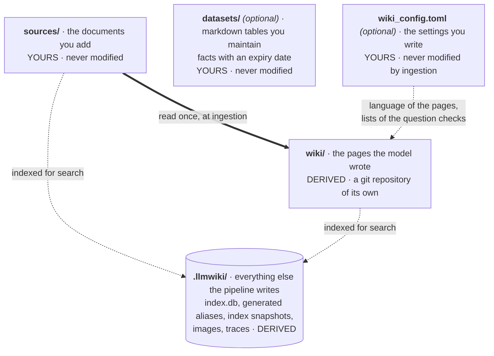
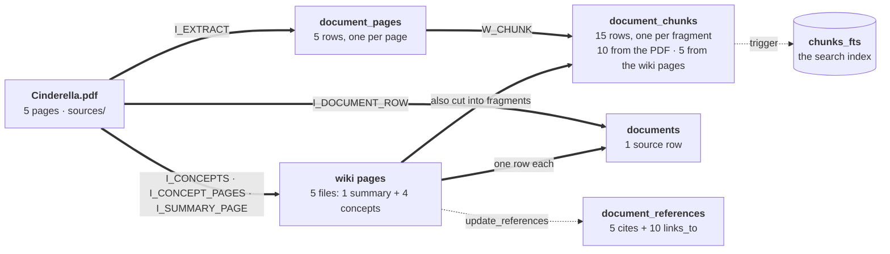
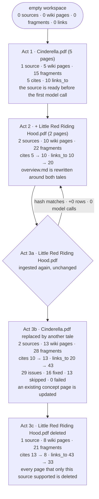

# Ingestion Walkthrough

This document follows what the system builds when you add a document to a wiki.
Its companion, [`query_walkthrough.md`](query_walkthrough.md), follows what happens
when you ask the wiki a question.

Each step of an ingestion is a **node**: a named step that the code records in the
trace. The **trace** is the log of the nodes of a run, written when the
environment variable `WIKI_TRACE` is `1`. The node table of
[`ingestion_nodes.md`](ingestion_nodes.md) gives, for each node, the file and the
symbol that run it.

**Audience.** A programmer who reads Python and SQL and has never seen this
project. Every term from language models and search, and every term this
project made up, is defined where it first appears.

**How it is arranged.** First, the pieces of a wiki and the reasons behind them.
Then five acts follow a small collection of documents through its life:

1. Act 1: a first document arrives.
2. Act 2: a second document joins it.
3. Act 3a: one document is ingested again, unchanged.
4. Act 3b: one document is replaced.
5. Act 3c: one document is deleted.

The last section covers wikis that also hold facts with an expiry date, such as
exchange rates.

**The figures are measured.** The figures of the acts come from the
[appendix](ingestion_walkthrough_appendix.md). The script
`scripts/capture_ingestion_walkthrough.py` writes the appendix by running the
pipeline with a real model:

```bash
uv run python scripts/capture_ingestion_walkthrough.py
```

The search figures come from a **fixture**: a wiki stored with the tests, in
`tests/fixtures/wikis/fairy-tales`. Two tests read the figures back out of this
document and compare them with their origin:

- `tests/unit/test_docs_ingestion_acts.py` compares the figures of the acts with
  the appendix.
- `tests/unit/test_docs_walkthrough_figures.py` compares the search figures with
  the fixture database.

A failing test means that the origin changed and this document did not.

**Two kinds of figure behave differently.** Row counts, fragment counts and link
counts come from code. A change in one of them means that the pipeline changed.
Page names and page text come from a model, and they differ between two runs over
the same documents. The section [Derived is not
repeatable](#derived-is-not-repeatable) describes the consequences.

## Where the idea comes from

Andrej Karpathy described the pattern of this project in a [short public
note](https://x.com/karpathy/status/2039805659525644595). A language model reads
each document once and writes the result as markdown pages. The model keeps those
pages up to date as documents arrive, and questions are answered from the pages.

The usual alternative is **RAG**, *retrieval-augmented generation*. A RAG system
keeps the documents cut into fragments. When a question arrives, the system
retrieves the fragments that look most relevant and pastes them into the prompt of
the model. Nothing is kept between questions. Every question reads the same
fragments again, and the answer depends on which fragments the search returned.

Karpathy's pattern moves the reading to the moment a document arrives. His three
layers map onto this project as follows:

| Karpathy's layer | In this project |
|---|---|
| Raw sources, never modified | `sources/`: the documents you add |
| The wiki, written by the model | `wiki/`: the generated markdown pages |
| The schema: the conventions the model follows | the prompts, and the optional `wiki_config.toml` of each wiki |

§1 of the [Programmer Manual](manual/programmer_manual.md) lists the proposals of
the note. It marks each proposal as built, partly built or not built. This
document shows how the first row of the table becomes the second.

## The pieces, before anything moves

A **workspace** is one wiki: one folder that holds everything about one subject.
Two workspaces share nothing.



The three inputs on top belong to you, and ingestion never writes to them. The web
interface edits `wiki_config.toml` only when you change a setting on one of its
screens. `wiki/` and `.llmwiki/` are derived from the inputs. The section [What is
truth and what is derived](#what-is-truth-and-what-is-derived) states how far that
holds.

### The documents a wiki accepts

The accepted formats are defined once, in `base/domain/ingestion/formats.py`:

| Format | How the text is obtained | Needs |
|---|---|---|
| `.pdf` | opendataloader-pdf extracts the text of each page | Java |
| `.docx`, `.doc`, `.odt`, `.rtf` | LibreOffice converts the file to PDF, and then the PDF path runs | LibreOffice and Java |
| `.md`, `.txt` | the file is read directly | nothing |
| `.png`, `.jpg`, `.jpeg`, `.webp`, `.gif` | one page whose text is the description that a vision model writes | a vision model |

A PDF with no text layer, such as a scanned page, needs **OCR** (optical character
recognition: reading the text off the image of a page). The setting `OCR_ENGINE`
chooses `none`, `tesseract` or `vision`. With `none`, the ingestion of a scanned
PDF fails with a message that names the setting.

### `wiki_config.toml`

`wiki_config.toml` is the one file where you tell the system something that the
documents cannot tell it. Every section is optional, and a wiki with no file runs
on defaults. `base/domain/chat/config.py` reads these sections:

| Section | What it sets |
|---|---|
| `[wiki] language` | `"en"` or `"es"`: the language of the generated pages and of the answers, whatever the language of the documents |
| `[assistant]` | the system prompt of the chat, and the suggested questions |
| `[pre_retrieval]` | whether the code checks a question and chooses its context before the model sees it; also `min_coverage` and `condense_question` |
| `[fuera_de_alcance]` | the **blacklist**: the terms this wiki refuses to answer about |
| `[alias_datos]` | other names for things the wiki covers |
| `[falsos_sinonimos]` | pairs of names that must never be treated as the same thing |
| `[intent]` | the expressions of a question about the whole wiki, and of a request for a calculation |
| `[verify]` | the thresholds of the sentence verifier and of the figure check |
| `[images]` | `ignore = true` leaves the images of the documents out of the wiki |

The chat has three modes. In the **agent mode**, the model searches the wiki with
tools. In the **pre-retrieval mode**, the code checks the question and chooses the
context before calling the model. In the **streaming mode**, the answer appears as
the model writes it. The blacklist, the aliases and the false synonyms act only in
the pre-retrieval mode. The [query walkthrough](query_walkthrough.md) describes
those checks. They appear here because ingestion writes one of their inputs: the
generated aliases.

### The lists, on the finance demo

The demo `examples/finanzas-argentinas` has the three lists that a person writes:

```toml
[fuera_de_alcance]
terminos = ["cedear", "cedears", "cripto", "bitcoin"]

[alias_datos]
dolar = ["billete verde", "divisa"]

[falsos_sinonimos]
cedear = ["accion", "acciones"]
"Plazo fijo UVA" = ['UVA']
```

Each list holds something that the documents cannot provide:

- **`billete verde`** is street slang for the US dollar. No document of the demo
  contains it, so no reading of the documents would find it.
- **`cripto`, `bitcoin`** name subjects the wiki has nothing to say about. A
  corpus never states what it lacks.
- **`cedear` and `acciones`** record a judgement. A CEDEAR is a certificate over
  the share of a foreign company. An answer about local shares would read
  correctly and be wrong.

**The blacklist matches literally.** It matches whole words, and an entry of
several words matches as a contiguous phrase. It does not reduce words to their
root. Measured on the demo:

| Question | Last node | What decided |
|---|---|---|
| «¿qué es una cripto?» | `R_BLACKLIST` | the blacklist: `cripto` is listed |
| «¿qué son las criptos?» | `R_NOT_IN_ROSTER` | the coverage roster: `criptos` is not listed, and the question names no covered subject |
| «¿conviene comprar cedears?» | `R_BLACKLIST` | the blacklist: `cedears` is listed |
| «¿a cuánto está el billete verde?» | `Q_SHOWN` | your `[alias_datos]`: the question reaches the dollar data |
| «¿qué es Aluar?» | `Q_SHOWN` | the generated aliases: `ALUA = ["Aluar"]` |

The **coverage roster** is the closed list of the names this wiki considers itself
to cover. It holds the titles of the concept pages, the categories of the datasets
and the aliases of both. The second row shows two checks that usually agree. The
blacklist misses `criptos`, and the roster refuses the question one step later. If
the roster of a wiki contained `criptos`, the gap in the blacklist would let the
question through.

**Aliases come from two places.**

- **The generated aliases.** During ingestion, the model returns the other names
  that each document uses for each concept. The pipeline writes them to
  `.llmwiki/aliases.generated.toml`. The demo's file holds 41 entries, for example
  `"ALUA" = ["Aluar"]`.
- **Your aliases.** `[alias_datos]` holds the names that no document uses.

`vocabulary.merge_aliases` adds the two lists together when the configuration is
read. The keys are compared lowercased, without accents and with `_` read as a
space. Your spelling of a key is the one kept.

**`[falsos_sinonimos]` deletes.** After the merge, every alias listed there is
removed from the result, whichever file supplied it. The deletion runs each time
the wiki opens. A new pair therefore takes effect without ingesting anything
again.

**The generated file accumulates.** Each ingestion reads the file and adds the
aliases of the document just processed. It drops blank aliases, repeated aliases
and aliases equal to their own concept, and writes the file back. The pipeline
never judges whether an alias is false. It prints every new alias for review, as
in Act 1:

```text
⚠️ New aliases to review in the vocabulary screen: «Cinderwench» → «Cinderella»; «fairy» → «Fairy godmother»; …
```

An entry whose concept page no longer exists stays in the file. Lint reports the
entry as `vocab_stale` (lint is described in [Lint and repair](#lint-and-repair)),
and removing it is a manual edit. Deleting a source is the exception:
`delete_source` removes the generated aliases of the pages it deletes (Act 3c).

### Derived is not repeatable

Model calls write the pages with a temperature between 0.2 and 0.4
(`base/domain/ingestion/wiki_generator.py`). The **temperature** sets how freely the
model chooses among likely words. Above zero, two calls with the same input can
return different text. Generating the same wiki twice from the same documents
gives three results:

- **the same knowledge**, because the documents did not change;
- **different wording**, because every sentence is written again;
- often **different concept pages**, because the model decides which subjects
  deserve a page.

The third result also changes the coverage roster, because the concept-page titles
are part of it. Suppose one run names a page *Stepmother* and another run names it
*Prince*. A question that names only the subject of that page can pass the
coverage check on one run and be refused on the other. A question that also names
a subject with a stable page is not affected.

Two practical consequences follow. A sentence you edited by hand is lost when the
page is generated again, because nothing distinguishes your sentence from the
model's. A page name or a link count that you quoted elsewhere can change on the
next generation.

### Three files in `wiki/` are not pages

- **`index.md`** is the catalogue: one line per page, grouped into summaries and
  concepts, each line with a one-sentence description.
- **`overview.md`** is the narrative of the whole collection. The model rewrites
  it on every ingestion.
- **`log.md`** is the dated record of what was ingested and when. The pipeline
  only appends to it.

None of the three files has a row in the `documents` table (`FIXED_PAGES`,
`base/services/wiki.py`). They are not cut into fragments and not in the search
index, so a search never returns them. A question about the whole collection reads
`overview.md` and `index.md` straight from disk.

### The web interface

Ingestion is driven from the web interface (`web/`). These screens take part:

- **Ingestar** (Ingest): add documents and follow the pages as they appear.
- **Mantener** (Maintain): lint and repair the whole wiki, rebuild the index and
  delete marked pages.
- **Vocabulario** (Vocabulary): review the generated aliases and edit the lists.
- **Historial** (History): see each commit of the wiki and return to an earlier
  commit.

## What ingesting one file does

### Compile once, read many times

A **source** is one of the documents you add. Its text stays true: the plot of a
tale does not change next week. That property makes the central decision safe. A
source is read once, at ingestion, and **compiled** into two kinds of page:

- one **summary page** per document, which says what the file contains;
- usually several **concept pages**, one per subject that the model finds worth a
  page.

A concept page belongs to its subject, not to one document. Several documents can
therefore add to the same concept page. Answering a question means reading these
pages, and the source stays underneath as the evidence that a citation points to.

The sources are read again in one situation: when the pages do not answer a
covered question. The query walkthrough calls that path **Tier 2**: the
pre-retrieval mode searches the fragments of the sources. The agent mode can search
the same fragments with a tool. Neither path compiles a page again.

### The steps

`ingest_file` (`base/domain/ingestion/pipeline.py`) runs the ingestion of one file.
The nodes form four stages:

| Stage | Nodes | What happens | Model call |
|---|---|---|---|
| Take it in | `I_VALIDATE`, `I_IS_CHANGED`, `I_DOCUMENT_ROW`, `I_EXTRACT` | check the file and its format; skip an unchanged file; insert or update its `documents` row with `status='processing'`; extract the text of each page | no, except for the descriptions of images |
| Publish the source | `W_CHUNK`, `W_STEM`, `W_INSERT_CHUNKS`, `W_FTS_TRIGGER` | cut the text into fragments, reduce their words to roots, write the fragments; the row becomes `status='ready'` | no |
| Write the wiki | `I_CONCEPTS`, `I_CONCEPT_PAGES`, `I_ALIASES`, `I_SUMMARY_PAGE`, `I_OVERVIEW` | one call returns the concepts and the summary; one call per concept writes its page; record the aliases; build the summary page; rewrite `overview.md` | yes, at `I_CONCEPTS`, `I_CONCEPT_PAGES` and `I_OVERVIEW` |
| Close | `I_LOG`, `I_COMMIT`, `I_LINT` | append to `log.md`; commit the wiki; run lint if the caller asked for it | no |

The summary page makes no model call of its own. `build_summary_page` lays out the
document summary and the concept names, which `I_CONCEPTS` already obtained from
the model. It adds the structure: the headings, the file name, the page count, the
date and the links to the concept pages.

`needs_ingestion` (`base/domain/ingestion/detector.py`) decides whether a file
*changed*. It first compares the **mtime**, the modification time that the
filesystem keeps. Only when the mtime differs, it compares the **hash**: a
fingerprint computed from the bytes of the file, stored in
`documents.content_hash`. A file whose last ingestion failed is always ingested
again. The cause of the failure can be a missing program, which the user installs
without touching the file.

### The source is published before the model runs

The source row becomes `status='ready'` when its fragments are written. That
happens before `I_CONCEPTS` makes the first model call. Every query filters out
the rows with `status='processing'`. From that moment, the source can be searched
and cited.

**What happens when a step fails.** An exception between `I_EXTRACT` and `I_LINT`
ends the document in `E_ROLLED_BACK`. `_rollback_wiki_pages` undoes the pages that
`I_CONCEPT_PAGES` and `I_SUMMARY_PAGE` wrote. The source row becomes
`status='failed'`, with the error message, and the next scan tries the file again.
As a result, a wiki page never points at a source that was not stored, and a
failed document leaves no half-written page.

**A reply that is not valid JSON gets one retry.** `I_CONCEPTS` asks the model for
the concepts and the summary in JSON, a structured text format. When the reply is
not valid JSON, `I_CONCEPTS_RETRY` sends the reply back and asks for the JSON
alone. A second invalid reply fails the document, with no page written.

### Images

A PDF can contain illustrations. The steps for images run inside `I_EXTRACT`:

1. `I_IMAGES_KEPT`: the images of the document are stored in its folder under
   `.llmwiki/`. An image is stored as JPEG when the JPEG weighs less than 70 % of
   the PNG.
2. `I_IMAGE_DESCRIBED`: a vision model describes each image, or a stored
   description is reused.
3. `I_IMAGE_SKIPPED`: an image is not described, with the reason. The reasons are
   too small, decorative, duplicate, over the limit of the document, and failed.

The design is in [`design_image_handling.md`](design_image_handling.md).

### Several files at once

A batch runs `ingest_file` once per document (`batch_ingest`,
`base/domain/ingestion/batch.py`). After the last document, it runs `I_OVERVIEW`,
`I_LINT`, `I_LOG` and `I_COMMIT` once.

An upload, a scan of `sources/` and a regeneration of the summaries end with two
more passes. Both passes cover only the pages that the run touched:

- `I_FINAL_REVIEW` runs lint and then repair.
- `I_CROSSLINKS` adds "See also" links between those pages, with no model call.

A scan also runs `I_DATASET_ALIASES` when the wiki has a `datasets/` folder. The
section [Wikis whose facts change](#wikis-whose-facts-change) describes that pass.

### Lint and repair

Ingestion cannot always leave the wiki consistent. A page can cite a source that
changed after the page was written. Two concept pages drawn from the same source
can end up with no link between them.

**Lint** finds those problems and reports them, and it never writes. **Repair**
fixes the problems that lint found, when the fix needs no judgement. Three words of
these passes appear in the acts:

- **stale**: a page whose cited source changed after the page was written.
- **missing xref**: two pages that cite the same source and do not link to each
  other. *Xref* is short for cross-reference.
- **skipped**: a problem that repair did not fix, always with the reason.

The repair after an ingestion runs with no model unless you ask for one. Two
repairs need a model, `stale` and `missing_concept`. The other repairs are plain
code. Two controls supply a model:

- **The checkbox** «Reparación completa con el modelo, más lenta» («Full repair with
  the model, slower»), on the Ingest screen, supplies a model to the repair of that
  ingestion.
- **The button** «Revisar y reparar la wiki» («Run Wiki Lint & Repair»), on the
  Maintain screen, runs lint and repair with a model over every page.

The pass after an ingestion examines only the pages that the ingestion touched.
Those pages are the summary pages of the ingested documents and every page that
cites them. The cost of the pass therefore does not grow with the size of the
wiki.

## What is truth and what is derived

The sources are the truth. `wiki/` and `.llmwiki/index.db` are derived from them.
Deleting either one loses no knowledge that the sources do not hold.

**Rebuilding the index costs no model call.** `reindex_from_disk`
(`base/domain/tools/reindex.py`) writes a fresh `index.db` from the files. The same
extractor reads the sources again, and the pages are read back from `wiki/`. The
pages are not written again, so their wording stays. Five values cannot come from
the files, and the rebuild resets them:

- the version of each document;
- the number of each document;
- the creation dates;
- the `stale_since` marks;
- the sentence verifications of the pages.

**Generating the pages again costs model calls.** Ingesting the sources again is a
new compilation. The wording changes, and the concept pages may get other names.
Every sentence edited by hand is lost.

### The database

`.llmwiki/index.db` is a **SQLite** database: a complete relational database in one
ordinary file, with no server. A workspace can therefore be copied or zipped like
any other folder. Act 1 writes these rows:



- **`documents`**: one row for every file the system knows, source or wiki page.
  The column `source_kind` says which. A source row also stores the hash and the
  mtime of the file.
- **`document_pages`**: one row per page of a source, with the text that the
  extractor obtained. Extraction is the slowest step after the model calls. The
  result is therefore stored, and a rebuild of the wiki does not repeat it.
- **`document_chunks`**: one row per fragment, for sources and wiki pages alike.
  Each fragment records its document, its page and a **breadcrumb**: the path of
  headings above the fragment, joined with ` > ` — `Cinderella > Definition`.
- **`chunks_fts`**: the search index over the fragments. No step writes to it.
  Triggers keep it in step with `document_chunks`.
- **`document_references`**: one row per link from one document to another.

Every child table declares `ON DELETE CASCADE` against its document. Deleting a
document row therefore deletes its pages, fragments and links in the same
statement, and the triggers remove its index entries.

### Fragments

A page is the wrong unit to search, because a page is too long to be a precise
answer. `chunk_pages` (`base/domain/ingestion/chunker.py`) adds paragraphs to a
fragment until the next paragraph would exceed about 512 **tokens**. A token is the
unit that a language model counts, roughly a piece of a word. The project estimates
the tokens of a text as its number of characters divided by four. That ratio is a
common approximation for English and Spanish.

A fragment always ends where a paragraph ends. The exception is a single paragraph
too long for one fragment, which is cut. A fragment can start by repeating whole
paragraphs from the end of the previous fragment, up to 128 tokens. That way, a
definition just before a boundary travels with the text that uses it.

### Roots, and the search index

The search index uses **FTS5**, the full-text search of SQLite. A full-text index
maps each word to the fragments that contain it. A search therefore reads only the
matching fragments, and it can rank them in the same lookup.

Before a fragment is indexed, `stem_text` (`W_STEM`) reduces each word to its
**root**. It uses the Snowball stemmer of the wiki's language: *slippers* and
*slipper* both become `slipper`. The fragment keeps its original text in `content`
and the reduced text in `content_stemmed`. The index reads `content_stemmed`. Its
tokenizer, `unicode61`, folds case and accents and reduces nothing on its own. The
search reduces the question the same way.

In the fixture wiki, whose 37 fragments come from three tales and the pages written
from them, the index maps `slipper` to eight fragments:

```text
slipper  →  53, 9, 16, 56, 8, 52, 1, 5
```

These numbers are `rowid`s, the internal row numbers of the fragments. They are
listed best first, which the index does only when the query asks for a ranking. The
other twenty-nine of the thirty-seven fragments do not contain the root, and the
search never reads them.

Two fragments of this corpus write only *slippers*, never the singular. A search for
`slipper` returns both. A scan with `LIKE '%slipper %'` would miss them. The index
therefore has a second advantage besides speed: the question does not have to use
the same word form as the corpus.

The index answers *which* fragments. A join with the tables supplies the text and
its origin:

```sql
SELECT d.filename, c.page, c.header_breadcrumb, c.content
  FROM chunks_fts
  JOIN document_chunks c ON c.rowid = chunks_fts.rowid
  JOIN documents       d ON d.id    = c.document_id
 WHERE chunks_fts MATCH '"slipper"'
 ORDER BY chunks_fts.rank;
```

The first three rows are `glass-slipper.md`, `Cinderella.pdf` and `cinderella.md`:
two wiki pages and one source in one ranked list. The index does not separate the
two layers. The code that searches makes that choice, with a filter on
`source_kind`.

### The ranking

**BM25** fills the column `rank`. BM25 is the standard relevance formula of
full-text search. It scores how strongly a fragment is about the query, not only
whether the fragment contains the query. The values are negative, and the best
match is the most negative. The project uses the formula without tuning. For
`slipper`:

| fragment | mentions | tokens | rank |
|---:|---:|---:|---:|
| 53 | 5 | 313 | −2.27 |
| 9 | 7 | 519 | −2.16 |
| 16 | 3 | 294 | −2.10 |
| 56 | 2 | 297 | −1.81 |
| 8 | 3 | 471 | −1.73 |
| 52 | 2 | 395 | −1.71 |
| 1 | 1 | 411 | −1.10 |
| 5 | 1 | 481 | −1.00 |

That last column shows three behaviours.

**Each repetition of a word adds less.** Among fragments of about 500 tokens, going
from one mention to three (5 → 8) improves the rank by 0.73. Going from three
mentions to seven (8 → 9) improves it by only 0.43.

**Length counts.** Fragments 1 and 5 mention the word once each, and the shorter
one, fragment 1, ranks higher. Fragments 56 and 52 mention it twice each, and again
the shorter one, fragment 56, ranks higher.

**Rare words count more.** A word present in most fragments does not tell the
fragments apart. BM25 therefore gives it less weight than the rarer words of the
same question. The table cannot show this behaviour, because the query
here is a single word.

**BM25 matches words, not meanings.** The pipeline has no **embeddings**. An
embedding is a list of numbers that a model computes for a text. Texts about similar
subjects get similar numbers, and most RAG systems search that way. Here, a fragment
that says the same thing in other words is not ranked low: the search does not
return it at all. Two parts of the design compensate:

- an alias connects the word a reader uses to the word the corpus uses;
- a concept page is written with the ordinary words for its subject.

The index is declared **external-content**: it keeps no copy of the text and reads
the text from `document_chunks`. With that arrangement, the index does not see the
writes to the table. Three triggers, on insert, update and delete, keep the index in
step.

### Links between documents

`document_references` holds two kinds of link. Act 1 writes, among others:

| `reference_type` | from | to |
|---|---|---|
| `cites` | `wiki/concepts/cinderella.md` | `Cinderella.pdf` |
| `links_to` | `wiki/concepts/cinderella.md` | `wiki/concepts/fairy-godmother.md` |

A `cites` row points down, at the source that a page was written from. A `links_to`
row points sideways, at a related page. The two kinds answer different questions:
*where did this come from?* and *what else should I read?*. Act 3c shows that they
also behave differently when a source is deleted. Because the links are stored in a
table, the origin of a page is an ordinary SQL query.

### History and rollback

`wiki/` is a git repository with no remote. The pipeline commits after every
ingestion, edit and deletion, so each page has a history. After each commit, the
pipeline also stores a copy of the index in `.llmwiki/snapshots/`.

The History screen returns a wiki to an earlier commit with `revert_wiki`
(`base/domain/rollback/revert.py`). `revert_wiki` checks out the pages of that
commit and commits them as a new commit. No history is rewritten, and the revert can
itself be reverted. The index follows the pages: the stored copy when one exists,
and `reindex_from_disk` otherwise.

If `git` is not installed, the commit is skipped with a warning. `WIKI_AUTOCOMMIT=0`
turns the commits off.

## The sequence, end to end

Each act states the workspace as the act leaves it, and the one thing that the act
demonstrates. The acts use a temporary corpus of two tales, which the capture
script builds and deletes. The fixture wiki of the search section holds three tales.
A figure per document, such as the 10 fragments of `Cinderella.pdf`, holds in both
corpora. A total for the whole corpus does not.



## Act 1 — one document lands in an empty wiki

Ingesting `Cinderella.pdf` (5 pages) produces **5 wiki pages**: 1 summary and 4
concepts (cinderella, fairy-godmother, glass-slipper and stepmother). It also
produces **15 fragments**, **5 `cites`** and **10 `links_to`**. It writes
`index.md`, `overview.md`, `log.md` and one git commit (`2174cc4`). The [appendix,
Act 1](ingestion_walkthrough_appendix.md#act-1--first-document) has the full
inventory.

The point of this act is the order of the steps. The source row is
`status='ready'` once its fragments are written, before `I_CONCEPTS` makes the first
model call. If a model call fails later, `E_ROLLED_BACK` undoes the pages and marks
the source `failed`. The next scan tries the file again. A page never points at a
source that was not stored.

The same act writes the first generated aliases. `I_ALIASES`
(`update_generated_aliases`, `base/domain/ingestion/alias_generation.py`) writes:

```toml
[alias_datos]
"Cinderella" = ["Cinderwench"]
"Fairy godmother" = ["fairy"]
"Stepmother" = ["mother-in-law"]
```

These entries are useful because of *when* they are written. A question about
«Cinderwench» has to reach the Cinderella page, and only the tale connects the two
names. Ingestion makes the connection once, while the tale is open. The connection
then holds for every later question.

The act also prints the topics of each page for review. A **topic** is a subject
that the model attaches to a page, and the coverage check counts topics. The
pipeline lists first the topics that are not in the text of the document. Those
topics are the most likely to be generic:

```text
⚠️ Of those, not in the text of the document (review them first): «kindness and virtue rewarded», «stepfamily cruelty», …
```

The topics are kept. Removing a generic topic would also refuse a question that the
wiki covers through that topic.

The lint and repair after the ingestion report 11 issues. Repair fixes 6
`missing_xref` in code. It skips 5 `unverified_pages`, which are advisory findings
with no automatic repair. An **unverified page** is a page whose sentences the
sentence verifier has not checked yet.

## Act 2 — a second document meets a non-empty wiki

Ingesting `Little Red Riding Hood.pdf` adds **5 wiki pages** (10 in total) and **7
fragments** (22 in total). It moves `cites` **5 → 10** and `links_to` **10 → 20**
([appendix, Act 2](ingestion_walkthrough_appendix.md#act-2--second-document)).

**`overview.md` is rewritten from scratch.** The new overview describes both tales
together, instead of two summaries joined end to end. A product of the first
ingestion is therefore revised by the second. Karpathy's note describes this effect
as a wiki that improves as documents are added.

The cross-links show the limit of that effect. `missing_xref_check` pairs the pages
that cite the *same* source, and two unrelated tales share no source. All the links
that repair added join the new pages to each other, and none reaches a Cinderella
page. A concept page links across documents only when a later document also covers
its subject. Act 3b shows that case.

**What `I_OVERVIEW` sends.** `update_overview` builds its prompt from three inputs:

| Input | Grows with the wiki? | Measured on the shipped demos |
|---|---|---|
| the current `overview.md`, without front matter | slowly: the instruction asks for three to five paragraphs | about 930 tokens (fairy tales) and 1,280 (finance) |
| the summary of the new document | no | one document's summary |
| the names of every concept page | linearly | about 51 tokens for 13 concepts (fairy tales), 58 for 19 (finance) |

The pages themselves are not sent. The prompt of one ingestion therefore grows in a
straight line with the number of concept pages, at about four tokens per name.
Summed over N ingestions, the names add up quadratically, but no single call carries
that sum. The choice has a limit. A detail of an earlier document that never reached
`overview.md` cannot return to it, because no rewrite reads the pages.

## Act 3a — ingesting an unchanged document again

Ingesting `Little Red Riding Hood.pdf` again, with no change on disk, logs one line.
Every counter of the
[appendix](ingestion_walkthrough_appendix.md#act-3a--re-ingest-unchanged) moves by
**+0**:

```text
⏭ Little Red Riding Hood.pdf — already up to date
```

`needs_ingestion` decides before any expensive step runs. Ingestion is
**idempotent**: running it twice leaves the workspace as running it once did, with
zero model calls. A scan of `sources/` is therefore safe to repeat. A folder with
nine unchanged files and one new file costs the model calls of one document.

## Act 3b — the source changed on disk

The capture script overwrites `Cinderella.pdf` with the bytes of `The Sleeping
Beauty in the Wood.pdf`, and keeps the file name. Change detection compares hashes
and never looks at *what* changed. For the pipeline, this act is a user who replaces
a document with a revised edition.

The source row stays at **2 rows, +0**: the existing row is updated, not duplicated.
Its pages and fragments are deleted and inserted again. The wiki grows to **13
pages** and **28 fragments**. The links move to `cites` **10 → 13** and `links_to`
**20 → 43** ([appendix, Act
3b](ingestion_walkthrough_appendix.md#act-3b--edited-source-re-ingested)).

**An existing concept page is updated, not duplicated.** The new tale also has a
fairy godmother, and the log says so:

```text
💡 Updating concept: Fairy godmother
💡 Creating concept: Spindle
💡 Creating concept: Ogre
💡 Creating concept: Sleeping Beauty
```

For an existing concept, `build_concept_page` uses its update prompt, which receives
the current page, instead of the create prompt.

The pages that Act 1 wrote from the old `Cinderella.pdf` keep citing the same source
row, which now holds the new tale. Repair therefore links them to the new pages,
because they cite the same source. Those links make up most of the 23 new
`links_to` rows.

The lint and repair report **29 issues, 16 fixed, 13 skipped, 0 failed**. The skips
have three reasons:

- **3 `stale`.** The concept pages cinderella, glass-slipper and stepmother were
  written from the old content, and their source changed after them. Repairing a
  stale page means writing its text again. That needs a model, and the pass had
  none:

  ```text
  ⏭️ [stale] skipped: 'stale' repair needs a model, and none was supplied. To fix these: tick "Full repair with the model, slower" before ingesting, or press "Run Wiki Lint & Repair" in Maintain to sweep the whole wiki now.
  ```

- **2 `missing_xref`, `already linked`.** Lint lists every issue before repair
  starts. An earlier fix of the same run had already added the link.
- **8 `unverified_pages`.** Advisory findings with no automatic repair.

The message of a skip names the missing piece in terms that the reader knows. It
names the checkbox and the button of the interface. Repair spent no model call that
nobody asked for, and it wrote no text to hide a gap.

The fairy-godmother page is not stale: its update rewrote it after the source
changed. Only the three concept pages that the new tale did not mention stay
behind.

## Act 3c — deleting a source

Deleting `Little Red Riding Hood.pdf` logs:

```text
Deleted source 'Little Red Riding Hood.pdf'; deleted 5 derived wiki page(s)
```

The pages (`little-red-riding-hood`, `wolf`, `red-riding-hood-cloak` and
`bobbin-latch`) are deleted, together with the summary page. Each of them cited only
the deleted source, so nothing was left to support them. `cites` drops **13 → 8**
and `links_to` drops **43 → 33** ([appendix, Act
3c](ingestion_walkthrough_appendix.md#act-3c--source-deleted)).

`delete_source` (`base/domain/tools/deletion.py`) decides the fate of each page by
what else the page cites:

| The page | What happens |
|---|---|
| the summary page of the source | deleted |
| a page whose only cited source is the deleted one | deleted, unless the page was saved from the chat: the conversation is another origin |
| a page that also cites another source | kept, marked stale (`stale_since`), and stripped of every citation of the deleted source |

After the deletion, no markdown file of `wiki/` links to anything deleted: not to a
deleted page, not to the source file, not to its images. The generated aliases of
the deleted pages are removed too. `wiki_config.toml` is not edited, because you
wrote it. The deletion returns the titles that the file still names, for you to
decide. No model is called, and the whole deletion is one commit.

The two kinds of link behave differently. A `cites` row of the deleted source goes
with the source row, through `ON DELETE CASCADE`. A `links_to` row between two
surviving pages stays. `links_to` therefore falls only by the links into the deleted
pages.

**Two meanings of stale.** The kept pages of the third row carry the mark
`stale_since`: a source they were written from is gone. Lint's `stale` check of Act
3b means something else: a source the page cites changed after the page.

| | Lint's `stale` check | The `stale_since` mark |
|---|---|---|
| What happened | a cited source was **edited** after the page | a cited source was **deleted** |
| How it is found | a comparison of timestamps, while the source still exists | a column of the page row, set at deletion |
| Repair | automatic for summary pages: generate them again from the source | none: the page needs review |

A page with `stale_since` keeps working: it is searched, cited and used in answers.
Three outcomes settle the mark:

1. A later ingestion rewrites the page, and the rewrite clears the mark.
2. The Maintain screen deletes the marked pages together.
3. You leave the page as it is.

The appendix of this act also lists `index.db-wal` and `index.db-shm`. They form
SQLite's **write-ahead log**: SQLite appends the pending changes to a companion file
and folds them in afterwards. An abandoned transaction therefore leaves the database
whole. The two files are bookkeeping, not data.

## Verify it yourself

`uv run python scripts/capture_ingestion_walkthrough.py` runs the five acts against a
fresh temporary workspace. It writes
[`docs/ingestion_walkthrough_appendix.md`](ingestion_walkthrough_appendix.md). The
model names the concepts differently on every run. A new appendix therefore makes
`tests/unit/test_docs_ingestion_acts.py` fail until this document quotes the new
figures.

## Wikis whose facts change

Everything above describes any wiki. This section describes the wikis that also hold
facts with an expiry date.

An encyclopedia of fairy tales is finished once written. An exchange rate is out of
date by the afternoon. Compiled into a page, a rate becomes a sentence such as «the
dollar is worth 1180», and the sentence loses the date of the rate. A wiki with facts
like these therefore keeps them in a second kind of input, which ingestion never
touches.

**Datasets** (`datasets/`) are markdown tables. The **front matter** of a file is the
YAML block between two `---` lines at its top. In a dataset, the front matter
declares the category, the key column, the metrics, the date of the values (`as_of`)
and the source. The demo's `datasets/dolar.md`:

```text
---
type: dataset
categoria: dolar
formato: largo
clave: tipo
metricas: { compra: "ARS", venta: "ARS" }
as_of: 2026-06-25
fuente: ambito.com
# Advisory attributes (finance overlay) — reference only (no gain formula).
disponibilidad: inmediata
moneda: ARS
---

| tipo    | compra | venta |
|---------|--------|-------|
| Oficial | 1000   | 1050  |
| Blue    | 1220   | 1240  |
| MEP     | 1180   | 1185  |
| CCL     | 1190   | 1196  |
| Tarjeta | 1300   | 1365  |
```

A dataset is **never ingested**. It has no row in `documents`, no fragment and no
page. `LocalMarkdownSource` (`base/domain/datasets/source.py`) reads the file when a
question needs it. Refreshing a rate means overwriting the file, and nothing has to
be ingested again.

| | Sources (`sources/`) | Datasets (`datasets/`) |
|---|---|---|
| What they hold | text that stays true | facts with an expiry date, each with its date |
| When they are read | once, at ingestion | when a question needs them |
| What happens to them | compiled into fragments and pages | nothing: the file is read and the row taken out |
| In the database | one row per document | no row |
| To refresh one | ingest it again; the pages built from it go stale | overwrite the file |
| The question they answer | «what **is** X?» | «what is X **worth today**?» |

### What a `datasets/` folder adds at ingestion

Two passes write generated aliases:

- **The concept-alias pass** (`I_ALIASES`) runs for every document of any wiki.
- **The dataset-alias pass** (`I_DATASET_ALIASES`, `regenerate_dataset_aliases`)
  runs once per scan, and only when `datasets/` exists.

A fingerprint of the dataset vocabulary gates the second pass
(`.llmwiki/dataset_aliases.fingerprint`). A scan of an unchanged `datasets/` folder
therefore makes no model call. The appendix of the acts never shows that file,
because the tale corpus has no `datasets/` folder.

The pipeline prints every new alias for review and drops none. Deciding that an
alias is false belongs to the curator. For example, a model that reads a document
about CEDEARs could propose `"CEDEAR" = ["Acciones locales"]`. «Acciones locales» is
a different instrument, with its own page. The curator rejects the pair in the
Vocabulary screen, which writes it under `[falsos_sinonimos]`.

Lint's `vocabulary` check reports one alias mapped to two concepts as
`vocab_ambiguous`. The demo had one case: «UVA» was an alias of both «Plazo fijo UVA»
and «Unidad de Valor Adquisitivo». «UVA» is the unit, not another name of the
deposit. `wiki_config.toml` therefore lists `"Plazo fijo UVA" = ['UVA']` under
`[falsos_sinonimos]`.

### The figures of an answer come from code

A tool reads a value out of a dataset and returns it unchanged. When a figure has to
be calculated, Python does the arithmetic, and the code appends the result to the
answer as a table. The model explains the figures in words.

After the answer, the figure check (`C_FIGURES`, `base/domain/chat/figure_check.py`)
compares every figure of the model's prose with the numbers the model received. The
web interface marks in red a figure that no number supports. The [query
walkthrough](query_walkthrough.md) and [`query_nodes.md`](query_nodes.md) follow that
path.

The arithmetic lives in the engine (`base/domain/extensions/finance_argentina/`), not
in the workspace. The extension activates only when the `datasets/` folder of a
workspace satisfies the manifest that the extension declares (`activate`,
`agent_tool.py`). A workspace therefore holds data only: markdown, a TOML file and a
SQLite database. Opening a wiki that someone sent you runs none of their code.

## Where to go next

- [`query_walkthrough.md`](query_walkthrough.md): what happens when someone asks the
  wiki a question.
- [`ingestion_nodes.md`](ingestion_nodes.md) and [`query_nodes.md`](query_nodes.md):
  every node, with its code and its trace record.
- [`sqlite_data_dictionary.md`](sqlite_data_dictionary.md): every column of every
  table.
- [`manual/workflows.md`](manual/workflows.md): the contract of each operation.
- [`contracts/chat-retrieval.md`](contracts/chat-retrieval.md): the retrieval
  contract, which the code has to satisfy.
