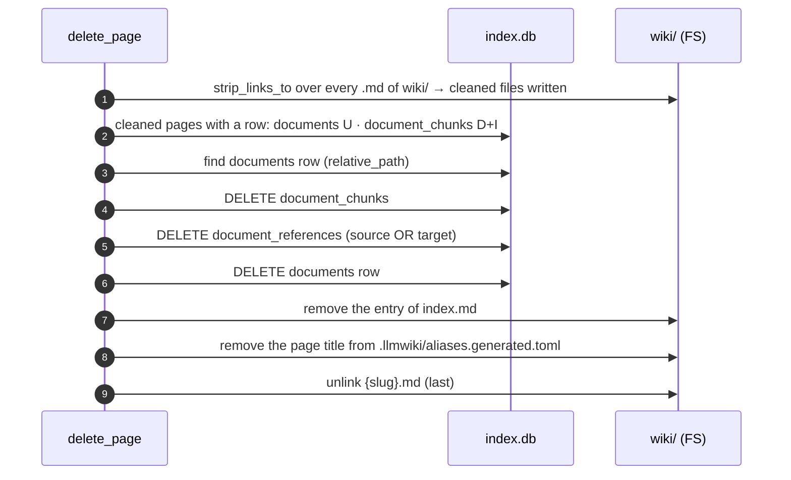

# 6.10 Wiki page deletion ✅

> §6.10 of the [LLMWiki Programmer Manual](../programmer_manual.md). The index
> for §6, with the quick-status table, the table-write matrix and the template
> every workflow file follows, is [§6 Workflows](../workflows.md).



**Entry:** `delete_page()` — `base/domain/tools/wiki_fs.py:delete_page`

```python
delete_page(db_path, workspace, dir_path="/wiki/concepts/", slug="snow-white")
# True if page existed; removes file, DB row, chunks, references,
# strips every link to it from every markdown file of wiki/, removes its entry
# from index.md and its generated aliases.
```

What `delete_page` cleans up atomically:

| Layer                 | What is removed                                                                       |
| --------------------- | ------------------------------------------------------------------------------------- |
| Disk                  | The `.md` file                                                                        |
| `documents`           | The row for this page                                                                 |
| `document_chunks`     | All FTS5 units (and via trigger, `chunks_fts`)                                        |
| `document_references` | All edges where this page is source **or** target                                     |
| Every `.md` of `wiki/` | Links to this page, by `strip_links_to`: a list item that is only the link is removed whole, a section left empty goes with its heading, a link in prose becomes its text. `index.md`, `overview.md` and `log.md` included |
| `index.md`            | The entry of the page                                                                 |
| `.llmwiki/aliases.generated.toml` | The generated aliases of the page title (the chat's coverage rule reads them) |

**Triggers:**

- `repair_orphan` (§6.2) — automatic repair path.
- **Delete** in the toolbar of the **Read** tab: `POST /w/{wiki_id}/delete/{page}` → `services.wiki.delete_page`, after the confirmation "Delete the page “…”?" (see §7.2). The service commits the deletion (`delete: <page>`), so **History** (§7.7) can undo it. The fixed pages `index`, `overview` and `log` have no **Delete** button and the route refuses them.

**Gaps:** none.
