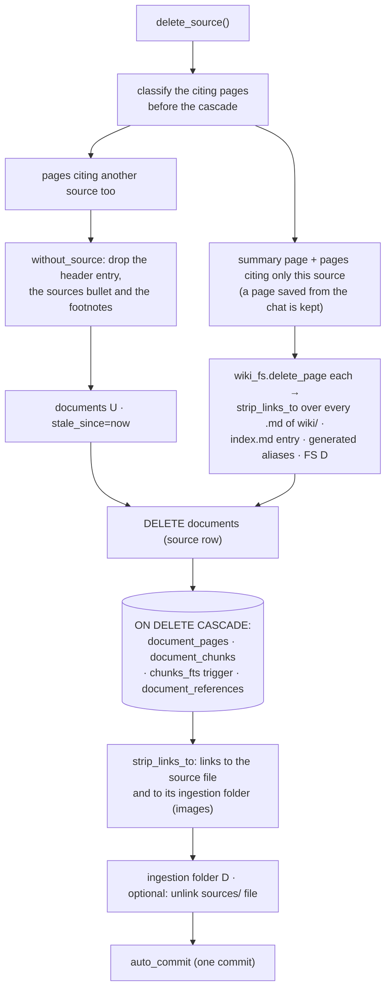

# 6.9 Source deletion ✅

> §6.9 of the [LLMWiki Programmer Manual](../programmer_manual.md). The index
> for §6, with the quick-status table, the table-write matrix and the template
> every workflow file follows, is [§6 Workflows](../workflows.md).



**Entry:** `delete_source()` — `base/domain/tools/deletion.py:delete_source`

```python
delete_source(db_path, workspace, doc_id, *, also_delete_file=False)
# -> SourceDeletion(action="deleted" | "failed", ..., filename, deleted_pages, stale_pages,
#                   edited_pages, config_mentions, file_removed)
```

**What it solves.** A deleted source used to leave behind the concept pages that
existed only because of it. On the fairy-tale demo, deleting `La Cenicienta.pdf`
deleted only `summaries/la-cenicienta.md`; `concepts/cenicienta.md` and
`concepts/hada-madrina.md`, which cite no other source, stayed, and the chat still
found them. A file removed from `sources/` by hand changed nothing at all: the index
kept the source and its fragments, and the chat still answered from them.

**The citing pages.** Before the FK cascade removes `document_references`, the pages
with a `cites` edge to the source are classified by what else they cite:

- **Deleted:** the summary page (`source_document_id == doc_id`) and every page whose
  only cited source is this one. A page whose header `sources` names `chat` (saved
  from a conversation) is kept: the conversation is another origin.
- **Kept:** a page that cites another source too. `without_source` removes every
  citation of the deleted file from it — the entry of the header field `sources`,
  the bullet of the sources section («## Sources», «## Fuentes») and the footnotes
  `[^N]: <file>` with their markers — and the page is marked
  `stale_since = datetime('now')`. The text the source contributed stays: a concept
  page is written by accumulation, so no record says which sentence came from which
  source. The page's generated aliases stay for the same reason. Both are the
  documented limit (`ROADMAP.md`, README «Limitations»).

**No link to anything deleted.** `wiki_fs.delete_page` runs `strip_links_to` over
every `.md` file of `wiki/` on disk — concept, summary and chat pages, `index.md`,
`overview.md`, `log.md` — without relying on the `links_to` edges of the index. A
list item that is only the link (`- [Cenicienta](cenicienta.md)`, the `index.md`
form `- [T](x.md) — description`) and an image are removed whole; a section left
empty by those removals goes with its heading; any other link becomes its text.
After the source row is deleted, the same pass removes the links to the source
file (`sources/<file>`) and to its ingestion folder `.llmwiki/cache/local/<doc id>/`
(the converted PDF and the kept images), and the folder is deleted. The page
«Delete» button (§6.10) uses the same `delete_page`.

**Generated aliases.** `delete_page` removes the deleted page's title from
`.llmwiki/aliases.generated.toml` (`remove_generated_aliases`). The chat merges that
file into the coverage rule (`chat/config.py`), so «¿Quién es el hada?» passed the
rule after `hada-madrina.md` was gone. `wiki_config.toml` is written by hand and
is never edited: the deleted titles and paths it still names are returned in
`config_mentions` and shown to the user.

**A file removed by hand.** `remove_missing_sources(db_path, workspace)` runs
`delete_source` (with `also_delete_file=False`) for every `source` row whose file
is no longer in `sources/`. It runs:

- when the user chooses the wiki (`web/routes/picker.py:wiki_home` with `opened`),
  skipped while an operation holds the wiki's lock; the result is kept on
  `OpenWiki.removed` and shown on every screen by a dismissible notice
  (`_removed_sources_notice.html`);
- at the start of a scan (`services.ingest.scan_sources`);
- before a rebuild of the index, on the old index (`reindex._delete_missing_sources`).

With nothing missing it writes nothing and makes no commit: one existence test per
source row. With no old index (a lost index) there is nothing to compare: the
rebuild registers the pages as they are, and their citation of the missing file is
not recorded.

File removal is opt-in (`also_delete_file=True`). The whole deletion is one
`auto_commit(workspace, "delete source: {filename}")`, so the History tab can go back
to the point before it: the pages, the index and the generated aliases return.
`sources/` is never touched by that return, so a file the deletion removed from
`sources/` does not come back; the next opening of the wiki would delete the source
again. The confirmation of the return names those files
(`revert.missing_sources`, `RevertPlan.missing_sources`), so the user copies them back
to `sources/` before opening the wiki.

UI: the **Delete** button in each row of the table "Sources" of the **Ingest** tab opens a
confirmation: "Delete the source “…”? Its summary page and the pages that cite only it
are deleted. The pages that also cite another source are kept, marked as stale, and
stop citing it. No link to a deleted page is left." It has the optional box "Also
remove file from sources/". The button **Delete the source** calls
`POST /w/{wiki_id}/sources/{doc_id}/delete` (`web/routes/ingest.py:source_delete`) →
`services.ingest.remove_source`, as a streamed operation under the lock of the wiki
(§7.3). The console shows one line per step, worded by the route from the
`SourceDeletion` fields: the start, each page deleted, the pages marked stale, the
pages whose citations or links were removed, the deleted pages `wiki_config.toml`
still names, a warning that the kept pages may still hold text and aliases from the
deleted document, the file removed from `sources/`, and the closing line (or the
failure, with the reason). The sources panel reloads when the operation ends, and
the chat drops its cached configuration (`AppState.reset_agents`).
