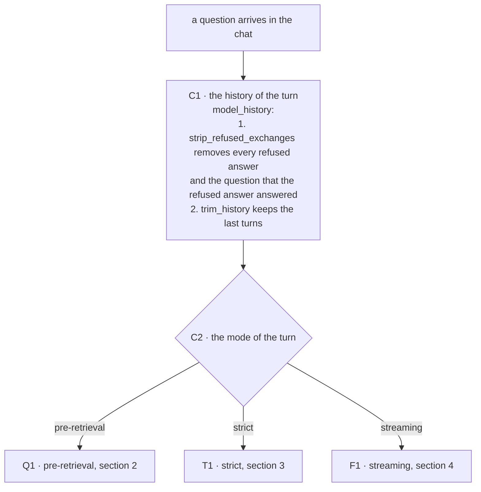
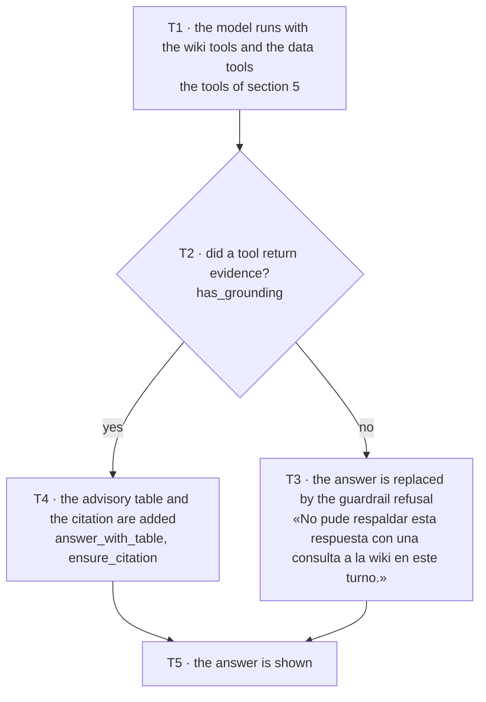
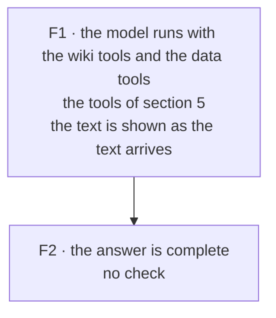

# Query nodes

This document is the reading diagram of the wiki: the steps that answer a
question in the chat. Its sibling, [`ingestion_nodes.md`](ingestion_nodes.md), is
the writing diagram: the steps that turn a source document into wiki pages and
put each fragment of text into the index.

Each step is a node with an identifier, for example `Q6`. The identifier of a
node appears in three places:

1. In this document, in a diagram and in a node table.
2. In the code, as the first argument of the tracing call that marks the node:
   `tracing.node("Q6", R, ...)` or `tracing.mark("Q5b", R, ...)`
   (`base/domain/tracing.py`).
3. In the trace of a chat turn, as the name of the record that the tracing call
   writes. The trace is written only when the environment variable `WIKI_TRACE`
   is set to `1`; the records go to `<workspace>/.llmwiki/traces/spans.jsonl`.

The test `tests/unit/test_flow_nodes.py` compares the node tables of this
document with the tracing calls of the code. A node added, renamed or removed in
the code and not in this document, or in this document and not in the code,
fails the test.

The chat has three modes. The mode decides who retrieves the text that the
answer is built from:

- **pre-retrieval**: the code retrieves the text, before the model is called,
  and the code decides whether the question is answered at all (section 2).
- **strict**: the model retrieves the text, by calling tools, and the code
  replaces an answer that no tool supports (section 3).
- **streaming**: the model retrieves the text, by calling tools, and the answer
  is shown as the model writes the answer, with no check (section 4).

The tools that the model calls are described once, in section 5.

## The node tables

Every node table of this document has the same columns:

- **ID**: the identifier of the node. The identifier is the same string as the
  first argument of the tracing call that marks the node.
- **What it does**.
- **Code**: the file and the symbol that run the node. A symbol is a function, a
  class or a constant defined in that file. The table never cites a line
  number, because a line number changes when the code above the line changes.
- **Trace**: the attributes of the record that the node writes in the trace,
  without the prefix `llmwiki.`. A node that writes no record says
  `none: <reason>`. A node whose record has no attribute says `no attributes`.
- **Status**: `code` for a node that the code runs; `design` for a node that
  exists only in a design.

## 1. The turn and the mode choice

Every turn, in every mode, starts with the same two nodes. The root record of the
trace of a turn is `turn`, with the attributes `conversation_id`, `turn` (the
position of the question in the conversation), `mode`, `question` and
`language`.

| ID | What it does | Code | Trace | Status |
|---|---|---|---|---|
| C1 | Builds the history that the model receives: removes every refused answer, with the question that the refused answer answered, then keeps the last turns. A refused first turn leaves the second turn with an empty history | `base/services/chat.py`, `model_history`; `base/domain/chat/guardrail.py`, `strip_refused_exchanges`; `base/domain/chat/history.py`, `trim_history` | `prior_messages`, `refused_dropped`, `history_messages` | code |
| C2 | Sends the turn to the mode that the chat selected | `base/services/chat.py`, `chat_turn_with_context`, `chat_turn_stream_with_context` | `mode` | code |

## 2. Pre-retrieval

One real question through the pre-retrieval mode: «¿Cuánto rinden los plazos
fijos?». Every value was computed with the code: `_normalize` for the
normalised question, the Spanish Snowball stemmer for the stems. The nodes
Q7a to Q7d were inserted after Q7, and the nodes Q5a and Q5b after Q5, so that the
other identifiers stay the same. S is the suggestions node, DB the index, and
each refusal node is named by the cause of the refusal (R1 to R5,
`RefusalCause` in `base/domain/chat/refusal.py`).

```mermaid
flowchart TD
    IDX[("DB · chunks_fts<br/>inverted index: each stem → the rows that contain the stem<br/>see ingestion_nodes.md")]

    subgraph R["Reading: a question arrives, pre-retrieval mode"]
        Q["Q1 · question<br/>«¿Cuánto rinden los plazos fijos?»"]
        N["Q2 · _normalize: lowercase, accents removed<br/>«¿cuanto rinden los plazos fijos?»"]
        BL{"Q3 · does the question name a blacklist term?<br/>is_off_limits, whole words, NOT stemmed<br/>[fuera_de_alcance]:<br/>– cedear<br/>– cedears<br/>– cripto<br/>– bitcoin"}
        ST["Q4 · stem_text on the question<br/>«cuant rind los plaz fij»"]
        RO{"Q5 · is the question in the coverage roster?<br/>mentions_known_data compares:<br/>– the stemmed question with the stemmed<br/>dataset categories, concept-page titles and aliases<br/>– the normalised question with the dataset keys, exact<br/>in the example, yes: plazo_fijo → «plaz fij»"}
        OP{"Q5a · is the user reading a wiki page?<br/>an open page makes the question covered"}
        CO{"Q5b · query condensation<br/>only with history, no data, no open page<br/>the model rewrites the follow-up so that the follow-up stands alone<br/>blacklist and roster run again on the rewrite<br/>«¿Y qué riesgos tiene?» → «¿Qué riesgos tiene la caución bursátil?»"}
        SQ["Q6 · wiki search, retrieve_wiki<br/>stop words removed, then stem_fts_query<br/>cuant OR rind OR plaz OR fij"]
        HITS{"Q7 · did the wiki search find a page?<br/>in the example, yes:<br/>– Plazo fijo tradicional<br/>– Plazo fijo UVA<br/>– …"}
        DC{"Q7a · does the question name a dataset category?<br/>the category, one of its keys, or an alias<br/>stemmed match<br/>in the example, yes: plazo_fijo"}
        DK{"Q7b · does the question name a key of that category?<br/>exact match<br/>in the example, no"}
        DR["Q7c · the code reads the rows of the key<br/>LocalMarkdownSource.query(categoria, clave)<br/>with as_of and fuente"]
        DN["Q7d · the code reads only the key names of the category<br/>in the example, the 8 names of the entidad column:<br/>Banco Nación … Brubank"]
        DS["Q8 · source search, retrieve_source_chunks<br/>– same index, scope=sources<br/>– at most 4 fragments"]
        CQ{"Q9 · is the question about the whole wiki?<br/>collection_intent, and the wiki has<br/>overview.md or index.md"}
        DQ{"Q10 · is the question a data question?<br/>– the question names a dataset category, stemmed<br/>– or a dataset key, exact<br/>– or a data alias from [alias_datos]<br/>– or asks for investment advice"}
        FR{"Q11 · did the source search find a fragment,<br/>for a question in the coverage roster?"}
        IR{"Q12 · is the question in the coverage roster?"}
        M1["Q13 · Tier 1: the wiki pages are injected,<br/>with the dataset rows of Q7c or the key names of Q7d<br/>the model writes the answer"]
        M4["Q14 · overview.md and index.md are injected<br/>the model writes the answer"]
        M2["Q15 · no page is injected<br/>the model calls the data tools of section 5<br/>the model writes the answer"]
        M3["Q16 · Tier 2: the source fragments are injected<br/>the model writes the answer"]
        V2{"Q17 · is the answer grounded in the fragments?<br/>coverage:<br/>– removes the stop words of the wiki's language<br/>– stems the remaining words<br/>– requires coverage ≥ min_coverage, 0.2 by default"}
        WARN["Q18 · the Tier-2 warning is appended<br/>⚠️ Esta respuesta proviene de un documento fuente<br/>sin página curada del wiki; verificá."]
        GR{"Q19 · did a dataset tool return evidence?<br/>has_grounding"}
        FS{"Q20 · does the answer open with<br/>«No encontré la respuesta en el texto que recibí de la wiki.»?"}
        OK["Q21 · the answer is shown<br/>ensure_citation adds the citation of the tools the model used<br/>for injected dataset rows, the code adds the dataset citation<br/>for injected pages, the citation is the model's own"]

        Q --> N --> BL
        BL -->|no| ST --> RO
        RO -->|yes| SQ
        RO -->|no| OP
        OP -->|yes| SQ
        OP -->|no| CO
        CO -->|in the roster| SQ
        CO -->|no| CQ
        SQ --> IDX
        IDX --> HITS
        HITS -->|yes| DC
        DC -->|yes| DK
        DC -->|no| M1
        DK -->|yes| DR --> M1
        DK -->|no| DN --> M1
        HITS -->|no| DS
        DS --> CQ
        CQ -->|yes| M4
        CQ -->|no| DQ
        DQ -->|yes| M2
        DQ -->|no| FR
        FR -->|yes| M3
        FR -->|no| IR
        M1 --> FS
        M4 --> FS
        M2 --> GR
        GR -->|yes| FS
        M3 --> V2
        V2 -->|yes| WARN --> FS
        FS -->|no| OK
    end

    subgraph X["Refusals"]
        R1["R1 · blacklist<br/>names the matched term, no suggestions<br/>¿Qué son los CEDEARs y conviene comprarlos?"]
        R2a["R2a · not in the roster<br/>suggestions, or the wiki's index when there are none<br/>¿Va a llover mañana en Rosario?"]
        R2b["R2b · in the roster, nothing found<br/>suggestions"]
        R3["R3 · not grounded<br/>names the source document, suggestions"]
        R4["R4 · no evidence behind the answer<br/>suggestions"]
        R5["R5 · the model's own refusal<br/>keeps the model's text, adds the cause line and the suggestions"]
        SUG["S · suggestions: the pages of the wiki search,<br/>run for the refusal when the wiki search has not run<br/>1. remove repeated pages<br/>2. concept pages whose title shares a root with the question<br/>3. the other concept pages<br/>4. summary pages<br/>5. keep the first five"]
    end

    BL -->|yes| R1
    CO -->|the rewrite names a blacklist term| R1
    IR -->|no| R2a
    IR -->|yes| R2b
    V2 -->|no| R3
    GR -->|no| R4
    FS -->|yes| R5
    SUG -.-> R2a
    SUG -.-> R2b
    SUG -.-> R3
    SUG -.-> R4
    SUG -.-> R5

    classDef db fill:#fde68a,stroke:#b45309,color:#1f2937
    class IDX db
    classDef ok fill:#bbf7d0,stroke:#15803d,color:#1f2937
    class OK ok
```

Every diamond is a question with two answers. When the wiki search finds a page,
Q7a and Q7b decide which dataset context joins the pages. When the wiki search
finds no page, the four questions that follow — whole wiki (Q9), data question
(Q10), source fragment (Q11), coverage roster (Q12) — decide between an answer
from the overview, an answer from the data tools, a Tier-2 answer and a refusal.

| ID | What it does | Code | Trace | Status |
|---|---|---|---|---|
| Q1 | The question enters the pre-retrieval flow | `base/domain/chat/preretrieval.py`, `pre_retrieval_answer`, `_pre_retrieval_turn` | `question` | code |
| Q2 | Lowercases the question and removes the accents of the question; punctuation stays | `base/domain/chat/scope.py`, `_normalize`; `base/domain/chat/preretrieval.py`, `_pre_retrieval_turn` | `normalized` | code |
| Q3 | Checks the normalised question against the blacklist, by whole word | `base/domain/chat/scope.py`, `is_off_limits`; `base/domain/chat/preretrieval.py`, `_pre_retrieval_turn` | `answer` | code |
| Q4 | Stems the question | `base/domain/text/stemming.py`, `stem_text`; `base/domain/chat/preretrieval.py`, `_pre_retrieval_turn` | `stemmed` | code |
| Q5 | Checks the question against the coverage roster: stemmed against the dataset categories, the concept-page titles and the aliases; exact against the dataset keys | `base/domain/chat/scope.py`, `mentions_known_data`; `base/domain/chat/preretrieval.py`, `_pre_retrieval_turn`, `build_vocabulary` | `answer`, `roster_size`, `aliases`, `matched` | code |
| Q5a | Checks whether the user is reading a wiki page; the page that the user is reading is injected first, and makes the question covered | `base/domain/chat/preretrieval.py`, `_open_page_block`, `_pre_retrieval_turn` | `answer`, `page` | code |
| Q5b | Rewrites a follow-up that names no topic into a question that stands alone, and runs the blacklist and the roster check again on the rewrite; the search uses the rewrite, the model answers the original question | `base/domain/chat/condense.py`, `accepted`; `base/domain/chat/preretrieval.py`, `_pre_retrieval_turn`; `base/services/chat.py`, `_condenser` | `rewritten`, `answer`, `off_limits`, `matched` | code |
| Q6 | Searches the wiki pages: removes the stop words, stems the terms, and runs the FTS query | `base/domain/chat/preretrieval.py`, `retrieve_wiki`, `_fts_query`, `_pre_retrieval_turn` | `fts_query`, `pages` | code |
| Q7 | Asks whether the wiki search returned a page | `base/domain/chat/preretrieval.py`, `plan_retrieval` | `answer`, `wiki_fragments` | code |
| Q7a | Asks whether the question names a dataset category, by stemmed match | `base/domain/chat/preretrieval.py`, `dataset_injection` | `answer`, `categories` | code |
| Q7b | Asks whether the question names a key of that category, by exact match | `base/domain/chat/preretrieval.py`, `dataset_injection` | `category`, `answer`, `keys` | code |
| Q7c | Reads the rows of the key and renders the rows as `query_dataset` renders the rows: `valor`, `unidad`, `as_of`, `fuente` | `base/domain/datasets/source.py`, `LocalMarkdownSource`; `base/domain/chat/dataset_tools.py`, `format_rows_as_table`; `base/domain/chat/preretrieval.py`, `dataset_injection` | `category`, `keys`, `rows` | code |
| Q7d | Reads only the key names of the category, without values | `base/domain/datasets/source.py`, `LocalMarkdownSource`; `base/domain/chat/preretrieval.py`, `dataset_injection` | `category`, `key_names` | code |
| Q8 | Searches the source documents, at most four fragments | `base/domain/chat/preretrieval.py`, `retrieve_source_chunks`, `_pre_retrieval_turn` | `fts_query`, `fragments` | code |
| Q9 | Asks whether the question is about the whole wiki, and whether the wiki has an overview or an index to inject | `base/domain/chat/scope.py`, `collection_intent`; `base/domain/chat/preretrieval.py`, `retrieve_collection_pages`, `plan_retrieval` | `answer`, `collection_pages` | code |
| Q10 | Asks whether the question is a data question: the question names a dataset category or key, or a data alias, or asks for investment advice | `base/domain/chat/scope.py`, `advisory_intent`; `base/domain/chat/preretrieval.py`, `plan_retrieval` | `answer` | code |
| Q11 | Asks whether the source search returned a fragment, for a question in the coverage roster | `base/domain/chat/preretrieval.py`, `plan_retrieval` | `answer`, `source_fragments`, `in_roster` | code |
| Q12 | Chooses between R2a and R2b by the coverage roster | `base/domain/chat/preretrieval.py`, `plan_retrieval` | `answer` | code |
| Q13 | Injects the wiki pages, with the dataset rows of Q7c or the key names of Q7d; the model answers from the injected text | `base/domain/chat/preretrieval.py`, `_answer_node`, `_pre_retrieval_turn`; the template: `prompts/inject_template.en.md` | `tier`, `context_chars`, `prompt` (a payload file), `raw_output` | code |
| Q14 | Injects `overview.md` and `index.md`; the model answers from the injected text | `base/domain/chat/preretrieval.py`, `_answer_node`, `_pre_retrieval_turn` | `tier`, `context_chars`, `prompt` (a payload file), `raw_output` | code |
| Q15 | Injects nothing; the model calls the data tools of section 5 | `base/domain/chat/preretrieval.py`, `_answer_node`, `_pre_retrieval_turn` | `tier`, `context_chars`, `prompt` (a payload file), `raw_output` | code |
| Q16 | Injects the source fragments; the model answers from the injected text | `base/domain/chat/preretrieval.py`, `_answer_node`, `_pre_retrieval_turn` | `tier`, `context_chars`, `prompt` (a payload file), `raw_output` | code |
| Q17 | Checks that the answer is grounded in the fragments, with the stop words of the wiki's language, stemming and the configured threshold | `base/domain/chat/overlap.py`, `coverage`; `base/domain/chat/preretrieval.py`, `_pre_retrieval_turn` | `answer`, `coverage`, `min_coverage` | code |
| Q18 | Appends the fixed Tier-2 warning to the answer | `base/domain/i18n.py`, `get_locale`; `base/domain/chat/preretrieval.py`, `_pre_retrieval_turn` | no attributes | code |
| Q19 | Asks whether a data tool returned evidence | `base/domain/chat/guardrail.py`, `has_grounding`; `base/domain/chat/preretrieval.py`, `_pre_retrieval_turn` | `answer` | code |
| Q20 | Asks whether the answer opens with the fixed refusal sentence of the model | `base/domain/chat/refusal.py`, `fixed_sentence`; `base/domain/chat/preretrieval.py`, `_pre_retrieval_turn` | `answer` | code |
| Q21 | Shows the answer; `ensure_citation` adds the citation of the tools the model used; for injected dataset rows the code adds the dataset citation; for injected pages the citation is the model's own | `base/domain/chat/postprocess.py`, `ensure_citation`, `answer_with_table`; `base/domain/chat/preretrieval.py`, `offer_available_keys`, `_pre_retrieval_turn` | `final_answer`, `citation_added`, `keys_offered` | code |
| R1 | Refusal of cause 1: the question, or the rewrite of Q5b, names a blacklist term; the refusal names the matched term | `base/domain/chat/refusal.py`, `render`; `base/domain/chat/preretrieval.py`, `_pre_retrieval_turn` | `cause`, `final_answer`, `suggestions` | code |
| R2a | Refusal of cause 2a: the question names no topic of the wiki | `base/domain/chat/refusal.py`, `render`; `base/domain/chat/preretrieval.py`, `_pre_retrieval_turn` | `cause`, `final_answer`, `suggestions` | code |
| R2b | Refusal of cause 2b: the question names a topic of the wiki, and the searches found no text | `base/domain/chat/refusal.py`, `render`; `base/domain/chat/preretrieval.py`, `_pre_retrieval_turn` | `cause`, `final_answer`, `suggestions` | code |
| R3 | Refusal of cause 3: the Tier-2 answer is not grounded in the fragments; the refusal names the source document | `base/domain/chat/refusal.py`, `render`; `base/domain/chat/preretrieval.py`, `_pre_retrieval_turn` | `cause`, `final_answer`, `suggestions` | code |
| R4 | Refusal of cause 4: no tool returned evidence behind the answer | `base/domain/chat/refusal.py`, `render`; `base/domain/chat/preretrieval.py`, `_pre_retrieval_turn` | `cause`, `final_answer`, `suggestions` | code |
| R5 | Refusal of cause 5: the model refused with the fixed sentence; the refusal keeps the text of the model and adds the cause line and the suggestions | `base/domain/chat/refusal.py`, `render`; `base/domain/chat/preretrieval.py`, `_pre_retrieval_turn` | `cause`, `final_answer`, `suggestions` | code |
| S | Builds the suggestions of a refusal from the coverage roster or from the wiki search | `base/domain/chat/refusal.py`, `roster_suggestions`, `search_suggestions` | none: the result of S is the `suggestions` attribute of the R record | code |

## 3. Strict

In the strict mode the model receives the question and the history, and decides
which tools to call (section 5). After the model answers, the code checks that a
tool returned evidence.

| ID | What it does | Code | Trace | Status |
|---|---|---|---|---|
| T1 | The model runs with the question, the history and the tools, and writes the answer | `base/services/chat.py`, `chat_turn_with_context`; `base/domain/chat/agent.py`, `create_agent` | `tools_called`, `raw_output` | code |
| T2 | Asks whether a tool return of the run carries evidence: a return that is not empty and is not one of the "nothing found" sentences of the tools | `base/domain/chat/guardrail.py`, `has_grounding`, `_is_substantive`; `base/services/chat.py`, `chat_turn_with_context` | `answer` | code |
| T3 | Replaces the answer by the guardrail refusal of the wiki's language | `base/domain/chat/guardrail.py`, `enforce_grounding`, `refusal_for`; `base/services/chat.py`, `chat_turn_with_context` | `final_answer` | code |
| T4 | Appends the advisory table, and adds the citation of the tools that the model used | `base/domain/chat/postprocess.py`, `answer_with_table`, `ensure_citation`; `base/services/chat.py`, `chat_turn_with_context` | `table_added`, `citation_added` | code |
| T5 | Shows the answer | `base/services/chat.py`, `chat_turn_with_context` | `final_answer`, `refusal_substituted` | code |

## 4. Streaming

In the streaming mode the model receives the question and the history, decides
which tools to call (section 5), and the answer is shown as the model writes the
answer. No code checks the answer.

| ID | What it does | Code | Trace | Status |
|---|---|---|---|---|
| F1 | The model runs with the question, the history and the tools; each chunk of text is shown as the chunk arrives | `base/services/chat.py`, `chat_turn_stream_with_context`; `base/domain/chat/agent.py`, `create_agent` | `tools_called` | code |
| F2 | The answer is complete; the answer is shown as the model wrote the answer | `base/services/chat.py`, `chat_turn_stream_with_context` | `final_answer` | code |

## 5. Tools

The tools that the model calls. The strict mode (T1) and the streaming mode (F1)
register the wiki tools (K1 to K3) and the data tools; the pre-retrieval mode
(Q15) registers only the data tools, because in the pre-retrieval mode the code
searches the wiki.

The data tools depend on the wiki:

- A wiki with the finance overlay (`base/domain/finance_argentina/agent_tool.py`,
  `activate`) registers K5 and the finance data tools K6 to K10, one per dataset
  category that passes the finance validator. A wiki with the finance overlay
  does not register K4.
- Any other wiki with a `datasets/` directory registers K4.

The arguments of a finance data tool accept only the values of the dataset of
the tool: the keys of the category and, for `plazo_dias`, the terms of the
dataset. The allowed values are read from the dataset files when the wiki
opens. A call with a value outside the allowed values raises `ModelRetry`, and
the model receives the allowed values and corrects the call. Each tool call writes one record, with the arguments of the
call and whether the return of the call is substantive (`_is_substantive`,
`base/domain/chat/guardrail.py`): not empty, and not one of the "nothing found"
sentences of the tools.

| ID | What it does | Code | Trace | Status |
|---|---|---|---|---|
| K1 | Reads one wiki page by its path | `base/domain/chat/wiki_tools.py`, `read_wiki_page` | `path`, `substantive` | code |
| K2 | Searches the wiki pages with an FTS query: every word first; when no page has every word, any word (`any_word_query`) | `base/domain/chat/wiki_tools.py`, `search_wiki_fts`; `base/domain/tools/search.py`, `any_word_query` | `query`, `limit`, `widened`, `substantive` | code |
| K3 | Searches the fragments of the source documents with an FTS query: every word first; when no fragment has every word, any word (`any_word_query`) | `base/domain/chat/tools.py`, `search_source_chunks`; `base/domain/tools/search.py`, `any_word_query` | `query`, `limit`, `widened`, `substantive` | code |
| K4 | Reads the rows of a dataset category, optionally of one key and one metric; not registered in a wiki with the finance overlay | `base/domain/chat/dataset_tools.py`, `query_dataset` | `categoria`, `clave`, `metrica`, `substantive` | code |
| K5 | Estimates and compares the investment alternatives for an amount and a horizon (finance overlay) | `base/domain/finance_argentina/agent_tool.py`, `estimar_alternativas` | `monto`, `horizonte_meses`, `moneda`, `substantive` | code |
| K6 | Reads the TNA of a plazo fijo, by entity and by term in days | `base/domain/finance_argentina/data_tools.py`, `tasa_plazo_fijo` | `entidad`, `plazo_dias`, `substantive`, `rejected` | code |
| K7 | Reads the TNA of a caución, by market and by term in days | `base/domain/finance_argentina/data_tools.py`, `tasa_caucion` | `mercado`, `plazo_dias`, `substantive`, `rejected` | code |
| K8 | Reads the buy and sell quotes of a type of dollar | `base/domain/finance_argentina/data_tools.py`, `cotizacion_dolar` | `tipo`, `substantive`, `rejected` | code |
| K9 | Reads the price of a share, by ticker | `base/domain/finance_argentina/data_tools.py`, `precio_accion` | `ticker`, `substantive`, `rejected` | code |
| K10 | Reads the return of a money market fund, by fund | `base/domain/finance_argentina/data_tools.py`, `rendimiento_fci` | `fondo`, `substantive`, `rejected` | code |
