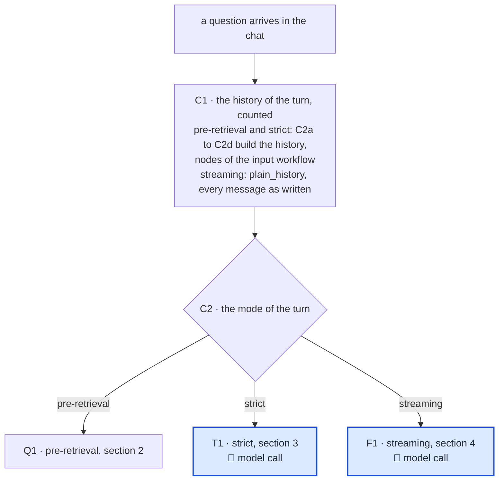
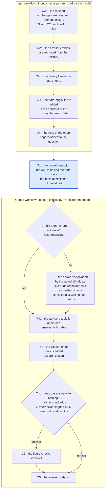
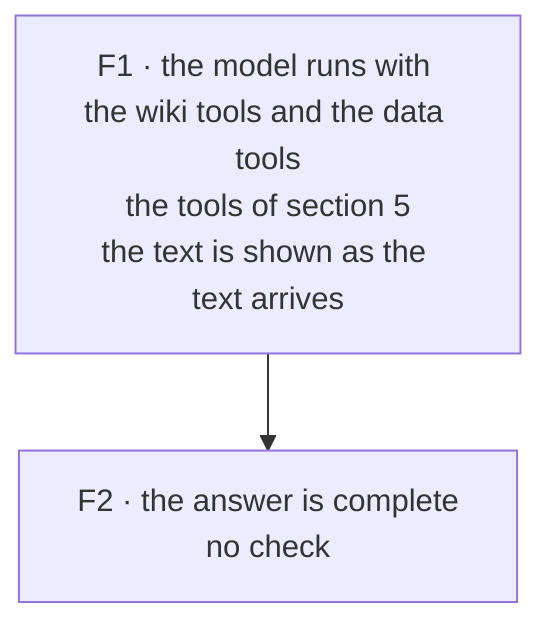

# Query nodes

This document is the reading diagram of the wiki: the steps that answer a
question in the chat. Its sibling, [`ingestion_nodes.md`](ingestion_nodes.md), is
the writing diagram: the steps that turn a source document into wiki pages and
put each fragment of text into the index.

Each step is a node with an identifier, for example `Q6`. The identifier of a
node appears in three places:

1. In this document, in a diagram and in a node table.
2. In the code, as the first argument of the tracing call that marks the node:
   `tracing.node("Q6", R, ...)` or `tracing.mark("Q5b", R, ...)`
   (`base/domain/tracing.py`).
3. In the trace of a chat turn, as the name of the record that the tracing call
   writes. The trace is written only when the environment variable `WIKI_TRACE`
   is set to `1`; the records go to `<workspace>/.llmwiki/traces/spans.jsonl`.

The test `tests/unit/test_flow_nodes.py` compares the node tables of this
document with the tracing calls of the code. A node added, renamed or removed in
the code and not in this document, or in this document and not in the code,
fails the test.

The chat has three modes. The mode decides who retrieves the text that the
answer is built from:

- **pre-retrieval**: the code retrieves the text, before the model is called,
  and the code decides whether the question is answered at all (section 2).
- **strict**: the model retrieves the text, by calling tools, and the code
  replaces an answer that no tool supports (section 3).
- **streaming**: the model retrieves the text, by calling tools, and the answer
  is shown as the model writes the answer. The code changes nothing between the
  user and the agent: no step edits the history, and no check runs on the answer
  (section 4).

The tools that the model calls are described once, in section 5.

The table [`workflow_nodes.md`](workflow_nodes.md) says, for each node of the
catalog of the chat workflows, which of the four workflows runs the node. The
table is generated from the code.

In the diagrams, a blue node whose label ends in «🤖 model call» is a node
where the code sends a request to the model. Every other node runs only code.

## The node tables

Every node table of this document has the same columns:

- **ID**: the identifier of the node. The identifier is the same string as the
  first argument of the tracing call that marks the node.
- **What it does**.
- **Code**: the file and the symbol that run the node. A symbol is a function, a
  class or a constant defined in that file. The table never cites a line
  number, because a line number changes when the code above the line changes.
- **Trace**: the attributes of the record that the node writes in the trace,
  without the prefix `llmwiki.`. A node that writes no record says
  `none: <reason>`. A node whose record has no attribute says `no attributes`.
- **Status**: `code` for a node that the code runs; `design` for a node that
  exists only in a design.

## 1. The turn and the mode choice

Every turn, in every mode, starts with the same two nodes. The root record of the
trace of a turn is `turn`, with the attributes `conversation_id`, `turn` (the
position of the question in the conversation), `mode`, `question` and
`language`.

| ID | What it does | Code | Trace | Status |
|---|---|---|---|---|
| C1 | Counts the history of the turn: the prior messages, the refused ones that C2a removes, and the messages that the model receives. In the pre-retrieval and strict modes, C1 is the first node of the input workflow and counts the history as `model_history` builds the history; C2a to C2d build the history, one step per node. In the streaming mode, the model receives every prior message as written (`plain_history`), with no message removed and no line added, and `refused_dropped` is 0 | `base/domain/chat/workflow/catalog.py`, `history_counts`; `base/domain/chat/history.py`, `history_counts`, `model_history`; `base/services/chat.py`, `chat_turn_stream_with_context`, `plain_history` | `prior_messages`, `refused_dropped`, `history_messages` | code |
| C2 | Records the mode of the turn. In the pre-retrieval and strict modes, C2 is the second node of the input workflow; in the streaming mode, `chat_turn_stream_with_context` records C2 | `base/domain/chat/workflow/catalog.py`, `mode`; `base/services/chat.py`, `chat_turn_with_context`, `chat_turn_stream_with_context` | `mode` | code |
| C2a | Removes from the history every refused answer, with the question that the refused answer answered. A refused first turn leaves the second turn with an empty history. Runs in the input workflows of the pre-retrieval and strict modes | `base/domain/chat/guardrail.py`, `strip_refused_exchanges`; `base/domain/chat/workflow/catalog.py`, `strip_refused` | `refused_dropped` | code |
| C2b | Replaces the advisory table of each answer of the history with a placeholder line; the model can call the advisory tool again. Runs in the input workflows of the pre-retrieval and strict modes | `base/domain/chat/history.py`, `compact_tables`; `base/domain/chat/workflow/catalog.py`, `compact_tables` | `compacted` | code |
| C2c | Keeps the last `max_turns` turns of the history, 3 by default. Runs in the input workflows of the pre-retrieval and strict modes | `base/domain/chat/history.py`, `cap_turns`, `DEFAULT_MAX_TURNS`; `base/domain/chat/workflow/catalog.py`, `trim_turns` | `trimmed`, `max_turns` | code |
| C2d | Builds the history that the model receives; an answer that read data ends with its origin line, which names the dataset or the tool that the figures came from. Runs in the input workflows of the pre-retrieval and strict modes | `base/domain/chat/history.py`, `with_origin_lines`, `data_origin`; `base/domain/chat/workflow/catalog.py`, `origin_lines` | `origin_lines`, `history_messages` | code |
| C3 | The figure check: classifies every figure of the prose as exact, rounded or unsupported, against the numbers of the passages of the turn, the advisory table, the messages of the user and the passages of the earlier answers. The figures of the advisory table, of the note above it, of the citation lines and of the Tier-2 warning are not checked. When the prose has rounded figures, a fixed note is appended. The text of the model is not edited. C3 runs in the pre-retrieval mode, before Q21, and in the strict mode, before T5. C3 does not run in the streaming mode. A refusal does not reach C3 | `base/domain/chat/figure_check.py`, `check_answer`, `appended_spans`; `base/domain/verify/figures.py`, `check_figures`; `base/domain/chat/workflow/catalog.py`, `figures`; `base/services/chat.py`, `check_turn_figures` | `figures_checked`, `figures_unsupported`, `figures_rounded`, `note_added` | code |
| C4 | Precedes the question with a note that names the page the user is reading, so that a question that names no topic is read as a question about that page. In the pre-retrieval mode, the note names the page only when Q5a found the page; in the strict mode, the note names the open page without checking that the page exists. Runs in the input workflows of the pre-retrieval and strict modes; the streaming mode adds the same note with no node | `base/domain/chat/preretrieval.py`, `with_open_page`; `base/domain/chat/workflow/catalog.py`, `open_page_note` | `answer`, `page` | code |

## 2. Pre-retrieval

One real question through the pre-retrieval mode: «¿Cuánto rinden los plazos
fijos?». Every value was computed with the code: `_normalize` for the
normalised question, the Spanish Snowball stemmer for the stems. A node
inserted after another node carries the identifier of that node and a letter,
for example Q5a to Q5g after Q5, so that the other identifiers stay the same. C2a
to C2d and C4 are nodes of section 1. S is the suggestions node, DB the index, and
each refusal node is named by the cause of the refusal (R1 to R5,
`RefusalCause` in `base/domain/chat/refusal.py`).

```mermaid
flowchart TD
    IDX[("DB · chunks_fts<br/>inverted index: each stem → the rows that contain the stem<br/>see ingestion_nodes.md")]

    subgraph IN["Input workflow · input_checks.py · runs before the model"]
        HA["C2a · the refused exchanges are removed from the history<br/>C1 and C2, section 1, run first"]
        HB["C2b · the advisory tables are removed from the history"]
        HC["C2c · the history keeps the last 3 turns"]
        HD["C2d · the data-origin line is added<br/>to the answers of the history that read data"]
        Q["Q1 · question<br/>«¿Cuánto rinden los plazos fijos?»"]
        N["Q2 · _normalize: lowercase, accents removed<br/>«¿cuanto rinden los plazos fijos?»"]
        BL{"Q3 · does the question name a blacklist term?<br/>is_off_limits, whole words, NOT stemmed<br/>[fuera_de_alcance]:<br/>– cedear<br/>– cedears<br/>– cripto<br/>– bitcoin"}
        ST["Q4 · stem_text on the question<br/>«cuant rind los plaz fij»"]
        DD["Q4a · does the question name data?<br/>a dataset category, stemmed; a dataset key, exact;<br/>a data alias; or a request for investment advice"]
        RO{"Q5 · is the question in the coverage roster?<br/>mentions_known_data compares:<br/>– the stemmed question with the stemmed<br/>dataset categories, concept-page titles and aliases<br/>– the normalised question with the dataset keys, exact<br/>in the example, yes: plazo_fijo → «plaz fij»"}
        OP{"Q5a · is the user reading a wiki page?<br/>an open page makes the question covered"}
        RW["Q5c · query condensation<br/>only with history, no data, no open page<br/>the model rewrites the follow-up so that the follow-up stands alone<br/>«¿Y qué riesgos tiene?» → «¿Qué riesgos tiene la caución bursátil?»<br/>🤖 model call"]
        AC{"Q5d · is the rewrite accepted?<br/>one line, not empty, not too long"}
        BR{"Q5e · does the rewrite name a blacklist term?"}
        DF["Q5f · does the rewrite name data?"]
        RG["Q5g · is the rewrite in the coverage roster?"]
        CO{"Q5b · the result of the condensation<br/>the text that the gate and the search examine:<br/>the accepted rewrite, or the question"}
        SQ["Q6 · wiki search, retrieve_wiki<br/>stop words removed, then stem_fts_query<br/>cuant OR rind OR plaz OR fij"]
        DS["Q8 · source search, retrieve_source_chunks<br/>– same index, scope=sources<br/>– at most 4 fragments"]
        CP["Q8a · for a question about the whole wiki,<br/>collection_intent, overview.md and index.md are read"]
        CA{"Q8b · the overview and the index join the open page<br/>is the question in the coverage roster?"}
        HITS{"Q7 · did the wiki search find a page?<br/>in the example, yes:<br/>– Plazo fijo tradicional<br/>– Plazo fijo UVA<br/>– …"}
        DC{"Q7a · does the question name a dataset category?<br/>the category, one of its keys, or an alias<br/>stemmed match<br/>in the example, yes: plazo_fijo"}
        DK{"Q7b · does the question name a key of that category?<br/>exact match<br/>in the example, no"}
        DR["Q7c · the code reads the rows of the key<br/>LocalMarkdownSource.query(categoria, clave)<br/>with as_of and fuente"]
        DN["Q7d · the code reads only the key names of the category<br/>in the example, the 8 names of the entidad column:<br/>Banco Nación … Brubank"]
        CQ{"Q9 · is the question about the whole wiki?<br/>Q8a read overview.md or index.md"}
        DQ{"Q10 · is the question a data question?<br/>– the question names a dataset category, stemmed<br/>– or a dataset key, exact<br/>– or a data alias from [alias_datos]<br/>– or asks for investment advice"}
        FR{"Q11 · did the source search find a fragment,<br/>for a question in the coverage roster?"}
        IR{"Q12 · is the question in the coverage roster?"}
        ON["C4 · the note of the open page is added to the question<br/>only when Q5a found the page"]
        SY["Q12a · the line of synonyms of the aliases of the question"]
        PR{"Q12b · the prompt: the injected text, the synonyms line<br/>and the question, in the inject template"}
    end

    subgraph AG["The agent call · _pre_retrieval_turn · between the two workflows"]
        M1["Q13 · Tier 1: the wiki pages are injected,<br/>with the dataset rows of Q7c or the key names of Q7d<br/>the model writes the answer<br/>🤖 model call"]
        M4["Q14 · overview.md and index.md are injected<br/>the model writes the answer<br/>🤖 model call"]
        M2["Q15 · no page is injected<br/>the model calls the data tools of section 5<br/>the model writes the answer<br/>🤖 model call"]
        M3["Q16 · Tier 2: the source fragments are injected<br/>the model writes the answer<br/>🤖 model call"]
    end

    subgraph OUT["Output workflow · output_checks.py · runs after the model"]
        V2{"Q17 · is the answer grounded in the fragments?<br/>coverage:<br/>– removes the stop words of the wiki's language<br/>– stems the remaining words<br/>– requires coverage ≥ min_coverage, 0.2 by default"}
        GR{"Q19 · did a dataset tool return evidence?<br/>has_grounding"}
        FS{"Q20 · does the answer open with<br/>«No encontré la respuesta en el texto que recibí de la wiki.»?"}
        TA["Q20a · the advisory table is appended<br/>when the advisory tool returned one"]
        KO["Q20b · the keys with data are offered<br/>when the model asked for a key without data"]
        CI["Q20c · ensure_citation adds the citation of the tools the model used<br/>for injected dataset rows, the code adds the dataset citation"]
        RF{"Q20d · for injected pages the answer does not name,<br/>mark_injected adds a Referencia line that lists them<br/>and says which ones the answer used cannot be determined<br/>is the answer a Tier-2 answer?"}
        WARN["Q18 · the Tier-2 warning is appended<br/>⚠️ Esta respuesta proviene de un documento fuente<br/>sin página curada del wiki; verificá."]
        FIG["C3 · the figure check, section 1<br/>every figure of the prose is exact, rounded or unsupported<br/>a note is appended when a figure is rounded"]
        OK["Q21 · the answer is shown"]
    end

        HA --> HB --> HC --> HD --> Q
        Q --> N --> BL
        BL -->|no| ST --> DD --> RO --> OP
        OP -->|yes, or the question is in the roster| SQ
        OP -->|follow-up, not covered| RW --> AC
        OP -->|no| CP
        AC -->|rewritten| BR
        AC -->|no| CO
        BR -->|no| DF --> RG --> CO
        CO -->|in the roster| SQ
        CO -->|no| CP
        SQ -.- IDX
        DS -.- IDX
        SQ -->|page found| CP
        SQ -->|no page| DS --> CP
        CP --> CA
        CA -->|in the roster| HITS
        CA -->|no| CQ
        HITS -->|yes| DC
        HITS -->|no| CQ
        DC -->|yes| DK
        DC -->|no| ON
        DK -->|yes| DR
        DK -->|no| DN
        DR -->|next category| DK
        DN -->|next category| DK
        DR --> ON
        DN --> ON
        CQ -->|yes| ON
        CQ -->|no| DQ
        DQ -->|yes| ON
        DQ -->|no| FR
        FR -->|yes| ON
        FR -->|no| IR
        ON --> SY --> PR
        PR -->|wiki pages| M1
        PR -->|overview| M4
        PR -->|data| M2
        PR -->|source fragments| M3
        M1 --> FS
        M4 --> FS
        M2 --> GR
        GR -->|yes| FS
        M3 -->|sentence verifier off| V2
        M3 -->|sentence verifier on| FS
        V2 -->|yes| FS
        FS -->|no| TA --> KO --> CI --> RF
        RF -->|Tier 2| WARN --> FIG
        RF -->|no| FIG
        FIG --> OK

    subgraph X["Refusals"]
        R1["R1 · blacklist<br/>names the matched term, no suggestions<br/>¿Qué son los CEDEARs y conviene comprarlos?"]
        R2a["R2a · not in the roster<br/>suggestions, or the wiki's index when there are none<br/>¿Va a llover mañana en Rosario?"]
        R2b["R2b · in the roster, nothing found<br/>suggestions"]
        R3["R3 · not grounded<br/>names the source document, suggestions"]
        R4["R4 · no evidence behind the answer<br/>suggestions"]
        R5["R5 · the model's own refusal<br/>keeps the model's text, adds the cause line and the suggestions"]
        SUG["S · suggestions: the pages of the wiki search,<br/>run for the refusal when the wiki search has not run<br/>1. remove repeated pages<br/>2. concept pages whose title shares a root with the question<br/>3. the other concept pages<br/>4. summary pages<br/>5. keep the first five"]
    end

    BL -->|yes| R1
    BR -->|yes| R1
    IR -->|no| R2a
    IR -->|yes| R2b
    V2 -->|no| R3
    GR -->|no| R4
    FS -->|yes| R5
    SUG -.-> R2a
    SUG -.-> R2b
    SUG -.-> R3
    SUG -.-> R4
    SUG -.-> R5

    classDef db fill:#fde68a,stroke:#b45309,color:#1f2937
    class IDX db
    classDef ok fill:#bbf7d0,stroke:#15803d,color:#1f2937
    class OK ok
    classDef llm fill:#dbeafe,stroke:#1d4ed8,stroke-width:2px,color:#1f2937
    class RW,M1,M2,M3,M4 llm
```

A diamond is a decision: the next node depends on the answer. When the wiki
search finds a page, Q7a and Q7b decide which dataset context joins the pages.
When the wiki search finds no page, the four questions that follow — whole wiki
(Q9), data question (Q10), source fragment (Q11), coverage roster (Q12) — decide
between an answer from the overview, an answer from the data tools, a Tier-2
answer and a refusal.

Two workflows of pydantic-graph run the nodes of this section, one before the
model and one after the model. Each node is a function of the catalog, `CATALOG`
in `base/domain/chat/workflow/catalog.py`. Each function is written once, and
each workflow registers the functions that the workflow uses (`register`). A
node that two workflows use is the same function in both workflows.

- **The input workflow**, `graph` in `base/domain/chat/workflow/input_checks.py`,
  runs C1, C2 and C2a to C2d (section 1), the checks of the question from Q1 to
  Q12, and C4, Q12a and Q12b, which build the prompt. The input workflow ends in
  a refusal (R1, R2a, R2b) or in the node that calls the agent (Q13 to Q16). The
  input workflow reads and writes the `PreRetrievalTurn` of the turn
  (`base/domain/chat/preretrieval.py`).
- **The agent call**: `_pre_retrieval_turn` (`base/domain/chat/preretrieval.py`)
  calls the agent between the two workflows, outside both workflows.
- **The output workflow**, `graph` in
  `base/domain/chat/workflow/output_checks.py`, runs the checks of the answer
  Q17, Q19 and Q20, the additions Q20a to Q20d and Q18, the figure check C3
  (section 1) and Q21. The output workflow ends in the answer or in a refusal
  (R3, R4, R5). Its state, `AnswerChecks`
  (`base/domain/chat/workflow/catalog.py`), holds the answer of the agent and the
  `PreRetrievalTurn` of the input workflow.

Each workflow declares the list of the catalog nodes that the workflow runs
(`PRE_RETRIEVAL_NODES`, `STRICT_NODES`). The table
[`workflow_nodes.md`](workflow_nodes.md) is generated from those lists.

| ID | What it does | Code | Trace | Status |
|---|---|---|---|---|
| Q1 | The question enters the pre-retrieval flow | `base/domain/chat/preretrieval.py`, `pre_retrieval_answer`, `PreRetrievalTurn`; `base/domain/chat/workflow/catalog.py`, `question` | `question` | code |
| Q2 | Lowercases the question and removes the accents of the question; punctuation stays | `base/domain/chat/scope.py`, `_normalize`; `base/domain/chat/workflow/catalog.py`, `normalize` | `normalized` | code |
| Q3 | Checks the normalised question against the blacklist, by whole word | `base/domain/chat/scope.py`, `is_off_limits`; `base/domain/chat/preretrieval.py`, `blacklist`; `base/domain/chat/workflow/catalog.py`, `blacklist` | `answer` | code |
| Q4 | Stems the question | `base/domain/text/stemming.py`, `stem_text`; `base/domain/chat/workflow/catalog.py`, `stem` | `stemmed` | code |
| Q4a | Checks whether the question names data: a dataset category, stemmed; a dataset key, exact; a data alias; or a request for investment advice. Builds the coverage roster first, once per turn | `base/domain/chat/scope.py`, `mentions_known_data`, `advisory_intent`; `base/domain/chat/preretrieval.py`, `ensure_roster`, `detect_data`; `base/domain/chat/workflow/catalog.py`, `data_detection` | `answer` | code |
| Q5 | Checks the question against the coverage roster: stemmed against the dataset categories, the concept-page titles and the aliases; exact against the dataset keys | `base/domain/chat/scope.py`, `mentions_known_data`; `base/domain/chat/preretrieval.py`, `build_vocabulary`, `ensure_roster`, `match_terms`; `base/domain/chat/workflow/catalog.py`, `roster` | `answer`, `roster_size`, `aliases`, `matched` | code |
| Q5a | Checks whether the user is reading a wiki page; the page that the user is reading is injected first, and makes the question covered | `base/domain/chat/preretrieval.py`, `_open_page_block`; `base/domain/chat/workflow/catalog.py`, `open_page` | `answer`, `page` | code |
| Q5c | Rewrites a follow-up that names no topic into a question that stands alone, from the conversation. Runs only with a condenser and a history, for a question that is not in the coverage roster, names no data and has no open page | `base/domain/chat/condense.py`, `prompt`; `base/services/chat.py`, `_condenser`; `base/domain/chat/workflow/catalog.py`, `rewrite` | `rewrite` | code |
| Q5d | Accepts the rewrite when the rewrite is one line, not empty and not too long; otherwise the search keeps the question. An accepted rewrite that differs from the question is what the gate and the search examine; the model answers the original question | `base/domain/chat/condense.py`, `accepted`; `base/domain/chat/workflow/catalog.py`, `accept_rewrite` | `answer`, `rewritten` | code |
| Q5e | Checks the rewrite against the blacklist, by whole word, as Q3 checks the question | `base/domain/chat/preretrieval.py`, `blacklist`; `base/domain/chat/workflow/catalog.py`, `blacklist_rewrite` | `answer` | code |
| Q5f | Checks whether the rewrite names data, as Q4a checks the question | `base/domain/chat/preretrieval.py`, `detect_data`; `base/domain/chat/workflow/catalog.py`, `data_detection_rewrite` | `answer` | code |
| Q5g | Checks the rewrite against the coverage roster, as Q5 checks the question | `base/domain/chat/preretrieval.py`, `match_terms`; `base/domain/chat/workflow/catalog.py`, `roster_rewrite` | `answer`, `matched` | code |
| Q5b | Records the result of the condensation (Q5c to Q5g): the text that the gate and the search examine, the rewrite or the question, and what the roster check found on that text. A rewrite that names a blacklist term does not reach Q5b: Q5e refuses it with R1. The search uses the rewrite, the model answers the original question | `base/domain/chat/workflow/catalog.py`, `condense` | `rewritten`, `answer`, `off_limits`, `matched` | code |
| Q6 | Searches the wiki pages: removes the stop words, stems the terms, and runs the FTS query. A topic of Q5 with no page among the hits gets the chunk of its own page in place of the last hit. An alias is searched by the name it stands for (`alias_titles`) | `base/domain/chat/preretrieval.py`, `retrieve_wiki`, `_fts_query`; `base/domain/chat/workflow/catalog.py`, `wiki_search` | `fts_query`, `pages` | code |
| Q7 | Asks whether the wiki search returned a page | `base/domain/chat/preretrieval.py`, `plan_retrieval`, `tier1_plan`; `base/domain/chat/workflow/catalog.py`, `wiki_pages` | `answer`, `wiki_fragments` | code |
| Q7a | Asks whether the question names a dataset category, by stemmed match | `base/domain/chat/preretrieval.py`, `named_categories`, `dataset_injection`; `base/domain/chat/workflow/catalog.py`, `dataset_categories` | `answer`, `categories` | code |
| Q7b | Asks whether the question names a key of that category, by exact match | `base/domain/chat/preretrieval.py`, `named_categories`, `dataset_injection`; `base/domain/chat/workflow/catalog.py`, `dataset_keys` | `category`, `answer`, `keys` | code |
| Q7c | Reads the rows of the key and renders the rows as `query_dataset` renders the rows: `valor`, `unidad`, `as_of`, `fuente` | `base/domain/datasets/source.py`, `LocalMarkdownSource`; `base/domain/chat/dataset_tools.py`, `format_rows_as_table`; `base/domain/chat/preretrieval.py`, `rows_block`, `dataset_injection`; `base/domain/chat/workflow/catalog.py`, `dataset_rows` | `category`, `keys`, `rows` | code |
| Q7d | Reads only the key names of the category, without values | `base/domain/datasets/source.py`, `LocalMarkdownSource`; `base/domain/chat/preretrieval.py`, `key_names_block`, `dataset_injection`; `base/domain/chat/workflow/catalog.py`, `dataset_key_names` | `category`, `key_names` | code |
| Q8 | Searches the source documents, at most four fragments | `base/domain/chat/preretrieval.py`, `retrieve_source_chunks`; `base/domain/chat/workflow/catalog.py`, `source_search` | `fts_query`, `fragments` | code |
| Q8a | Asks whether the question is about the whole wiki and, for such a question, reads the overview and the index of the wiki from disk; no page is read when the wiki has neither page. The expressions are the `[intent] collection` list of `wiki_config.toml`, or the base list of the wiki's language | `base/domain/chat/scope.py`, `collection_intent`; `base/domain/chat/intent.py`; `base/domain/chat/preretrieval.py`, `retrieve_collection_pages`, `intent_lists`; `base/domain/chat/workflow/catalog.py`, `collection_pages` | `answer`, `pages` | code |
| Q8b | Adds the pages that Q8a read to the wiki pages, when the user reads a wiki page and the question names no topic of the wiki. Such a question is in the coverage roster only because of the open page, and Q7 answers it from the wiki pages before Q9 runs: with the overview open, «what is in this wiki?» still gets the index | `base/domain/chat/workflow/catalog.py`, `collection_with_open_page` | `answer`, `pages` | code |
| Q9 | Asks whether Q8a read an overview or an index for a question about the whole wiki; with those pages, the plan injects them | `base/domain/chat/preretrieval.py`, `plan_retrieval`, `tier1_plan`; `base/domain/chat/workflow/catalog.py`, `collection` | `answer`, `collection_pages` | code |
| Q10 | Asks whether the question is a data question: the question names a dataset category or key, or a data alias, or asks for investment advice (the `[intent] advisory` list, or the base list of the active domains, with an amount or a horizon) | `base/domain/chat/scope.py`, `advisory_intent`; `base/domain/chat/intent.py`; `base/domain/chat/preretrieval.py`, `plan_retrieval`, `data_plan`; `base/domain/chat/workflow/catalog.py`, `data_question` | `answer` | code |
| Q11 | Asks whether the source search returned a fragment, for a question in the coverage roster | `base/domain/chat/preretrieval.py`, `plan_retrieval`, `tier2_plan`; `base/domain/chat/workflow/catalog.py`, `source_fragments` | `answer`, `source_fragments`, `in_roster` | code |
| Q12 | Chooses between R2a and R2b by the coverage roster | `base/domain/chat/preretrieval.py`, `plan_retrieval`; `base/domain/chat/workflow/catalog.py`, `roster_refusal` | `answer` | code |
| Q12a | Builds the line that names each alias of the question with the name the alias stands for. Without the line, «¿qué es el billete verde?» gets the pages of the dollar and no text that says «billete verde» is the dollar. The line is empty when the question names no alias | `base/domain/chat/preretrieval.py`, `synonyms_line`; `base/domain/chat/workflow/catalog.py`, `synonyms` | `answer`, `line` | code |
| Q12b | Builds the prompt that the model receives: the synonyms line and the injected text of the plan in the inject template, followed by the question with the note of C4; with no injected text, the synonyms line and the question | `base/domain/chat/preretrieval.py`, `build_prompt`; `base/domain/chat/workflow/catalog.py`, `prompt`; the template: `prompts/inject_template.en.md` | `injected`, `prompt_chars` | code |
| Q13 | Injects the wiki pages, with the dataset rows of Q7c or the key names of Q7d; the model answers from the injected text | `base/domain/chat/preretrieval.py`, `_answer_node`, `_pre_retrieval_turn`; the template: `prompts/inject_template.en.md` | `tier`, `context_chars`, `prompt` (a payload file), `raw_output` | code |
| Q14 | Injects `overview.md` and `index.md`; the model answers from the injected text | `base/domain/chat/preretrieval.py`, `_answer_node`, `_pre_retrieval_turn` | `tier`, `context_chars`, `prompt` (a payload file), `raw_output` | code |
| Q15 | Injects nothing; the model calls the data tools of section 5 | `base/domain/chat/preretrieval.py`, `_answer_node`, `_pre_retrieval_turn` | `tier`, `context_chars`, `prompt` (a payload file), `raw_output` | code |
| Q16 | Injects the source fragments; the model answers from the injected text | `base/domain/chat/preretrieval.py`, `_answer_node`, `_pre_retrieval_turn` | `tier`, `context_chars`, `prompt` (a payload file), `raw_output` | code |
| Q17 | Checks that the answer is grounded in the fragments, with the stop words of the wiki's language, stemming and the configured threshold. Skipped when the sentence verifier checks the answer (the checkbox «Verificar las oraciones» of the web interface, with the verifier installed): the verifier is then the only comparison of the answer against the fragments | `base/domain/chat/overlap.py`, `coverage`; `base/domain/chat/workflow/catalog.py`, `fragment_coverage` | `answer`, `coverage`, `min_coverage` | code |
| Q18 | Appends the fixed Tier-2 warning to the answer | `base/domain/i18n.py`, `get_locale`; `base/domain/chat/workflow/catalog.py`, `tier2_warning` | no attributes | code |
| Q19 | Asks whether a data tool returned evidence | `base/domain/chat/guardrail.py`, `has_grounding`; `base/domain/chat/workflow/catalog.py`, `tool_evidence` | `answer` | code |
| Q20 | Asks whether the answer opens with the fixed refusal sentence of the model | `base/domain/chat/refusal.py`, `fixed_sentence`; `base/domain/chat/workflow/catalog.py`, `model_refusal` | `answer` | code |
| Q20a | Appends the advisory table when the advisory tool returned one | `base/domain/chat/postprocess.py`, `answer_with_table`; `base/domain/chat/workflow/catalog.py`, `table` | `table_added` | code |
| Q20b | Offers the keys with data when the model asked for a key without data | `base/domain/chat/preretrieval.py`, `offer_available_keys`; `base/domain/chat/workflow/catalog.py`, `keys` | `keys_offered` | code |
| Q20c | `ensure_citation` adds the citation of the tools the model used; for injected dataset rows the code adds the dataset citation | `base/domain/chat/postprocess.py`, `ensure_citation`; `base/domain/chat/workflow/catalog.py`, `citation` | `citation_added` | code |
| Q20d | When the answer names none of the injected wiki pages, `mark_injected` adds a `Referencia:` line that lists the pages the model received and says that which of them the answer used cannot be determined. When the model wrote its own reference line with injected pages, `mark_injected` labels that line `Referencia según el modelo` and adds below it a line that starts with `Además` and lists every page the model received | `base/domain/chat/postprocess.py`, `mark_injected`, `injected_pages`; `base/domain/chat/workflow/catalog.py`, `injected_reference` | `injected_marked` | code |
| Q21 | Shows the answer, with the additions of Q20a to Q20d; `citation_added` says whether Q20c or Q20d added a line. When the sentence verifier runs, the web interface adds the line `Referencia según el verificador de oraciones`, with the injected pages split into apparently used (they support at least one sentence) and apparently not used. That line replaces the line of `mark_injected`; when the answer has only a reference line of the model, the line goes below it, and the model's line is labelled `Referencia según el modelo` | `base/domain/chat/postprocess.py`, `resolve_injected`; `web/routes/chat.py`, `chat_stream`; `base/domain/chat/workflow/catalog.py`, `shown` | `final_answer`, `citation_added`, `keys_offered` | code |
| R1 | Refusal of cause 1: the question (Q3) or the rewrite (Q5e) names a blacklist term; the refusal names the matched term | `base/domain/chat/refusal.py`, `render`; `base/domain/chat/preretrieval.py`, `refuse`; `base/domain/chat/workflow/catalog.py`, `refuse_blacklist` | `cause`, `final_answer`, `suggestions` | code |
| R2a | Refusal of cause 2a: the question names no topic of the wiki | `base/domain/chat/refusal.py`, `render`; `base/domain/chat/preretrieval.py`, `refuse`, `suggestions`; `base/domain/chat/workflow/catalog.py`, `refuse_not_in_roster` | `cause`, `final_answer`, `suggestions` | code |
| R2b | Refusal of cause 2b: the question names a topic of the wiki, and the searches found no text | `base/domain/chat/refusal.py`, `render`; `base/domain/chat/preretrieval.py`, `refuse`, `suggestions`; `base/domain/chat/workflow/catalog.py`, `refuse_nothing_found` | `cause`, `final_answer`, `suggestions` | code |
| R3 | Refusal of cause 3: the Tier-2 answer is not grounded in the fragments; the refusal names the source document | `base/domain/chat/refusal.py`, `render`; `base/domain/chat/preretrieval.py`, `refuse`, `suggestions`; `base/domain/chat/workflow/catalog.py`, `refuse_unsupported` | `cause`, `final_answer`, `suggestions` | code |
| R4 | Refusal of cause 4: no tool returned evidence behind the answer | `base/domain/chat/refusal.py`, `render`; `base/domain/chat/preretrieval.py`, `refuse`, `suggestions`; `base/domain/chat/workflow/catalog.py`, `refuse_ungrounded` | `cause`, `final_answer`, `suggestions` | code |
| R5 | Refusal of cause 5: the model refused with the fixed sentence; the refusal keeps the text of the model, which states the cause, and adds the suggestions | `base/domain/chat/refusal.py`, `render`; `base/domain/chat/preretrieval.py`, `refuse`, `suggestions`; `base/domain/chat/workflow/catalog.py`, `refuse_model` | `cause`, `final_answer`, `suggestions` | code |
| S | Builds the suggestions of a refusal from the coverage roster or from the wiki search | `base/domain/chat/refusal.py`, `roster_suggestions`, `search_suggestions` | none: the result of S is the `suggestions` attribute of the R record | code |

## 3. Strict

In the strict mode the model receives the question and the history, and decides
which tools to call (section 5). After the model answers, the code checks that a
tool returned evidence.

The strict mode has two workflows too, with the call to the model, T1, between
them. `chat_turn_with_context` (`base/services/chat.py`) runs both workflows.

- **The input workflow**, `strict_graph` in
  `base/domain/chat/workflow/input_checks.py`, runs C1, C2, C2a to C2d and C4
  (section 1). The input workflow builds the history and the question that the
  model receives, and checks nothing in the question. Its state is a
  `StrictTurn`.
- **The output workflow**, `strict_graph` in
  `base/domain/chat/workflow/output_checks.py`, runs T2, T3, the additions T4a
  to T4c, the figure check C3 and T5. Its state is the `AnswerChecks` of the
  answer, with no `PreRetrievalTurn`.

C1, C2, C2a to C2d, C4 and C3 are the same functions of the catalog as in the
pre-retrieval mode.

| ID | What it does | Code | Trace | Status |
|---|---|---|---|---|
| T1 | The model runs with the question, the history and the tools, and writes the answer | `base/services/chat.py`, `chat_turn_with_context`; `base/domain/chat/agent.py`, `create_agent` | `tools_called`, `raw_output` | code |
| T2 | Asks whether a tool return of the run carries evidence: a return that is not empty and is not one of the "nothing found" sentences of the tools | `base/domain/chat/guardrail.py`, `has_grounding`, `_is_substantive`; `base/domain/chat/workflow/catalog.py`, `evidence` | `answer` | code |
| T3 | Replaces the answer by the guardrail refusal of the wiki's language | `base/domain/chat/guardrail.py`, `enforce_grounding`, `refusal_for`; `base/domain/chat/workflow/catalog.py`, `guardrail` | `final_answer` | code |
| T4a | Appends the advisory table when the advisory tool returned one; no change on a refusal | `base/domain/chat/postprocess.py`, `answer_with_table`; `base/domain/chat/workflow/catalog.py`, `strict_table` | `table_added` | code |
| T4b | Adds the citation of the tools that the model used. The index and the overview of the wiki are not cited: the model reads them to find the page that answers | `base/domain/chat/postprocess.py`, `ensure_citation`; `base/domain/chat/workflow/catalog.py`, `strict_citation` | `citation_added` | code |
| T4c | An answer that still cites nothing (no page read, no data queried, no source named) gets the line `Referencia: ninguna (…)`. A refusal, of T3 or of the model, is left as it is | `base/domain/chat/postprocess.py`, `mark_uncited`; `base/domain/chat/refusal.py`, `is_refusal`; `base/domain/chat/workflow/catalog.py`, `uncited_mark` | `uncited_marked` | code |
| T5 | Shows the answer | `base/services/chat.py`, `chat_turn_with_context`; `base/domain/chat/workflow/catalog.py`, `strict_answer` | `final_answer`, `refusal_substituted` | code |

## 4. Streaming

In the streaming mode the model receives the question and the history, decides
which tools to call (section 5), and the answer is shown as the model writes the
answer. The code changes nothing between the user and the agent:

- **The history**: the model receives every prior message as written
  (`plain_history`, `base/services/chat.py`). Refused exchanges stay, the history
  is not trimmed, and no origin line is added. A long conversation can exceed the
  token limit of the model.
- **The question**: the model receives the question as written. When the user
  reads a wiki page, the question is preceded by the note that names the page
  (`with_open_page`), as in the strict mode.
- **The answer**: the user sees the text of the model. No check runs on the
  answer: the figure check C3 does not run, and no line is appended.

| ID | What it does | Code | Trace | Status |
|---|---|---|---|---|
| F1 | The model runs with the question, the history and the tools; each chunk of text is shown as the chunk arrives | `base/services/chat.py`, `chat_turn_stream_with_context`; `base/domain/chat/agent.py`, `create_agent` | `tools_called` | code |
| F2 | The answer is complete. The answer is shown as the model wrote the answer, with no check and no appended line | `base/services/chat.py`, `chat_turn_stream_with_context` | `final_answer` | code |

## 5. Tools

The tools that the model calls. The strict mode (T1) and the streaming mode (F1)
register the wiki tools (K1 to K3) and the data tools; the pre-retrieval mode
(Q15) registers only the data tools, because in the pre-retrieval mode the code
searches the wiki.

The data tools depend on the wiki:

- A wiki with the finance overlay (`base/domain/extensions/finance_argentina/agent_tool.py`,
  `activate`) registers K5 and the finance data tools K6 to K10, one per dataset
  category that passes the finance validator. A wiki with the finance overlay
  does not register K4.
- Any other wiki with a `datasets/` directory registers K4.

The arguments of a finance data tool accept only the values of the dataset of
the tool: the keys of the category and, for `plazo_dias`, the terms of the
dataset. The allowed values are read from the dataset files when the wiki
opens. A call with a value outside the allowed values raises `ModelRetry`, and
the model receives the allowed values and corrects the call. Each tool call writes one record, with the arguments of the
call and whether the return of the call is substantive (`_is_substantive`,
`base/domain/chat/guardrail.py`): not empty, and not one of the "nothing found"
sentences of the tools.

| ID | What it does | Code | Trace | Status |
|---|---|---|---|---|
| K1 | Reads one wiki page by its path | `base/domain/chat/wiki_tools.py`, `read_wiki_page` | `path`, `substantive` | code |
| K2 | Searches the wiki pages with an FTS query: every word first; when no page has every word, any word (`any_word_query`) | `base/domain/chat/wiki_tools.py`, `search_wiki_fts`; `base/domain/tools/search.py`, `any_word_query` | `query`, `limit`, `widened`, `substantive` | code |
| K3 | Searches the fragments of the source documents with an FTS query: every word first; when no fragment has every word, any word (`any_word_query`). Each result carries the whole fragment | `base/domain/chat/tools.py`, `search_source_chunks`; `base/domain/tools/search.py`, `any_word_query` | `query`, `limit`, `widened`, `substantive` | code |
| K4 | Reads the rows of a dataset category, optionally of one key and one metric; not registered in a wiki with the finance overlay | `base/domain/chat/dataset_tools.py`, `query_dataset` | `categoria`, `clave`, `metrica`, `substantive` | code |
| K5 | Estimates and compares the investment alternatives for an amount and a horizon (finance overlay) | `base/domain/extensions/finance_argentina/agent_tool.py`, `estimar_alternativas` | `monto`, `horizonte_meses`, `moneda`, `substantive` | code |
| K6 | Reads the TNA of a plazo fijo, by entity and by term in days | `base/domain/extensions/finance_argentina/data_tools.py`, `tasa_plazo_fijo` | `entidad`, `plazo_dias`, `substantive`, `rejected` | code |
| K7 | Reads the TNA of a caución, by market and by term in days | `base/domain/extensions/finance_argentina/data_tools.py`, `tasa_caucion` | `mercado`, `plazo_dias`, `substantive`, `rejected` | code |
| K8 | Reads the buy and sell quotes of a type of dollar | `base/domain/extensions/finance_argentina/data_tools.py`, `cotizacion_dolar` | `tipo`, `substantive`, `rejected` | code |
| K9 | Reads the price of a share, by ticker | `base/domain/extensions/finance_argentina/data_tools.py`, `precio_accion` | `ticker`, `substantive`, `rejected` | code |
| K10 | Reads the return of a money market fund, by fund | `base/domain/extensions/finance_argentina/data_tools.py`, `rendimiento_fci` | `fondo`, `substantive`, `rejected` | code |
