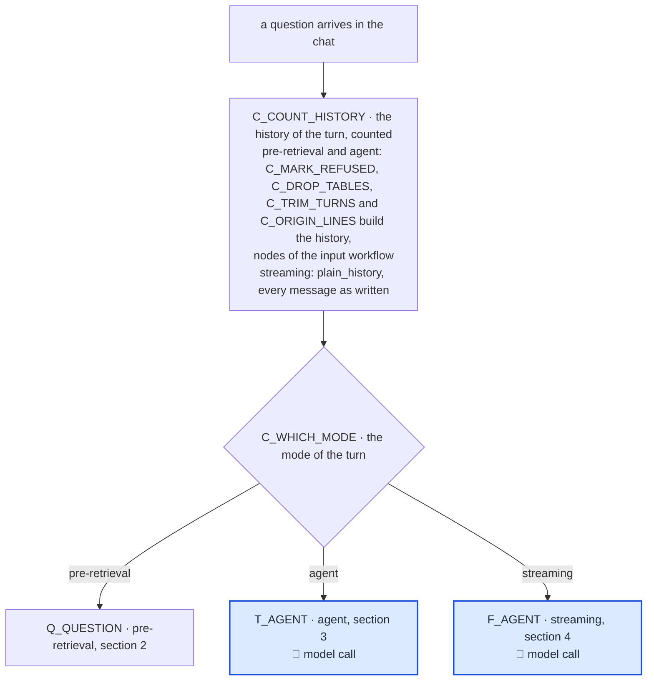
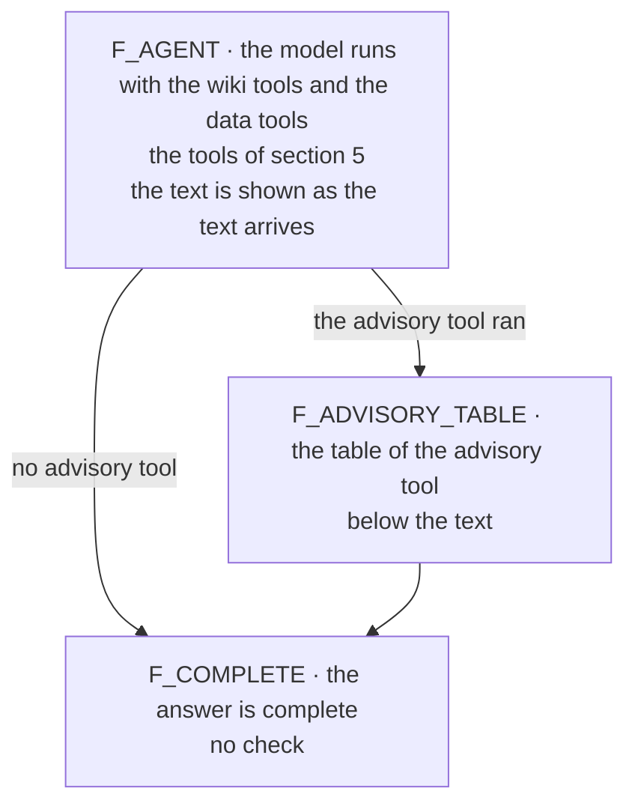

# Query nodes

This document is the reading diagram of the wiki: the steps that answer a
question in the chat. Its sibling, [`ingestion_nodes.md`](ingestion_nodes.md), is
the writing diagram: the steps that turn a source document into wiki pages and
put each fragment of text into the index.

Each step is a node with an identifier, for example `Q_SEARCH_WIKI`. The identifier of a
node appears in three places:

1. In this document, in a node table, and in a diagram of this document or of
   [`workflow_diagrams.md`](workflow_diagrams.md).
2. In the code, as the first argument of the tracing call that marks the node:
   `tracing.node("Q_SEARCH_WIKI", R, ...)` or `tracing.mark("Q_CONDENSED", R, ...)`
   (`base/domain/tracing.py`).
3. In the trace of a chat turn, as the name of the record that the tracing call
   writes. The trace is written only when the environment variable `WIKI_TRACE`
   is set to `1`; the records go to `<workspace>/.llmwiki/traces/spans.jsonl`.

The test `tests/unit/test_flow_nodes.py` compares the node tables of this
document with the tracing calls of the code. A node added, renamed or removed in
the code and not in this document, or in this document and not in the code,
fails the test.

The chat has three modes. The mode decides who retrieves the text that the
answer is built from:

- **pre-retrieval**: the code retrieves the text, before the model is called,
  and the code decides whether the question is answered at all (section 2).
- **agent**: the model retrieves the text, by calling tools, and the code
  replaces an answer that no tool supports (section 3).
- **streaming**: the model retrieves the text, by calling tools, and the answer
  is shown as the model writes the answer. The code changes nothing between the
  user and the agent: no step edits the history, and no check runs on the answer
  (section 4).

The tools that the model calls are described once, in section 5.

The table [`workflow_nodes.md`](workflow_nodes.md) says, for each node of the
catalog of the chat workflows, which of the four workflows runs the node. The
table is generated from the code.

The diagrams of the pre-retrieval and agent workflows are generated from the
code, in [`workflow_diagrams.md`](workflow_diagrams.md). Sections 2 and 3 link
to those diagrams. In the diagram of section 1, a blue node whose label ends in
«🤖 model call» is a node where the code sends a request to the model. Every
other node runs only code.

## The node tables

Every node table of this document has the same columns:

- **ID**: the identifier of the node. The identifier is the same string as the
  first argument of the tracing call that marks the node.
- **What it does**.
- **Code**: the file and the symbol that run the node. A symbol is a function, a
  class or a constant defined in that file. The table never cites a line
  number, because a line number changes when the code above the line changes.
- **Trace**: the attributes of the record that the node writes in the trace,
  without the prefix `llmwiki.`. A node that writes no record says
  `none: <reason>`. A node whose record has no attribute says `no attributes`.
- **Status**: `code` for a node that the code runs; `design` for a node that
  exists only in a design.

## 1. The turn and the mode choice

Every turn, in every mode, starts with the same two nodes. The root record of the
trace of a turn is `turn`, with the attributes `conversation_id`, `turn` (the
position of the question in the conversation), `mode`, `question` and
`language`.

| ID | What it does | Code | Trace | Status |
|---|---|---|---|---|
| C_COUNT_HISTORY | Counts the history of the turn: the prior messages, the refusals that C_MARK_REFUSED replaces by a note, and the messages that the model receives. In the pre-retrieval and agent modes, C_COUNT_HISTORY is the first node of the input workflow and counts the history as `model_history` builds the history; C_MARK_REFUSED, C_DROP_TABLES, C_TRIM_TURNS and C_ORIGIN_LINES build the history, one step per node. In the streaming mode, the model receives every prior message as written (`plain_history`), with no message removed and no line added, and `refused_marked` is 0 | `base/domain/chat/workflow/catalog.py`, `history_counts`; `base/domain/chat/history.py`, `history_counts`, `model_history`; `base/services/chat.py`, `chat_turn_stream_with_context`, `plain_history` | `prior_messages`, `refused_marked`, `history_messages` | code |
| C_WHICH_MODE | Records the mode of the turn. In the pre-retrieval and agent modes, C_WHICH_MODE is the second node of the input workflow; in the streaming mode, `chat_turn_stream_with_context` records C_WHICH_MODE | `base/domain/chat/workflow/catalog.py`, `mode`; `base/services/chat.py`, `chat_turn_with_context`, `chat_turn_stream_with_context` | `mode` | code |
| C_MARK_REFUSED | Replaces every refused answer of the history with the note «[pregunta anterior sin respuesta]» (in English, «[earlier question, not answered]»); the question that got the refusal stays, so a follow-up keeps its topic. Runs in the input workflows of the pre-retrieval and agent modes | `base/domain/chat/guardrail.py`, `mark_refused_exchanges`, `REFUSED_NOTE`; `base/domain/chat/workflow/catalog.py`, `strip_refused` | `refused_marked` | code |
| C_DROP_TABLES | Replaces the advisory table of each answer of the history with a placeholder line; the model can call the advisory tool again. Runs in the input workflows of the pre-retrieval and agent modes | `base/domain/chat/history.py`, `compact_tables`; `base/domain/chat/workflow/catalog.py`, `compact_tables` | `compacted` | code |
| C_TRIM_TURNS | Keeps the last `max_turns` turns of the history, 3 by default. Runs in the input workflows of the pre-retrieval and agent modes | `base/domain/chat/history.py`, `cap_turns`, `DEFAULT_MAX_TURNS`; `base/domain/chat/workflow/catalog.py`, `trim_turns` | `trimmed`, `max_turns` | code |
| C_ORIGIN_LINES | Builds the history that the model receives; an answer that read data ends with its origin line, which names the dataset or the tool that the figures came from. Runs in the input workflows of the pre-retrieval and agent modes | `base/domain/chat/history.py`, `with_origin_lines`, `data_origin`; `base/domain/chat/workflow/catalog.py`, `origin_lines` | `origin_lines`, `history_messages` | code |
| C_FIGURES | The figure check: classifies every figure of the prose as exact, rounded or unsupported, against the numbers of the passages of the turn, the advisory table, the messages of the user and the passages of the earlier answers. The figures of the advisory table, of the note above it, of the citation lines and of the Tier-2 warning are not checked. When the prose has rounded figures, a fixed note is appended. The text of the model is not edited. C_FIGURES runs in the pre-retrieval mode, before Q_SHOWN, and in the agent mode, before T_SHOWN. C_FIGURES does not run in the streaming mode. A refusal does not reach C_FIGURES | `base/domain/chat/figure_check.py`, `check_answer`, `appended_spans`; `base/domain/verify/figures.py`, `check_figures`; `base/domain/chat/workflow/catalog.py`, `figures`; `base/services/chat.py`, `check_turn_figures` | `figures_checked`, `figures_unsupported`, `figures_rounded`, `note_added` | code |
| C_OPEN_PAGE_NOTE | Precedes the question with a note that names the page the user is reading, so that a question that names no topic is read as a question about that page. In the pre-retrieval mode, the note names the page only when Q_PAGE_OPEN found the page; in the agent mode, the note names the open page without checking that the page exists. Runs in the input workflows of the pre-retrieval and agent modes; the streaming mode adds the same note with no node | `base/domain/chat/preretrieval.py`, `with_open_page`; `base/domain/chat/workflow/catalog.py`, `open_page_note` | `answer`, `page` | code |
| C_VERIFY_SENTENCES | The sentence verification, with the checkbox «Verificar las oraciones» on: checks each sentence of the answer against the passages of the turn, marks the unsupported ones, and splits the injected pages into apparently used and apparently not used in the reference line. Runs after Q_SHOWN or T_SHOWN, in the web route, in the pre-retrieval and agent modes; a reload of the thread keeps its marks | `web/routes/chat.py`, `chat_stream`, `_verification_node` | `checked`, `unsupported`, `described`, `used`, `not_used`, `reference`; on a failure, `failed` | code |

## 2. Pre-retrieval

The diagrams of the two workflows of this mode are generated from the graphs,
in [`workflow_diagrams.md`](workflow_diagrams.md): the input workflow in
[Pre-retrieval, input](workflow_diagrams.md#pre-retrieval-input) and the output
workflow in [Pre-retrieval, output](workflow_diagrams.md#pre-retrieval-output).
The identifier of a node is the letter of its family and a name of what the
node does. A decision node is named by its question: `Q_IN_ROSTER` asks whether
the question names a topic of the coverage roster. A node of the rewrite of a
follow-up carries `RW_`: `Q_RW_IN_ROSTER` asks the same of the rewrite. A new
node changes no other identifier. C_COUNT_HISTORY, C_WHICH_MODE, C_MARK_REFUSED, C_DROP_TABLES, C_TRIM_TURNS, C_ORIGIN_LINES, C_OPEN_PAGE_NOTE, C_FIGURES and C_VERIFY_SENTENCES are nodes of section 1. Each refusal node is
named by the cause of the refusal (R_BLACKLIST, R_NOT_IN_ROSTER, R_NOTHING_FOUND, R_UNSUPPORTED, R_NO_EVIDENCE and R_MODEL, `RefusalCause` in
`base/domain/chat/refusal.py`).

The generated diagrams show the steps, the decisions and the branches. The
generated diagrams do not show the values of a turn, the calls to the model, the
index or the suggestions node S. The paragraphs below describe the values, the
calls, the index and S.

The values below come from one real question, «¿Cuánto rinden los plazos
fijos?», asked in the example wiki `examples/finanzas-argentinas`. Every value
of Q_NORMALIZE, Q_STEM and Q_SEARCH_WIKI was computed with the code: `_normalize` for the normalised question, the Spanish Snowball stemmer
for the stems, `_fts_query` and `stem_fts_query` for the query.

- **Q_NORMALIZE**: the normalised question is «¿cuanto rinden los plazos fijos?».
- **Q_IN_BLACKLIST**: the question names no blacklist term. The blacklist is the
  `[fuera_de_alcance]` list of `wiki_config.toml`: `cedear`, `cedears`,
  `cripto` and `bitcoin` in the example wiki. `is_blacklisted` compares whole
  words of the normalised question, not stemmed.
- **Q_STEM**: the stems of the question are «cuant rind los plaz fij».
- **Q_IN_ROSTER**: `mentions_known_data` compares the stemmed question with the stemmed
  dataset categories, concept-page titles, the topics the concept and summary pages declare
  in their front-matter (`topics`) and aliases, and the normalised
  question with the dataset keys, by exact match. The question is in the
  coverage roster: the category `plazo_fijo` stems to «plaz fij».
- **Q_SEARCH_WIKI**: the wiki search removes the stop words and stems the other words. The
  FTS query is `"rind" OR "plaz" OR "fij"`. The search finds pages such as
  «Plazo fijo tradicional» and «Plazo fijo UVA».
- **Q_NAMES_CATEGORY and Q_NAMES_KEY**: the question names the category `plazo_fijo` and no key of
  the category. Q_KEY_NAMES reads the 8 key names of the `entidad` column, from «Banco
  Nación» to «Brubank».

The index is the table `chunks_fts`, an inverted index from each stem to the
rows that contain the stem (see [`ingestion_nodes.md`](ingestion_nodes.md)).
The wiki search Q_SEARCH_WIKI reads the wiki rows of the index. The source search Q_SEARCH_SOURCES reads
the source rows of the same index, and returns at most 4 fragments.

Two kinds of node send a request to the model:

- **Q_REWRITE** rewrites a follow-up into a question that stands alone, for example
  «¿Y qué riesgos tiene?» into «¿Qué riesgos tiene la caución bursátil?».
- **Q_AGENT_PAGES, Q_AGENT_COLLECTION, Q_AGENT_TOOLS or Q_AGENT_FRAGMENTS** are the agent call. Each node injects a different text: the
  wiki pages (Tier 1, with the dataset rows of Q_KEY_ROWS or the key names of Q_KEY_NAMES),
  the overview and the index, the dataset alone, or the source fragments (Tier 2). A data
  question with no wiki page (Q_AGENT_TOOLS) receives the rows of Q_KEY_ROWS or the key
  names of Q_KEY_NAMES when the question names a dataset category, and nothing otherwise;
  the model keeps the data tools of section 5.
- **Q_RETRY_SOURCES** runs after Q_AGENT_PAGES when the answer opens with the fixed
  refusal sentence, the test of Q_MODEL_REFUSED. The datum can be only in a source
  document: «¿En qué se convertían los lacayos de Cenicienta a la medianoche?» gets the
  page of Cenicienta, and the lizards are only in `La Cenicienta.pdf`. The code searches
  the source documents as Q_SEARCH_SOURCES does, and calls the model again with the
  fragments (Q_AGENT_FRAGMENTS); the output workflow checks that Tier-2 answer. With no
  fragment, the output workflow checks the refusal and ends in R_MODEL. The retry is a
  retrieval, not a check: like the calls to the model, it is a step of the model workflow.

Three nodes of the output workflow use a fixed text or a threshold:

- **Q_IS_GROUNDED** stems the content words of the answer and counts the fraction that
  the fragments contain. The answer is grounded when the fraction is at least
  `min_coverage`, 0.2 by default.
- **Q_MODEL_REFUSED** looks for the fixed refusal sentence at the start of the answer:
  «No encontré la respuesta en el texto que recibí de la wiki.» in Spanish.
- **Q_SOURCE_WARNING** appends the Tier-2 warning: «⚠️ Esta respuesta proviene de un
  documento fuente sin página curada del wiki; verificá.» in Spanish.

The suggestions node S runs for every refusal but R_BLACKLIST. R_BLACKLIST names the matched
term and lists no suggestion. S takes the concept pages of the coverage roster
for a question in the roster, and the pages of a wiki search otherwise. S then
removes the repeated pages and orders the rest in three groups: the concept
pages whose title shares a stem with the question, the other concept pages, and
the summary pages. S keeps the first five. A refusal with no suggestion points
to the index of the wiki, and R_NOT_IN_ROSTER always points to the index.

Example questions of two refusals: «¿Qué son los CEDEARs y conviene
comprarlos?» ends in R_BLACKLIST, and «¿Va a llover mañana en Rosario?» ends in R_NOT_IN_ROSTER. R_UNSUPPORTED
names the source document. R_MODEL keeps the text of the model and adds the cause
line and the suggestions.

Two workflows of pydantic-graph run the nodes of this section, one before the
model and one after the model. Each node is a function of the catalog, `CATALOG`
in `base/domain/chat/workflow/catalog.py`. Each function is written once, and
each workflow registers the functions that the workflow uses (`register`). A
node that two workflows use is the same function in both workflows.

- **The input workflow**, `graph` in `base/domain/chat/workflow/input_checks.py`,
  runs C_COUNT_HISTORY, C_WHICH_MODE, C_MARK_REFUSED, C_DROP_TABLES, C_TRIM_TURNS and C_ORIGIN_LINES (section 1), the checks of the question from Q_QUESTION to
  Q_ROSTER_REFUSAL, and C_OPEN_PAGE_NOTE, Q_SYNONYMS and Q_PROMPT, which build the prompt. The input workflow ends in
  a refusal (R_BLACKLIST, R_NOT_IN_ROSTER, R_NOTHING_FOUND) or in the node that calls the agent (Q_AGENT_PAGES, Q_AGENT_COLLECTION, Q_AGENT_TOOLS or Q_AGENT_FRAGMENTS). The
  input workflow reads and writes the `PreRetrievalTurn` of the turn
  (`base/domain/chat/preretrieval.py`).
- **The model workflow**, `graph` in `base/domain/chat/workflow/model_calls.py`, calls
  the agent under the node that the input workflow ended in (`call_agent`,
  `base/domain/chat/preretrieval.py`), and runs the retry Q_RETRY_SOURCES with its second
  call (Q_AGENT_FRAGMENTS). `_pre_retrieval_turn` runs the three workflows in order.
- **The output workflow**, `graph` in
  `base/domain/chat/workflow/output_checks.py`, runs the checks of the answer
  Q_IS_GROUNDED, Q_TOOL_EVIDENCE and Q_MODEL_REFUSED, the additions Q_ADVISORY_TABLE, Q_OFFER_KEYS, Q_CITE_TOOLS and Q_CITE_PAGES and Q_SOURCE_WARNING, the figure check C_FIGURES
  (section 1) and Q_SHOWN. The output workflow ends in the answer or in a refusal
  (R_UNSUPPORTED, R_NO_EVIDENCE, R_MODEL). Its state, `AnswerChecks`
  (`base/domain/chat/workflow/catalog.py`), holds the answer of the agent and the
  `PreRetrievalTurn` of the input workflow.

Each workflow declares the list of the catalog nodes that the workflow runs
(`PRE_RETRIEVAL_NODES`, `AGENT_NODES`). The table
[`workflow_nodes.md`](workflow_nodes.md) is generated from those lists.

| ID | What it does | Code | Trace | Status |
|---|---|---|---|---|
| Q_QUESTION | The question enters the pre-retrieval flow | `base/domain/chat/preretrieval.py`, `pre_retrieval_answer`, `PreRetrievalTurn`; `base/domain/chat/workflow/catalog.py`, `question` | `question` | code |
| Q_NORMALIZE | Lowercases the question and removes the accents of the question; punctuation stays | `base/domain/chat/scope.py`, `_normalize`; `base/domain/chat/workflow/catalog.py`, `normalize` | `normalized` | code |
| Q_IN_BLACKLIST | Checks the normalised question against the blacklist, by whole word. Also runs in the input workflow of the agent mode (section 3) | `base/domain/chat/scope.py`, `is_blacklisted`; `base/domain/chat/preretrieval.py`, `blacklist`; `base/domain/chat/workflow/catalog.py`, `blacklist` | `answer` | code |
| Q_STEM | Stems the question | `base/domain/text/stemming.py`, `stem_text`; `base/domain/chat/workflow/catalog.py`, `stem` | `stemmed` | code |
| Q_NAMES_DATA | Checks whether the question names data: a dataset category, stemmed; a dataset key, exact; an alias of a category or a key (an alias of a page title is not data); or a request for investment advice. Builds the coverage roster first, once per turn | `base/domain/chat/scope.py`, `mentions_known_data`, `advisory_intent`; `base/domain/chat/preretrieval.py`, `ensure_roster`, `detect_data`; `base/domain/chat/workflow/catalog.py`, `data_detection` | `answer` | code |
| Q_IN_ROSTER | Checks the question against the coverage roster: stemmed against the dataset categories, the concept-page titles, the topics the concept and summary pages declare (`topics` in the front-matter, `page_topics`) and the aliases; exact against the dataset keys | `base/domain/chat/scope.py`, `mentions_known_data`; `base/domain/chat/preretrieval.py`, `build_vocabulary`, `ensure_roster`, `match_terms`; `base/domain/chat/workflow/catalog.py`, `roster` | `answer`, `roster_size`, `aliases`, `matched` | code |
| Q_PAGE_OPEN | Checks whether the user is reading a wiki page; the page that the user is reading is injected first, and makes the question covered | `base/domain/chat/preretrieval.py`, `_open_page_block`; `base/domain/chat/workflow/catalog.py`, `open_page` | `answer`, `page` | code |
| Q_REWRITE | Rewrites a follow-up that names no topic into a question that stands alone, from the conversation. Runs only with a condenser and a history, for a question that is not in the coverage roster, names no data and has no open page | `base/domain/chat/condense.py`, `prompt`; `base/services/chat.py`, `_condenser`; `base/domain/chat/workflow/catalog.py`, `rewrite` | `rewrite` | code |
| Q_RW_ACCEPTED | Accepts the rewrite when the rewrite is one line, not empty and not too long; otherwise the search keeps the question. An accepted rewrite that differs from the question is what the gate and the search examine; the model answers the original question | `base/domain/chat/condense.py`, `accepted`; `base/domain/chat/workflow/catalog.py`, `accept_rewrite` | `answer`, `rewritten` | code |
| Q_RW_IN_BLACKLIST | Checks the rewrite against the blacklist, by whole word, as Q_IN_BLACKLIST checks the question | `base/domain/chat/preretrieval.py`, `blacklist`; `base/domain/chat/workflow/catalog.py`, `blacklist_rewrite` | `answer` | code |
| Q_RW_NAMES_DATA | Checks whether the rewrite names data, as Q_NAMES_DATA checks the question | `base/domain/chat/preretrieval.py`, `detect_data`; `base/domain/chat/workflow/catalog.py`, `data_detection_rewrite` | `answer` | code |
| Q_RW_IN_ROSTER | Checks the rewrite against the coverage roster, as Q_IN_ROSTER checks the question | `base/domain/chat/preretrieval.py`, `match_terms`; `base/domain/chat/workflow/catalog.py`, `roster_rewrite` | `answer`, `matched` | code |
| Q_CONDENSED | Records the result of the condensation (Q_REWRITE, Q_RW_ACCEPTED, Q_RW_IN_BLACKLIST, Q_RW_NAMES_DATA and Q_RW_IN_ROSTER): the text that the gate and the search examine, the rewrite or the question, and what the roster check found on that text. A rewrite that names a blacklist term does not reach Q_CONDENSED: Q_RW_IN_BLACKLIST refuses it with R_BLACKLIST. The search uses the rewrite, the model answers the original question | `base/domain/chat/workflow/catalog.py`, `condense` | `rewritten`, `answer`, `blacklist`, `matched` | code |
| Q_SEARCH_WIKI | Searches the wiki pages: removes the stop words, stems the terms, and runs the FTS query. A topic of Q_IN_ROSTER with no page among the hits gets the chunk of its own page in place of the last hit. An alias is searched by the name it stands for (`alias_titles`) | `base/domain/chat/preretrieval.py`, `retrieve_wiki`, `_fts_query`; `base/domain/chat/workflow/catalog.py`, `wiki_search` | `fts_query`, `pages` | code |
| Q_PAGE_FOUND | Asks whether the wiki search returned a page | `base/domain/chat/preretrieval.py`, `plan_retrieval`, `tier1_plan`; `base/domain/chat/workflow/catalog.py`, `wiki_pages` | `answer`, `wiki_fragments` | code |
| Q_NAMES_CATEGORY | Asks whether the question names a dataset category, by stemmed match | `base/domain/chat/preretrieval.py`, `named_categories`, `dataset_injection`; `base/domain/chat/workflow/catalog.py`, `dataset_categories` | `answer`, `categories` | code |
| Q_NAMES_KEY | Asks whether the question names a key of that category, by exact match | `base/domain/chat/preretrieval.py`, `named_categories`, `dataset_injection`; `base/domain/chat/workflow/catalog.py`, `dataset_keys` | `category`, `answer`, `keys` | code |
| Q_KEY_ROWS | Reads the rows of the key and renders the rows as `query_dataset` renders the rows: `valor`, `unidad`, `as_of`, `fuente` | `base/domain/datasets/source.py`, `LocalMarkdownSource`; `base/domain/chat/dataset_tools.py`, `format_rows_as_table`; `base/domain/chat/preretrieval.py`, `rows_block`, `dataset_injection`; `base/domain/chat/workflow/catalog.py`, `dataset_rows` | `category`, `keys`, `rows` | code |
| Q_KEY_NAMES | Reads only the key names of the category, without values | `base/domain/datasets/source.py`, `LocalMarkdownSource`; `base/domain/chat/preretrieval.py`, `key_names_block`, `dataset_injection`; `base/domain/chat/workflow/catalog.py`, `dataset_key_names` | `category`, `key_names` | code |
| Q_SEARCH_SOURCES | Searches the source documents by the question and by the names its aliases stand for, at most four fragments | `base/domain/chat/preretrieval.py`, `retrieve_source_chunks`; `base/domain/chat/workflow/catalog.py`, `source_search` | `fts_query`, `fragments` | code |
| Q_COLLECTION_PAGES | Asks whether the question is about the whole wiki and, for such a question, reads the overview and the index of the wiki from disk; no page is read when the wiki has neither page. The expressions are the `[intent] collection` list of `wiki_config.toml`, or the base list of the wiki's language | `base/domain/chat/scope.py`, `collection_intent`; `base/domain/chat/intent.py`; `base/domain/chat/preretrieval.py`, `retrieve_collection_pages`, `intent_lists`; `base/domain/chat/workflow/catalog.py`, `collection_pages` | `answer`, `pages` | code |
| Q_COLLECTION_OPEN_PAGE | Adds the pages that Q_COLLECTION_PAGES read to the wiki pages, when the user reads a wiki page and the question names no topic of the wiki. Such a question is in the coverage roster only because of the open page, and Q_PAGE_FOUND answers it from the wiki pages before Q_IS_COLLECTION runs: with the overview open, «what is in this wiki?» still gets the index | `base/domain/chat/workflow/catalog.py`, `collection_with_open_page` | `answer`, `pages` | code |
| Q_IS_COLLECTION | Asks whether Q_COLLECTION_PAGES read an overview or an index for a question about the whole wiki; with those pages, the plan injects them. A question that names data (Q_NAMES_DATA) goes on to Q_IS_DATA even with those pages: «¿cuánto ganaría con cada una?» names data and says «cada» | `base/domain/chat/preretrieval.py`, `plan_retrieval`, `tier1_plan`; `base/domain/chat/workflow/catalog.py`, `collection` | `answer`, `collection_pages` | code |
| Q_IS_DATA | Asks whether the question is a data question: the question names a dataset category or key, or a data alias, or asks for investment advice (the `[intent] advisory` list, or the base list of the active domains, with an amount or a horizon) | `base/domain/chat/scope.py`, `advisory_intent`; `base/domain/chat/intent.py`; `base/domain/chat/preretrieval.py`, `plan_retrieval`, `data_plan`; `base/domain/chat/workflow/catalog.py`, `data_question` | `answer` | code |
| Q_FRAGMENT_FOUND | Asks whether the source search returned a fragment, for a question in the coverage roster | `base/domain/chat/preretrieval.py`, `plan_retrieval`, `tier2_plan`; `base/domain/chat/workflow/catalog.py`, `source_fragments` | `answer`, `source_fragments`, `in_roster` | code |
| Q_ROSTER_REFUSAL | Chooses between R_NOT_IN_ROSTER and R_NOTHING_FOUND by the coverage roster | `base/domain/chat/preretrieval.py`, `plan_retrieval`; `base/domain/chat/workflow/catalog.py`, `roster_refusal` | `answer` | code |
| Q_SYNONYMS | Builds the line that names each alias of the question with the name the alias stands for. Without the line, «¿qué es el billete verde?» gets the pages of the dollar and no text that says «billete verde» is the dollar. The line is empty when the question names no alias | `base/domain/chat/preretrieval.py`, `synonyms_line`; `base/domain/chat/workflow/catalog.py`, `synonyms` | `answer`, `line` | code |
| Q_PROMPT | Builds the prompt that the model receives: the synonyms line and the injected text of the plan in the inject template, followed by the question with the note of C_OPEN_PAGE_NOTE; with no injected text, the synonyms line and the question | `base/domain/chat/preretrieval.py`, `build_prompt`; `base/domain/chat/workflow/catalog.py`, `prompt`; the template: `prompts/inject_template.en.md` | `injected`, `prompt_chars` | code |
| Q_AGENT_PAGES | Injects the wiki pages, with the dataset rows of Q_KEY_ROWS or the key names of Q_KEY_NAMES; the model answers from the injected text | `base/domain/chat/preretrieval.py`, `_answer_node`, `call_agent`; the template: `prompts/inject_template.en.md` | `tier`, `context_chars`, `prompt` (a payload file), `raw_output` | code |
| Q_AGENT_COLLECTION | Injects `overview.md` and `index.md`; the model answers from the injected text | `base/domain/chat/preretrieval.py`, `_answer_node`, `call_agent` | `tier`, `context_chars`, `prompt` (a payload file), `raw_output` | code |
| Q_AGENT_TOOLS | Injects the dataset that the question names (Q_KEY_ROWS or Q_KEY_NAMES), or nothing when the question names no dataset category; the model keeps the data tools of section 5 | `base/domain/chat/preretrieval.py`, `_answer_node`, `call_agent` | `tier`, `context_chars`, `prompt` (a payload file), `raw_output` | code |
| Q_RETRY_SOURCES | The answer of Q_AGENT_PAGES opens with the fixed refusal sentence: searches the source documents by the text of Q_SEARCH_SOURCES; with fragments, Q_AGENT_FRAGMENTS calls the model again with them | `base/domain/chat/preretrieval.py`, `search_sources_for_retry`, `is_model_refusal`, `source_query`; `base/domain/chat/workflow/model_calls.py` | `refused_output`, `fts_query`, `fragments` | code |
| Q_AGENT_FRAGMENTS | Injects the source fragments; the model answers from the injected text | `base/domain/chat/preretrieval.py`, `_answer_node`, `call_agent` | `tier`, `context_chars`, `prompt` (a payload file), `raw_output` | code |
| Q_IS_GROUNDED | Checks that the answer is grounded in the fragments, with the stop words of the wiki's language, stemming and the configured threshold. Skipped for a refusal of the model, which goes to Q_MODEL_REFUSED first, and when the sentence verifier checks the answer (the checkbox «Verificar las oraciones» of the web interface, with the verifier installed): the verifier is then the only comparison of the answer against the fragments | `base/domain/chat/overlap.py`, `coverage`; `base/domain/chat/workflow/catalog.py`, `fragment_coverage` | `answer`, `coverage`, `min_coverage` | code |
| Q_EVIDENCE_QUOTE | With the check «evidence quote», the prompt asks the answer to open with `Evidencia: «…»`, the sentence of the context that answers the question. Looks for that sentence in the injected context, ignoring case, spaces, quotes and markdown; a sentence of fewer than 4 words, `ninguna` or no evidence line fail, and the model workflow then runs Q_RETRY_SOURCES | `base/domain/chat/relevance.py`, `evidence_quote`, `quote_found`; `base/domain/chat/workflow/catalog.py`, `evidence_check`; the instruction: `prompts/relevance_evidence.en.md` | `quote`, `found` | code |
| Q_JUDGE_PAGES | With the check «judge», a separate call to the model receives the question and the injected pages and answers yes or no; «no» sends the turn to Q_RETRY_SOURCES, and any other answer counts as yes | `base/domain/chat/relevance.py`, `judge_says_yes`, `judge_user_prompt`; `base/domain/chat/workflow/catalog.py`, `judge_check`; the prompt: `prompts/relevance_judge.en.md` | `verdict`, `passed` | code |
| Q_RELEVANCE_WARNING | The check of Q_EVIDENCE_QUOTE or Q_JUDGE_PAGES failed and Q_RETRY_SOURCES found no fragment: appends to the answer a line that names the check and says that the wiki pages do not answer the question | `base/domain/chat/relevance.py`, `warning`; `base/domain/chat/workflow/catalog.py`, `relevance_warning` | `check` | code |
| Q_SOURCE_WARNING | Appends the fixed Tier-2 warning to the answer | `base/domain/i18n.py`, `get_locale`; `base/domain/chat/workflow/catalog.py`, `tier2_warning` | no attributes | code |
| Q_TOOL_EVIDENCE | Asks whether a data tool returned evidence. Runs only when nothing was injected: injected rows or key names ground the answer without a tool call | `base/domain/chat/guardrail.py`, `has_grounding`; `base/domain/chat/workflow/catalog.py`, `tool_evidence` | `answer` | code |
| Q_MODEL_REFUSED | Asks whether the answer opens with the fixed refusal sentence of the model | `base/domain/chat/refusal.py`, `fixed_sentence`; `base/domain/chat/workflow/catalog.py`, `model_refusal` | `answer` | code |
| Q_ADVISORY_TABLE | Appends the advisory table when the advisory tool returned one | `base/domain/chat/postprocess.py`, `answer_with_table`; `base/domain/chat/workflow/catalog.py`, `table` | `table_added` | code |
| Q_OFFER_KEYS | Offers the keys with data when the model asked for a key without data | `base/domain/chat/preretrieval.py`, `offer_available_keys`; `base/domain/chat/workflow/catalog.py`, `keys` | `keys_offered` | code |
| Q_CITE_TOOLS | `ensure_citation` adds the citation of the tools the model used; for injected dataset rows the code adds the dataset citation | `base/domain/chat/postprocess.py`, `ensure_citation`; `base/domain/chat/workflow/catalog.py`, `citation` | `citation_added` | code |
| Q_CITE_PAGES | When the answer names none of the injected wiki pages, `mark_injected` adds a `Referencia:` line that lists the pages the model received and says that which of them the answer used cannot be determined. When the model wrote its own reference line with injected pages, `mark_injected` labels that line `Referencia según el modelo` and adds below it a line that starts with `Además` and lists every page the model received | `base/domain/chat/postprocess.py`, `mark_injected`, `injected_pages`; `base/domain/chat/workflow/catalog.py`, `injected_reference` | `injected_marked` | code |
| Q_SHOWN | Shows the answer, with the additions of Q_ADVISORY_TABLE, Q_OFFER_KEYS, Q_CITE_TOOLS and Q_CITE_PAGES; `citation_added` says whether Q_CITE_TOOLS or Q_CITE_PAGES added a line. When the sentence verifier runs, the web interface adds the line `Referencia según el verificador de oraciones`, with the injected pages split into apparently used (they support at least one sentence) and apparently not used. That line replaces the line of `mark_injected`; when the answer has only a reference line of the model, the line goes below it, and the model's line is labelled `Referencia según el modelo` | `base/domain/chat/postprocess.py`, `resolve_injected`; `web/routes/chat.py`, `chat_stream`; `base/domain/chat/workflow/catalog.py`, `shown` | `final_answer`, `citation_added`, `keys_offered` | code |
| R_BLACKLIST | Refusal of cause 1: the question (Q_IN_BLACKLIST) or the rewrite (Q_RW_IN_BLACKLIST) names a blacklist term; the refusal names the matched term. Also ends the input workflow of the agent mode (section 3) | `base/domain/chat/refusal.py`, `render`; `base/domain/chat/preretrieval.py`, `refuse`; `base/domain/chat/workflow/catalog.py`, `refuse_blacklist` | `cause`, `final_answer`, `suggestions` | code |
| R_NOT_IN_ROSTER | Refusal of cause 2a: the question names no topic of the wiki | `base/domain/chat/refusal.py`, `render`; `base/domain/chat/preretrieval.py`, `refuse`, `suggestions`; `base/domain/chat/workflow/catalog.py`, `refuse_not_in_roster` | `cause`, `final_answer`, `suggestions` | code |
| R_NOTHING_FOUND | Refusal of cause 2b: the question names a topic of the wiki, and the searches found no text | `base/domain/chat/refusal.py`, `render`; `base/domain/chat/preretrieval.py`, `refuse`, `suggestions`; `base/domain/chat/workflow/catalog.py`, `refuse_nothing_found` | `cause`, `final_answer`, `suggestions` | code |
| R_UNSUPPORTED | Refusal of cause 3: the Tier-2 answer is not grounded in the fragments; the refusal names the source document | `base/domain/chat/refusal.py`, `render`; `base/domain/chat/preretrieval.py`, `refuse`, `suggestions`; `base/domain/chat/workflow/catalog.py`, `refuse_unsupported` | `cause`, `final_answer`, `suggestions` | code |
| R_NO_EVIDENCE | Refusal of cause 4: no tool returned evidence behind the answer | `base/domain/chat/refusal.py`, `render`; `base/domain/chat/preretrieval.py`, `refuse`, `suggestions`; `base/domain/chat/workflow/catalog.py`, `refuse_ungrounded` | `cause`, `final_answer`, `suggestions` | code |
| R_MODEL | Refusal of cause 5: the model refused with the fixed sentence; the refusal keeps the text of the model, which states the cause, and adds the suggestions | `base/domain/chat/refusal.py`, `render`; `base/domain/chat/preretrieval.py`, `refuse`, `suggestions`; `base/domain/chat/workflow/catalog.py`, `refuse_model` | `cause`, `final_answer`, `suggestions` | code |
| S | Builds the suggestions of a refusal from the coverage roster or from the wiki search | `base/domain/chat/refusal.py`, `roster_suggestions`, `search_suggestions` | none: the result of S is the `suggestions` attribute of the R record | code |

## 3. Agent

In the agent mode the model receives the question and the history, and decides
which tools to call (section 5). Before the model runs, the code checks the
question against the blacklist. After the model answers, the code checks that a
tool returned evidence. Without evidence, the model runs once more, told to consult
the wiki (T_RETRY); without evidence again, the answer is shown with a warning. The
code never replaces the answer of this mode by a refusal: the refusal is a last resort.

The agent mode has two workflows too, with the call to the model, T_AGENT, between
them. `chat_turn_with_context` (`base/services/chat.py`) runs both workflows.

- **The input workflow**, `agent_graph` in
  `base/domain/chat/workflow/input_checks.py`, runs C_COUNT_HISTORY, C_WHICH_MODE, C_MARK_REFUSED, C_DROP_TABLES, C_TRIM_TURNS and C_ORIGIN_LINES
  (section 1), then Q_IN_BLACKLIST. A question that names a blacklisted term ends in the
  refusal R_BLACKLIST: the model is not called and the output workflow does not run. Any
  other question goes to C_OPEN_PAGE_NOTE, which builds the question that the model
  receives. The blacklist reads the words of the question only: the agent mode has
  no rewrite of a follow-up. Its state is an `AgentTurn`.
- **The output workflow**, `agent_graph` in
  `base/domain/chat/workflow/output_checks.py`, runs T_TOOL_EVIDENCE, T_NO_EVIDENCE_WARNING, the additions T_ADVISORY_TABLE
  to T_MARK_UNCITED, the figure check C_FIGURES and T_SHOWN. Its state is the `AnswerChecks` of the
  answer, with no `PreRetrievalTurn`.

C_COUNT_HISTORY, C_WHICH_MODE, C_MARK_REFUSED, C_DROP_TABLES, C_TRIM_TURNS, C_ORIGIN_LINES, Q_IN_BLACKLIST, R_BLACKLIST, C_OPEN_PAGE_NOTE and C_FIGURES are the same functions of the catalog as in the
pre-retrieval mode.

The diagrams of the two workflows of this mode are generated from the graphs:
the input workflow in [Agent, input](workflow_diagrams.md#agent-input) and
the output workflow in [Agent, output](workflow_diagrams.md#agent-output).
The generated diagrams do not show T_AGENT and T_RETRY, the calls to the model, which
run between the two workflows. In T_AGENT the model runs with the wiki tools and the data
tools of section 5. When no tool return of T_AGENT carries evidence, T_RETRY runs the
model again with the question and the instruction of `prompts/agent_retry.<lang>.md`, and
the output workflow checks the answer of T_RETRY. Two nodes of the output workflow write
a fixed text:

- **T_NO_EVIDENCE_WARNING** appends to an answer that no tool return backs, after the
  retry: «Ninguna consulta a la wiki respalda esta respuesta: puede venir del conocimiento
  general del modelo.» in Spanish.
- **T_MARK_UNCITED** adds the line «Referencia: ninguna (…)» to an answer that cites
  nothing (`mark_uncited`). A refusal of the model is left as it is.

| ID | What it does | Code | Trace | Status |
|---|---|---|---|---|
| T_AGENT | The model runs with the question, the history and the tools, and writes the answer | `base/services/chat.py`, `chat_turn_with_context`; `base/domain/chat/agent.py`, `create_agent` | `tools_called`, `raw_output` | code |
| T_RETRY | No tool return of T_AGENT carries evidence: the model runs once more with the same history and the question followed by the instruction to consult the wiki. One retry at most | `base/services/chat.py`, `chat_turn_with_context`; `prompts/agent_retry.es.md` | `tools_called`, `raw_output` | code |
| T_TOOL_EVIDENCE | Asks whether a tool return of the run carries evidence: a return that is not empty and is not one of the "nothing found" sentences of the tools | `base/domain/chat/guardrail.py`, `has_grounding`, `_is_substantive`; `base/domain/chat/workflow/catalog.py`, `evidence` | `answer` | code |
| T_NO_EVIDENCE_WARNING | Appends the warning of the wiki's language to an answer that no tool return backs, after the retry. The answer is never replaced | `base/domain/i18n.py`, `no_evidence_warning`; `base/domain/chat/workflow/catalog.py`, `no_evidence_warning` | no attributes | code |
| T_ADVISORY_TABLE | Appends the advisory table when the advisory tool returned one; no change on a refusal | `base/domain/chat/postprocess.py`, `answer_with_table`; `base/domain/chat/workflow/catalog.py`, `agent_table` | `table_added` | code |
| T_CITE_TOOLS | Adds the citation of the tools that the model used. The index and the overview of the wiki are not cited: the model reads them to find the page that answers | `base/domain/chat/postprocess.py`, `ensure_citation`; `base/domain/chat/workflow/catalog.py`, `agent_citation` | `citation_added` | code |
| T_MARK_UNCITED | An answer that still cites nothing (no page read, no data queried, no source named) gets the line `Referencia: ninguna (…)`. A refusal of the model is left as it is | `base/domain/chat/postprocess.py`, `mark_uncited`; `base/domain/chat/refusal.py`, `is_refusal`; `base/domain/chat/workflow/catalog.py`, `uncited_mark` | `uncited_marked` | code |
| T_SHOWN | Shows the answer | `base/services/chat.py`, `chat_turn_with_context`; `base/domain/chat/workflow/catalog.py`, `agent_answer` | `final_answer`, `refusal_substituted` | code |

## 4. Streaming

In the streaming mode the model receives the question and the history, decides
which tools to call (section 5), and the answer is shown as the model writes the
answer. The code changes nothing between the user and the agent:

- **The history**: the model receives every prior message as written
  (`plain_history`, `base/services/chat.py`). Refused exchanges stay, the history
  is not trimmed, and no origin line is added. A long conversation can exceed the
  token limit of the model.
- **The question**: the model receives the question as written. When the user
  reads a wiki page, the question is preceded by the note that names the page
  (`with_open_page`), as in the agent mode.
- **The answer**: the user sees the text of the model. No check runs on the
  answer: the figure check C_FIGURES does not run, and no line is appended. The one
  addition is the table of the advisory tool, when the tool ran (F_ADVISORY_TABLE):
  the prompt of the tool tells the model not to copy the table, because the code adds
  it. The table goes below the text, as the tool returned it; the text is not changed.

| ID | What it does | Code | Trace | Status |
|---|---|---|---|---|
| F_AGENT | The model runs with the question, the history and the tools; each chunk of text is shown as the chunk arrives | `base/services/chat.py`, `chat_turn_stream_with_context`; `base/domain/chat/agent.py`, `create_agent` | `tools_called` | code |
| F_ADVISORY_TABLE | Appends the table that the advisory tool returned, below the text, as the tool returned it; the text of the model is not changed. Only when the tool ran | `base/services/chat.py`, `chat_turn_stream_with_context`; `base/domain/chat/postprocess.py`, `advisory_table` | `table_added` | code |
| F_COMPLETE | The answer is complete. The answer is shown as the model wrote the answer, with no check; the only appended text is the table of F_ADVISORY_TABLE | `base/services/chat.py`, `chat_turn_stream_with_context` | `final_answer` | code |

## 5. Tools

The tools that the model calls. The agent mode (T_AGENT) and the streaming mode (F_AGENT)
register the wiki tools (K_READ_PAGE, K_SEARCH_WIKI and K_SEARCH_SOURCES) and the data tools; the pre-retrieval mode
(Q_AGENT_TOOLS) registers only the data tools, because in the pre-retrieval mode the code
searches the wiki.

The data tools depend on the wiki:

- A wiki with the finance overlay (`base/domain/extensions/finance_argentina/agent_tool.py`,
  `activate`) registers K_ALTERNATIVES and the finance data tools K_PLAZO_FIJO, K_CAUCION, K_DOLLAR, K_SHARE_PRICE and K_MONEY_MARKET, one per dataset
  category that passes the finance validator. A wiki with the finance overlay
  does not register K_READ_DATASET.
- Any other wiki with a `datasets/` directory registers K_READ_DATASET.

The arguments of a finance data tool accept only the values of the dataset of
the tool: the keys of the category and, for `plazo_dias`, the terms of the
dataset. The allowed values are read from the dataset files when the wiki
opens. A call with a value outside the allowed values raises `ModelRetry`, and
the model receives the allowed values and corrects the call. Each tool call writes one record, with the arguments of the
call and whether the return of the call is substantive (`_is_substantive`,
`base/domain/chat/guardrail.py`): not empty, and not one of the "nothing found"
sentences of the tools.

| ID | What it does | Code | Trace | Status |
|---|---|---|---|---|
| K_READ_PAGE | Reads one wiki page by its path | `base/domain/chat/wiki_tools.py`, `read_wiki_page` | `path`, `substantive` | code |
| K_SEARCH_WIKI | Searches the wiki pages with an FTS query: every word first; when no page has every word, any word (`any_word_query`) | `base/domain/chat/wiki_tools.py`, `search_wiki_fts`; `base/domain/tools/search.py`, `any_word_query` | `query`, `limit`, `widened`, `substantive` | code |
| K_SEARCH_SOURCES | Searches the fragments of the source documents with an FTS query: every word first; when no fragment has every word, any word (`any_word_query`). Each result carries the whole fragment | `base/domain/chat/tools.py`, `search_source_chunks`; `base/domain/tools/search.py`, `any_word_query` | `query`, `limit`, `widened`, `substantive` | code |
| K_READ_DATASET | Reads the rows of a dataset category, optionally of one key and one metric; not registered in a wiki with the finance overlay | `base/domain/chat/dataset_tools.py`, `query_dataset` | `categoria`, `clave`, `metrica`, `substantive` | code |
| K_ALTERNATIVES | Estimates and compares the investment alternatives for an amount and a horizon (finance overlay) | `base/domain/extensions/finance_argentina/agent_tool.py`, `estimar_alternativas` | `monto`, `horizonte_meses`, `moneda`, `substantive` | code |
| K_PLAZO_FIJO | Reads the TNA of a plazo fijo, by entity and by term in days | `base/domain/extensions/finance_argentina/data_tools.py`, `tasa_plazo_fijo` | `entidad`, `plazo_dias`, `substantive`, `rejected` | code |
| K_CAUCION | Reads the TNA of a caución, by market and by term in days | `base/domain/extensions/finance_argentina/data_tools.py`, `tasa_caucion` | `mercado`, `plazo_dias`, `substantive`, `rejected` | code |
| K_DOLLAR | Reads the buy and sell quotes of a type of dollar | `base/domain/extensions/finance_argentina/data_tools.py`, `cotizacion_dolar` | `tipo`, `substantive`, `rejected` | code |
| K_SHARE_PRICE | Reads the price of a share, by ticker | `base/domain/extensions/finance_argentina/data_tools.py`, `precio_accion` | `ticker`, `substantive`, `rejected` | code |
| K_MONEY_MARKET | Reads the return of a money market fund, by fund | `base/domain/extensions/finance_argentina/data_tools.py`, `rendimiento_fci` | `fondo`, `substantive`, `rejected` | code |
