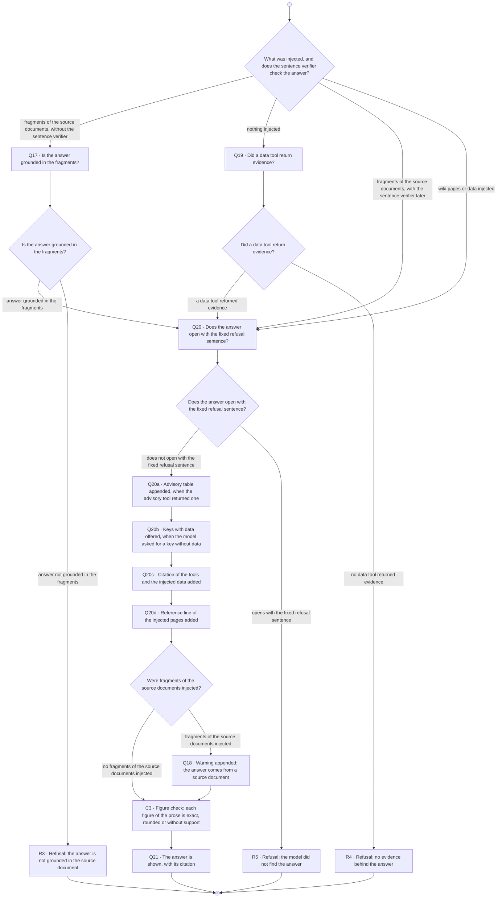
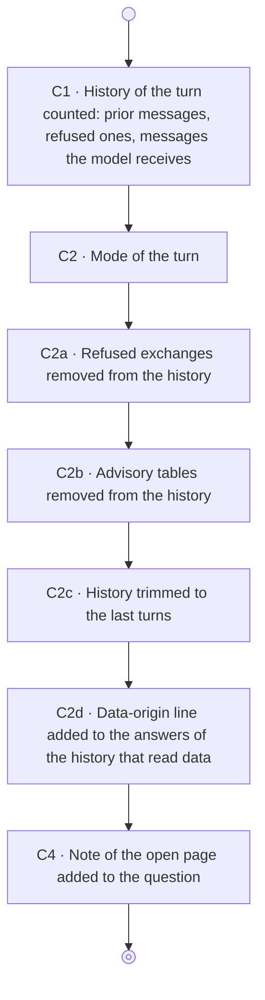
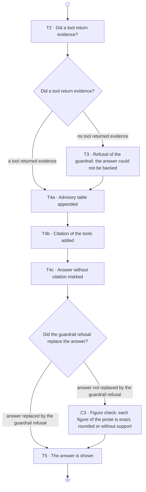

# Workflow diagrams

This file is generated by `scripts/workflow_diagrams.py` from the graphs of the
chat workflows (`base/domain/chat/workflow/diagrams.py`). Do not edit it by
hand: the test `tests/unit/test_workflow_diagrams_doc.py` fails when the file
differs from the graphs. Regenerate it with:

    uv run python scripts/workflow_diagrams.py

Each diagram is the one that the audit page of a conversation draws, in English
and without the marks of a turn. A box is a step, with its identifier and its
short text. A diamond is a decision, with its question. An arrow that leaves a
decision carries the label of its branch. The small filled circle is the start
of the workflow, and the framed circle is its end.

What each node does is in [`query_nodes.md`](query_nodes.md). The calls to the
model run between the two workflows of a mode, outside both. The streaming mode
has no workflows.

## Pre-retrieval, input

The input workflow of the pre-retrieval mode builds the history, checks the
question, retrieves the text that the prompt injects and ends in a refusal or
in a call to the model.

```mermaid
flowchart TD
  wf_start@{ shape: sm-circ }
  wf_end@{ shape: fr-circ }
  C1["C1 · History of the turn counted: prior messages, refused ones, messages the model receives"]
  C2["C2 · Mode of the turn"]
  C2a["C2a · Refused exchanges removed from the history"]
  C2b["C2b · Advisory tables removed from the history"]
  C2c["C2c · History trimmed to the last turns"]
  C2d["C2d · Data-origin line added to the answers of the history that read data"]
  Q1["Q1 · The question enters pre-retrieval"]
  Q2["Q2 · The question normalised (lowercase, no accents)"]
  Q3["Q3 · Does the question name a blacklisted term?"]
  after_Q3{"Does the question name a blacklisted term?"}
  Q4["Q4 · The question reduced to stems"]
  R1["R1 · Refusal: blacklisted term"]
  Q4a["Q4a · Does the question name data: a dataset term, an alias or an advice request?"]
  Q5["Q5 · Does the question name a topic of the wiki (coverage roster)?"]
  Q5a["Q5a · Is the user reading a wiki page?"]
  after_Q5a{"Is the question a follow-up to rewrite, does it name a wiki topic, or is a page open?"}
  Q5c["Q5c · The model rewrites the follow-up"]
  Q6["Q6 · Search in the wiki pages"]
  Q8a["Q8a · Overview and index read, for a question about the whole wiki"]
  Q5d["Q5d · Is the rewrite accepted: one line, not empty, not too long?"]
  Q8b["Q8b · Overview and index added to the open page"]
  after_Q6{"Did the wiki search find a page?"}
  Q8["Q8 · Search in the source documents"]
  after_Q5d{"Was the rewrite accepted?"}
  after_Q8b{"Does the question name a wiki topic, or is a page open?"}
  Q5b["Q5b · Result of the condensation: the text that the search examines, and what the checks found on it"]
  Q5e["Q5e · Does the rewrite name a blacklisted term?"]
  Q7["Q7 · Did the search find a page?"]
  Q9["Q9 · Is the question about the whole wiki?"]
  after_Q5b{"Does the examined text name a wiki topic?"}
  after_Q5e{"Does the rewrite name a blacklisted term?"}
  after_Q7{"Did the wiki search find a page?"}
  after_Q9{"Was the overview or the index read?"}
  C4["C4 · Note of the open page added to the question"]
  Q10["Q10 · Is it a data question?"]
  Q5f["Q5f · Does the rewrite name data?"]
  Q7a["Q7a · Does the question name a dataset category?"]
  Q12a["Q12a · Line of synonyms added for the aliases of the question"]
  Q5g["Q5g · Does the rewrite name a topic of the wiki (coverage roster)?"]
  after_Q10{"Does the question name data?"}
  after_Q7a{"Does the question name a dataset category?"}
  Q11["Q11 · Did the source search find a fragment?"]
  Q12b["Q12b · Prompt built from the injected text and the question"]
  Q7b["Q7b · Does the question name a key of that category?"]
  after_Q11{"Did the source search find a fragment, and does the question name a wiki topic?"}
  after_Q7b{"Does the question name a key of that category?"}
  agent{"What text was injected into the prompt?"}
  Q12["Q12 · Refusal chosen by the coverage roster"]
  Q13["Q13 · Wiki pages given to the model, which writes the answer"]
  Q14["Q14 · Overview and index given to the model"]
  Q15["Q15 · No page given: the model calls the data tools"]
  Q16["Q16 · Source fragments given to the model"]
  Q7c["Q7c · Rows of the key read from the dataset"]
  Q7d["Q7d · Key names of the category read from the dataset"]
  after_Q12{"Does the question name a wiki topic, or is a page open?"}
  after_Q7cd{"Is a named category left?"}
  R2a["R2a · Refusal: no information received from the wiki"]
  R2b["R2b · Refusal: a topic of the wiki, no text found"]

  wf_start --> C1
  C1 --> C2
  C2 --> C2a
  C2a --> C2b
  C2b --> C2c
  C2c --> C2d
  C2d --> Q1
  Q1 --> Q2
  Q2 --> Q3
  Q3 --> after_Q3
  after_Q3 -->|"names no blacklisted term"| Q4
  after_Q3 -->|"names a blacklisted term"| R1
  Q4 --> Q4a
  R1 --> wf_end
  Q4a --> Q5
  Q5 --> Q5a
  Q5a --> after_Q5a
  after_Q5a -->|"follow-up with no wiki topic, no data and no open page"| Q5c
  after_Q5a -->|"names a wiki topic or a page is open"| Q6
  after_Q5a -->|"names no wiki topic and no page is open"| Q8a
  Q5c --> Q5d
  Q6 --> after_Q6
  Q8a --> Q8b
  after_Q6 -->|"found a wiki page"| Q8a
  Q5d --> after_Q5d
  Q8b --> after_Q8b
  after_Q6 -->|"found no wiki page"| Q8
  Q8 --> Q8a
  after_Q5d -->|"rewrite not accepted"| Q5b
  after_Q5d -->|"rewrite accepted"| Q5e
  after_Q8b -->|"names a wiki topic or a page is open"| Q7
  after_Q8b -->|"names no wiki topic and no page is open"| Q9
  Q5b --> after_Q5b
  Q5e --> after_Q5e
  Q7 --> after_Q7
  Q9 --> after_Q9
  after_Q5e -->|"rewrite names a blacklisted term"| R1
  after_Q5b -->|"the examined text names a wiki topic"| Q6
  after_Q5b -->|"the examined text names no wiki topic"| Q8a
  after_Q7 -->|"found no wiki page"| Q9
  after_Q5e -->|"rewrite names no blacklisted term"| Q5f
  after_Q7 -->|"found a wiki page"| Q7a
  after_Q9 -->|"overview or index read"| C4
  after_Q9 -->|"no overview or index read"| Q10
  C4 --> Q12a
  Q10 --> after_Q10
  Q5f --> Q5g
  Q7a --> after_Q7a
  Q5g --> Q5b
  after_Q10 -->|"names data"| C4
  after_Q7a -->|"names no dataset category"| C4
  Q12a --> Q12b
  after_Q10 -->|"names no data"| Q11
  after_Q7a -->|"names a dataset category"| Q7b
  Q11 --> after_Q11
  Q12b --> agent
  Q7b --> after_Q7b
  after_Q11 -->|"found a source fragment and names a wiki topic"| C4
  after_Q11 -->|"found no source fragment or names no wiki topic"| Q12
  after_Q7b -->|"names a key of the category"| Q7c
  after_Q7b -->|"names no key of the category"| Q7d
  agent -->|"wiki pages injected"| Q13
  agent -->|"overview and index injected"| Q14
  agent -->|"nothing injected"| Q15
  agent -->|"fragments of the source documents injected"| Q16
  Q13 --> wf_end
  Q14 --> wf_end
  Q15 --> wf_end
  Q16 --> wf_end
  Q12 --> after_Q12
  Q7c --> after_Q7cd
  Q7d --> after_Q7cd
  after_Q7cd -->|"no named category is left"| C4
  after_Q7cd -->|"a named category is left"| Q7b
  after_Q12 -->|"names no wiki topic and no page is open"| R2a
  after_Q12 -->|"names a wiki topic or a page is open"| R2b
  R2a --> wf_end
  R2b --> wf_end
```

## Pre-retrieval, output

The output workflow of the pre-retrieval mode checks the answer of the model,
adds the table, the citations and the warning, and ends in the answer or in a
refusal.

## Strict, input

The input workflow of the strict mode builds the history and the question that
the model receives, and checks nothing in the question.

## Strict, output

The output workflow of the strict mode checks that a tool returned evidence,
adds the table and the citation, and shows the answer.

